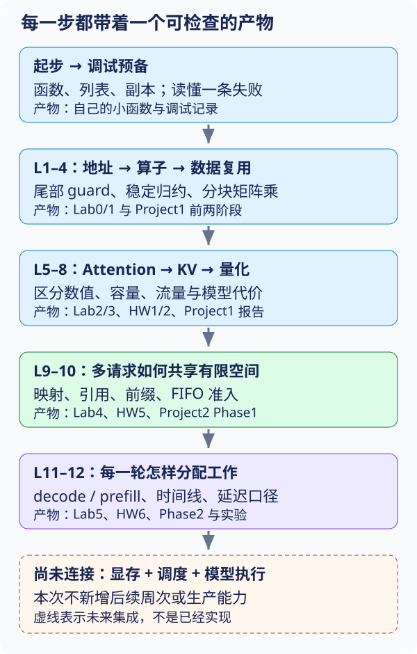

# 自学路线：把读懂、算对、写出来分开检查

这一版不新增第 7 周及以后内容，而是重整已经发布的起步、预备和第 1–6 周。讲义是主教材，Lab 是实现练习，HW 是推导与迁移，Project 是组合；外部视频和论文是扩展，不是理解正文的必需替代品。

如果你以前已经做过，不必重置网站进度或重写正确代码。先用每章的新例子检验理解；解释不清的地方再读对应小节。题号、已有接口和评分分母保持兼容。网站勾选记录的是个人进度，不是考试成绩。

## 1. 先找到真正的课程根目录

本课每条 `python course/...` 命令，都从**能够直接看到 course 文件夹的目录**运行。

| 你拿到的材料 | 从哪里开始 |
| :--- | :--- |
| 网站“下载课程代码”得到的 ZIP | 解压后进入同时含 index.html、START_HERE.md、course 的那层 |
| moliflower.github.io 源码仓库 | 从仓库根执行 `cd _courses/deepinfer`，然后再执行教材命令 |
| 只打开手机网页 | 可以读、手算和看图；Python 测试仍需在电脑本地运行 |

先运行一条没有待填空内容的命令：

```bash
python course/foundations/demo.py
python course/tools/grade.py foundations --question q0
```

系统只有 python3 时统一替换 python。Windows 可以使用 `./course/run.ps1` 启动器。课程核心只用 Python 标准库，不要求先装 PyTorch、CUDA 或模型权重。文件找不到时先检查当前目录，不要先安装一堆依赖。

## 2. 整体地图：前一层给后一层什么



从图上向下看：我们先知道一个位置怎样找到数据，再知道一个算子怎样复用数据，接着知道 attention 为什么要留下 KV，最后才讨论多请求如何分配空间与时间。直接从调度器开始抄代码，会同时遇到索引、所有权、状态机和指标四种问题。

## 3. 不按日历赶路，按入口检查前进

### 入口 A：第一次写函数

从 [Python 起步](foundations/README.md) 开始。先能解释 return 和 print 的区别，再跟踪 if/for，最后用列表和累计状态解决一个小问题。你不需要先懂矩阵、GPU 或大模型。

入口检查：`values=[2,5]`，另写一个新列表把每项加一；改变新列表的第一个元素时，原列表应不变。若不能解释为什么，先不要进入 KV cache 的所有权问题。

### 入口 B：会写，但不知道失败在哪里

进入 [调试预备](prep/README.md)。按“读失败 → 手算期望 → 缩小输入 → 定位假设 → 修改 → 回归”做，不把碰巧通过一个输入当成修复。预备的矩阵和副本会反复用于后面课程。

### 入口 C：准备学习 GPU 执行与算子

读 [L1](lectures/lec01.md) 和 [L2](lectures/lec02.md)，做 Lab0。先只用 Python 跟踪编号、地址和尾部 guard；硬件扩展是第二遍选读，不是第一次开始课程的门槛。

继续 [L3](lectures/lec03.md) → Lab1，再读 [L4](lectures/lec04.md) → Project1 的分块阶段。不要跳过“一格输出由哪些乘积累加”而直接背三重 tile 循环。Project1 的学习顺序不是题号顺序，按项目说明先做依赖项。

### 入口 D：从算子到 Attention 和 KV

[L5](lectures/lec05.md) → Lab2 的数值部分，再读 [L6](lectures/lec06.md) → Lab2 代价部分。先会算一个非均匀 attention 输出，再讨论不保存整张中间矩阵的方法。

[L7](lectures/lec07.md) → Lab3，随后 [L8](lectures/lec08.md)。推荐在 L7、L8 都完成后统一做 HW1/2；HW2 的 KV 先修在 L7 才齐，HW1 的完整量化先修到 L8 才齐。不因编号是 HW1 就误以为第一讲后必须全部完成。

### 入口 E：共享资源与调度

进入第 5–6 周前，先回答：列表副本与别名是什么？非整除长度如何分页？为什么 `t//B` 不是物理块 ID？失败前修改了状态会有什么后果？这些问题若不稳，回到预备副本、L7 与 Lab3，而不是在一个大模拟器里一起调试。

## 4. 第 5–6 周的逐站路线

| 站点 | 先读与手算 | 再做 | 通过这一站的证据 |
| :--- | :--- | :--- | :--- |
| 1 | L9：逻辑页、物理块与共享所有权 | Lab4 Q1–Q4 | 解释一个非连续页表、一条共享生命周期、一条失败不变式 |
| 2 | L10：公共前缀、完整块、逐请求取整 | HW5 Q1–Q3 | 手算命中与容量，指出仍有引用的块为何不可淘汰 |
| 3 | Phase1：有限预留容量下的事件 | Project2 Q1/Q2 | 同一输入得到逐事件快照，解释严格 FIFO 的队首阻塞 |
| 4 | L11：迭代边界、到达和请求生命周期 | Lab5 Q1 | 在图上标记准入、首输出、结束，区分并发数和本轮预算 |
| 5 | L12：拆 prompt、量时间、选统计分母 | Lab5 Q2、HW6 Q1–Q3 | 手算预算和 TTFT/TPOT/goodput，不混用秒与 tick |
| 6 | Phase2：把策略接到执行循环 | project2_scheduler Q1/Q2 | 复现小轨迹、换输入、核对 18 组实验并说明模型边界 |

每站可以分几次学习；表里的一站不是必须一天完成的任务。建议一次只读到一个可手算的检查点，然后合上答案做题。章节顶部的文字浏览时长不是学会整章的承诺。

## 5. 每一小节都做四件事

1. **预测**：先写输入、单位、预期输出，不执行代码。把“不确定”具体写成一条问题。
2. **追踪**：画一行表：这一步读什么、改什么、哪些量必须不变。图不是装饰，要指着箭头解释发生了什么。
3. **实现**：只写当前最小步骤，运行对应测试；不要一口气填完整个项目后再找错。
4. **迁移**：换一个正常输入、一个边界输入、一个会击穿错误想法的反例；能解释才继续。

例如分页时，不只会回答 length=10、B=4 需要 3 页，还要能回答 length=0、length=12，以及为什么两条 length=1 的独立请求不能合并后只算一页。正常例子教规则，边界和反例检验你有没有理解规则的适用条件。

## 6. 出错时怎样缩小问题

| 现象 | 先检查什么 | 不要先做什么 |
| :--- | :--- | :--- |
| NotImplementedError | 是否仍是题目给出的待实现函数 | 不要误认为 Python 没装好 |
| 数值不对 | 手算小输入、累计量初值、mask/归一化顺序 | 不要通过放宽误差掩盖明显逻辑错误 |
| 只有第二次调用失败 | 输入是否被修改、内部状态是否残留、列表是否共享 | 不要只对第二次调用特判 |
| 空输入或非法尾部失败 | 参数与全输入验证是否早于状态修改 | 不要看到预算耗尽就跳过验证 |
| 时间多一轮或少一轮 | 首输出来自哪轮、补位在哪个边界 | 不要为了匹配一条轨迹随意加减 1 |
| 吞吐量异常漂亮 | 分母是否含空闲、是否把模拟 tick 当秒 | 不要把模型假设当成设备测量 |

优先用 `--question q1 --failfast`；需要提示时用 `--hint 1`，再逐层展开。参考答案用于事后对照，不是测试结果本身。先写下自己的理由再看参考，可以避免“看得懂答案”冒充“能独立写出”。

## 7. 接口标签不等于物理定律

课程保留已有题目的接口契约，不为了排版统一而破坏你的实现：

| 容易混淆的约定 | 正确读法 |
| :--- | :--- |
| Lab0/HW1/Project1 的 Roofline 平局标签是 memory；HW2 Q4 是 compute | 物理上两条限制同时达到；字符串只是题目规定的返回值 |
| HW2 的共享节省与 HW5 的总共享容量 | 先明确是否已有一份额外保留的前缀，再数副本，不混用分母 |
| Lab3 free 与 Lab4 release | 前者单请求拥有全部数据；后者共享块要等最后一个引用释放 |
| Phase1 的 token 长度与 Phase2 的 prompt/output | Phase1 预留已知总长度的页数；Phase2 模拟每轮处理，但没有接入页池 |
| 网页“完成”和测试 PASS | 前者是自记进度，后者验证公开行为；两者都不能替代口头解释与迁移 |

## 8. 两个项目阶段如何连接，而不是假装已经连接

Phase1 回答“这个请求现在是否有预留容量”；Phase2 回答“已准入请求这一轮做多少工作”。真正连接时，引擎需要在接受计划前确认新增 KV 所需空间，成功后才能提交状态，失败则要等待、重算或按明确策略抢占；不能先宣布产出 token 再发现空间不足。

本课当前没有实现这段集成，也没有真实模型执行。读完两阶段后，你应能指出哪些状态分别由请求管理器、页池、调度策略和执行器拥有，而不是把它们揉成一个难以验证的大循环。

## 9. 一章学完如何自检

拿一张空纸，完成下面四项：

- 不看正文解释本章为什么需要这个机制，举一个旧方法的失败或浪费案例。
- 用新的小输入走完整个过程，并给每个数写单位。
- 指出实现中的一个关键不变式，给出能破坏它的错误写法及反例。
- 区分本章已经验证的行为、教学假设和未来未实现的能力。

如果只能复述术语，回到手算；能手算但写不出，回到最小实现；能写出但解释不了边界，回到反例。不要把任何一项“不熟”当成不适合学习系统的结论，它只是下一步要练的具体能力。

所有章节与题目对应见 [教材总索引](TEXTBOOK.md)，评分见 [掌握度与验收](ASSESSMENT.md)。第 7–15 周继续保持未发布状态；这次先把前面的知识真正连起来。
