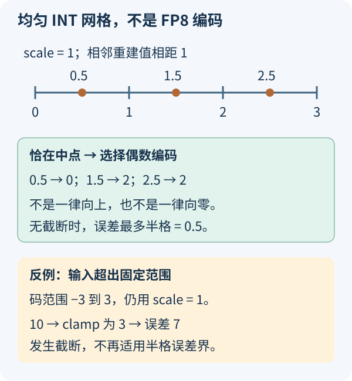

# Homework1：从推导到代价函数

> **先修**：Lab0/1/2、[L4 Roofline](../../lectures/lec04.md)、[L5 Attention](../../lectures/lec05.md)、[L7 KV cache](../../lectures/lec07.md)、[L8 量化](../../lectures/lec08.md)。安排在第 4 周以后。  
> **投入**：5–7 小时，可拆为两次。必做 Q1–Q9 与三道书面题。  
> **交付**：`hw01.py`、基于 [REPORT_TEMPLATE.md](REPORT_TEMPLATE.md) 的个人推导笔记。

## 0. 学习顺序与工作方式

先完成 L7、Lab3、L8，再统一做 HW1/2。先修不是装饰：Q3/Q9 用 KV 容量，Q6–Q8 用量化网格，未学完时不要靠猜补公式。所有命令从**课程根目录 `deepinfer/`** 执行，即包含 `course/` 的目录；个人主页源码对应 `_courses/deepinfer/`。

每题按“定义输入输出 → 写最小手算 → 找边界/反例 → 实现 → 核对单位 → 解释局限”循环。遇到失败先缩小输入，不要同时修改一整份作业。

Homework 的代码框架给定接口和契约，要求独立组织步骤。`test_hw01.py` 是公开测试；`hw01_solution.py` 在尝试和记录卡点后对照。标准库即可，不修改测试。

```bash
python3 course/tools/grade.py hw01 --list
python3 course/tools/grade.py hw01 --question q1 --unlock
python3 course/tools/grade.py hw01 --question q1 --failfast
python3 course/tools/grade.py hw01 --question q1 --hint 1
```

每题替换 q1 即可；三级提示按需获取。使用 [记录模板](../../WORKSHEET.md)，每个答案至少含“符号定义 → 推导 → 代入 → 单位 → 模型条件”。

Windows PowerShell 可以将上述 `python3` 换为 `py -3`。整份测试会逐题显示通过数；`未完成` 表示测试未全部执行或有跳过，不能当作通过。程序超过 30 秒会提示检查循环；需要时用 `--timeout 60`。公开测试覆盖接口，不替代书面解释。

开始前，不看答案完成三个自检：能把 1GB 和 1GiB 分别写成字节；能解释函数的 `return` 与 `print`；能在 traceback 中定位自己的代码行。若后两项不熟悉，回到 foundations/prep。

| 题号 | 修改函数 | 编码依赖 | 独立测试 |
| :--- | :--- | :--- | :--- |
| Q1 | arithmetic_intensity | 无 | `--question q1` |
| Q2 | roofline_time | 无 | `--question q2` |
| Q3 | kv_cache_bytes | 无 | `--question q3` |
| Q4 | mla_kv_cache_bytes | 无 | `--question q4` |
| Q5 | attention_flops | 无 | `--question q5` |
| Q6 | quantize_per_tensor | 无 | `--question q6` |
| Q7 | dequantize_per_tensor | 无；测试直接给整数码 | `--question q7` |
| Q8 | quant_error | Q6、Q7 | `--question q8` |
| Q9 | max_kv_tokens | Q3 | `--question q9` |

表中参数接在 `python3 course/tools/grade.py hw01` 后。Q1–Q7 是建立工具；Q8 将工具组合，Q9 将正向容量模型反过来解决预算。先独立尝试，再记录所用提示和参考材料。

## 1. Required：接口与分题规格

数量参数为非负整数，字节/FLOPs 为非负数；负值抛 `ValueError`。带宽/算力必须正；Q1 字节数也必须正。数值输入保证有限，除 Q6 的 bits 外不要求做类型检查。Q9 的每 token 模型尺寸必须严格为正，防止分母为零；其他计数函数接受零值。所有函数保持输入不变。

### Q1：arithmetic_intensity——先看分母来自哪里

推导台阶：把乘加工作量计为 F FLOPs，把实际模型假定搬运量计为 M bytes，先检查 M>0，再计算 F/M。单位是 FLOP/B，不是 FLOP/s。某一实现重读数据会增大 M，因此同一数学表达式不保证相同 AI。

返回 FLOPs/Bytes 的 float；bytes_moved<=0 或 flops<0 抛 `ValueError`。自测 `arithmetic_intensity(120,40)==3`。解释为什么两个同 shape 的 GEMM 可以有不同 AI：分母取决于数据复用方案。

### Q2：roofline_time——两条不能绕过的下界

先在纸上各写一行：`memory_s=M/(BW*1e9)`，`compute_s=F/(P*1e12)`。两项单位都为秒，最终取较慢者，不相加；这是允许理想重叠的下界模型，不表示真实执行必达到它。

**平局对照**：M=1e9、F=1e11、BW=100、P=10 时两项都是 0.01 s，本题返回 memory；HW2 的 AI 恰在拐点时返回 compute。两个标签只是不同接口的平局约定，物理上两条限制同时达到，不要为了“统一”而改掉测试契约。

返回 `(秒数,"memory"或"compute")`。GB/s 用 1e9，TFLOP/s 用 1e12，取搬运与计算时间的最大值；相等返回 memory。非正硬件值抛 `ValueError`。

例子：1GB、1TFLOP、100GB/s、10TFLOP/s，两个时间是 0.01s 和 0.1s，返回 `(0.1,"compute")`。本题是理想下界，不把 CPU 实测秒数代入 GPU 峰值利用率。

### Q3：kv_cache_bytes——从一个 token、一层往外数

先写 K 有多少元素，再写 V 同样多，然后乘 dtype 字节；再乘层数、序列长度、batch。若结果差一个 2，分开检查 K/V 的 2 与 bf16 字节的 2；若 GQA 结果过大，检查用了 Hkv 还是 query heads。

参数顺序见 starter；返回标准 MHA/GQA 的 KV 有效载荷字节数：`2*L*Hkv*D*S*B*w`。前面的 2 来自 K/V。用 KV heads 而非 query heads。

L=32,Hkv=8,D=128,S=1024,B=2,w=2 时为 268435456B=256MiB。先从“一个 token、一个层”推导，禁止只在笔记抄最终公式。容量不含页尾、scale、对齐或权重。

### Q4：mla_kv_cache_bytes——改变表示，不是删掉一个系数

先画“共享 latent + RoPE 部分”两个存储框，再相加元素数。这不是把 Q3 机械除以二；两个表示的维度不同。比较压缩比时只改变表示或只改变 dtype，再做综合比较，避免把两种收益混为一项。

返回 `L*(rank+rope_dim)*S*B*w`。K/V 共享 latent；本模型将 latent 和 RoPE 都按相同 w 存储。如果实际精度不同，应分两项计算。

L=32,rank=512,rope=64,S=1024,B=2,w=1，结果为 37748736B=36MiB。与 Q3 比较时先统一 dtype，才能区分结构压缩和低精度各自的贡献。

### Q5：attention_flops——先数配对，再数每对运算

s=3 的 causal 逐行有 1、2、3 个配对，总计 6；full 每行 3 个，总计 9。每对 QK 点积约 2d FLOPs，PV 累加约 2d，再乘 batch、heads。因此可以先用小三角形验证计数，不必一开始拿大矩阵调试。

按两个 matmul 的有效工作计 FLOPs。full 有 s² 个配对，causal 有 `s(s+1)/2` 个；每个配对每头每 batch 计 4d FLOPs。忽略投影、softmax 和 mask 运算。

b=1,h=8,s=128,d=64：full 为 33554432，causal 为 16908288。大 s 时接近一半，s=1 时两者相同。直接 dense matmul 再 mask 不会自动节省这些 FLOPs。

### Q6：quantize_per_tensor——每一列中间结果都能解释

先手算一行表：原值 → amax → scale → 原值/scale → round → clamp。编码列表是新对象，scale 是正浮点数。只有小例子预测正确后再写循环。



图中 scale=1 的中点案例适合做确定测试：输入 `[0.5,1.5,2.5,3]`、bits=3，必须得到 `[0,2,2,3]`。最后一个 3 固定 amax，不能删去后仍假定 scale=1。

输入有限数值列表和整数 bits∈[2,16]，非整数、bool 或超界 bits 抛 `ValueError`，空输入也需检查。返回 `(新整数列表q,正float scale)`。采用对称均匀整数网格：`qmax=2**(bits-1)-1`、qmin=-qmax。空或全零输入 scale=1；其他输入 scale=amax/qmax。

使用 Python `round` 的 ties-to-even，再 clamp。例子 `[-1,0,1]`、bits=3 得 `([-3,0,3],1/3)`。此题是 INT 量化，不是 FP8/FP4 编码器。

### Q7：dequantize_per_tensor——直接给码，独立验证重建

Q7 不依赖 Q6 才能测试。先给固定码和 scale，看每个输出是否为 float、输入是否保持不变、是否返回新列表。这样 Q6 出错时不至于让两个错误彼此抵消。

返回新 float 列表，每项 `q_i*scale`。输入为 Q6 产生的整数码和正 scale。自测 `[0,1,-2]`、scale=0.25，得到 `[0,0.25,-0.5]`。

### Q8：quant_error——组合正确的小部件

先单独核对 Q6 和 Q7，再逐元素算绝对差，取最大值。不要把 `max` 写成 `sum/len`。为了检查计算本身，用一个有非零误差的案例；只测试端点和零，会让假实现也通过。

依赖 Q6/Q7，返回 round-trip 最大绝对误差，空列表返回 0.0，但仍检查 bits。不要用相对误差替代。对当前 amax 选择的未截断均匀网格，误差不超过 scale/2（加很小浮点容差）。仅检查这个上界不够：总返回 0 的错误实现也满足上界。额外自测 `[0,0.2,1]`、bits=3 的误差应为 2/15。

### Q9：max_kv_tokens——从正向模型反推最大整数

先调用 Q3 计算 1 token、1 条序列的载荷，再用预算整除。这里预算已经专用于 KV，不是整张卡容量。先分清预算对象，再写最大性两个不等式，避免返回一个虽然装得下却不是最大的值。

输入专门用于 KV 的 `budget_bytes` 和模型参数，返回能容纳的**最大总 token 数**。这些 token 可分散在多条序列中；本题暂不含分页、共享、权重和 workspace。复用 Q3，不新写一份 KV 公式。参数顺序以 starter 为准。

例子：预算 512MiB，L=32,Hkv=8,D=128,w=2 时能放 4096 token；预算少 1B 时只能放 4095。要求使用整数运算，大于 2⁵³ 的预算也要准确。预算非负，模型维度及每元素字节数必须正，否则抛 `ValueError`。

完成条件：若返回 t，在笔记中同时验证“t 个 token 装得下”和“t+1 个 token 装不下”；仅证明前一个条件不能证明答案最大。进一步解释为什么 4096 token 不能直接称为“4096 并发请求”。

## 2. Required：书面迁移题

**W1（性能模型）**：F=100GFLOP、B=2GB、P=10TFLOP/s、BW=100GB/s。给出 AI、拐点、两条时间下界和 bound。若只将 B 减半，时间下界变化多少？说明“带宽流量减半”为什么不总是“时间减半”。

**W2（显存预算）**：给定 512MiB 专门用于 KV，L=32,Hkv=8,D=128,w=2。先求每 token 字节数，再求所有序列合计的 token 容量。若每序列长 1024，能放几条？写清此预算已排除权重与运行时内存。

**W3（量化反例）**：分别对 `[0.1,0.2,0.3]` 和 `[0.1,0.2,100]` 做 8-bit per-tensor 量化。列 scale、整数码、误差。证明无 clipping 时 scale/2 界；解释固定 scale 后输入超范围时为什么失效。

<details>
<summary>书面题自查数值（先完成推导）</summary>

W1：AI=50，拐点=100，memory=0.02s，compute=0.01s；B 减半后下界为 0.01s。W2：每 token 131072B=128KiB；512MiB 能容纳 4096 token，即四条 1024 长序列。W3 的 scale 分别是 0.3/127 与 100/127；后一组两个小值都舍入到 0。

</details>

## 3. 按卡点而不是按行数调试

| 失败现象 | 第一项检查 | 最小反例 |
| :--- | :--- | :--- |
| bound 总是反 | 字节与 FLOPs 是否用对分母 | 同时算出两个秒数 |
| KV 差一个 2 | K/V 与 dtype 的系数分开了吗 | L=Hkv=D=S=N=1、w=2，应 4 B |
| causal 错一条对角线 | 是否粗暴除二 | s=1，full 与 causal 相同 |
| 全零量化报错 | scale 是否为零 | `[0,0]` |
| 平局码错误 | 是否最近偶数 | 0.5、1.5、2.5，scale=1 |
| 空输入 bits 漏检 | 验证是否在早返回之前 | `[]`、bits=True |
| 最大容量少一个或多一个 | 是否整数整除 | 正好预算与少 1 B |

## 4. Checkpoint、验收与选做

Checkpoint A：Q1–Q5、Q9 与 W1/W2；Checkpoint B：Q6–Q8 与 W3。最后运行：

```bash
python3 course/tools/grade.py hw01
```

checkoff：不看笔记解释 KV 两个系数 2 的来源（K/V 与 bf16 字节数）；解释整数舍入界和 FP 浮点间距的区别；用 s=1 检查 causal 公式。

验收采用四项证据：代码满足全部公开契约；W1 的每项带单位；W2/Q9 有最大性的两个不等式；W3 用反例说明误差界的适用条件。测试通过但无法解释一项时，将它记录为待复习。不要把参考解复制后的通过记录当成独立完成。

**Optional**：给量化加 per-group scale。对相同数据比较最大误差与 scale 元数据字节数；明确 group 尾部怎么处理。可参考第八讲和仓库 `doc/inference_deployment_qa.md` 的格式说明。
