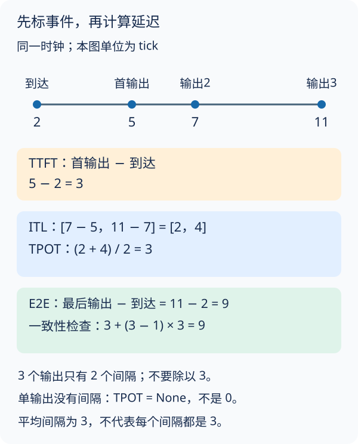

# HW6：从时间线推导延迟，而不是套一个平均公式

先修 [L12](../../lectures/lec12.md)。建议 2–3 小时，先手算后编码。修改 [hw06.py](hw06.py)，用 [test_hw06.py](test_hw06.py) 验证。此作业独立于调度器，接受已有的完成请求时间戳，不需要运行模型，也不把 Python 执行耗时当成请求延迟。

## 1. 先画一条请求的一生



到达 2，首输出 5，后续输出 7、11。先在纸上写三个区间：等待首输出为 3，两个输出间隔为 2、4；最后才做平均。对照图中的刻度，确认你的 TPOT 分母为什么是 2 而不是 3。后面每题都沿用“先核实数据 → 逐请求算指标 → 再聚合”的顺序。

## 2. Q1：单请求指标

`request_metrics(arrival,token_times)` 返回 `{"ttft":值,"tpot":值或None,"e2e":值}`。接口与原题一致：

- arrival 和每个时间必须是 Python int/float，有限且非负；拒绝 bool、NaN、无穷、字符串。
- token_times 是非空 list、严格递增，每项 >= arrival；允许首时间等于 arrival。
- TTFT=首时间−arrival；E2E=末时间−arrival；TPOT=(末−首)/(token数−1)。单输出 TPOT=None。
- 不修改输入；非法值抛 ValueError。正常测试使用可安全表示的有限数，不研究浮点溢出。

先完成一个只检查合法两输出数据的最小版本：`arrival=1, times=[3,7]`，三个结果应是 2、4、6。然后加入多输出，再专门处理单输出；最后加入容器、数值、顺序验证。不要先过滤掉非法时间，因为过滤会悄悄改变 token 数和统计意义。

| 手算输入 | TTFT | TPOT | E2E | 学习目的 |
| :--- | ---: | :--- | ---: | :--- |
| 2，[5,7,11] | 3 | 3 | 9 | 逐间隔均值等于端点公式 |
| 0，[5,7,11] | 5 | 3 | 11 | 排队改变不应改变 TPOT |
| 1，[4] | 3 | None | 3 | 无间隔不是零间隔 |
| 0，[0] | 0 | None | 0 | 通用指标允许零 TTFT |

最小反例：`E2E/n` 在第一行碰巧为 3，但在第二行变为 11/3，击穿错误公式。`times=[2,2]` 违反严格递增，不能靠排序或去重修复。检查点：每个 n>1 合法例子都应满足 `E2E=TTFT+(n−1)*TPOT`；单输出不要把 None 参与乘法。

## 3. Q2：请求等权，分母由问题决定

`aggregate_metrics(records)` 的 records 必须为 list，每项 tuple/list 恰含 `(arrival,token_times)`，沿用 Q1 契约。返回 `{"mean_ttft":值或None,"mean_tpot":值或None}`。TTFT 对全部请求等权；TPOT 仅对有两个及以上输出的请求等权。空 records 两项 None；全是单输出时 mean_tpot=None。任何非法记录都要抛 ValueError，不修改输入。

思考顺序：先复用 Q1 得到逐请求字典；把所有 TTFT 放入一列，把非 None 的 TPOT 放另一列；分别记录两个分母；最后求均值。不要一边遍历一边把 token 数加进请求分母，也不要用 `value or 0` 抹去“无定义”。

```text
records = [(0,[1,5]), (0,[2,3,4,5]), (1,[2])]
TTFT 列 = [1,2,1]             → 4/3
有定义的 TPOT 列 = [4,1]     → 2.5
全部 ITL = [4,1,1,1]          → 1.75（不是本题口径）
```

这是最小的有区分力练习：两个非单输出请求有不同数量的间隔，才能辨别请求平均与间隔平均；再加一个单输出，才能辨别 None 的排除规则。检查点：追加一条单输出请求会改变 mean_ttft，却不改变 mean_tpot；给所有 arrival 和输出时间统一加 10，各项延迟均不变。

## 4. Q3：SLO goodput 数的是达标请求

`slo_goodput(records,ttft_limit,tpot_limit,duration)` 返回达标请求数 / duration。

records 沿用 Q2；两个 limit 是有限非负 int/float，拒绝 bool；duration 同类型但必须 >0。窗口固定 `[0,duration]`，所有 arrival 和输出时间必须落在其中，连不达标的请求也必须合法。TTFT<=limit 且 TPOT<=limit 才达标，等号通过；单输出只检查 TTFT。空 records 返回 0，但仍验证全部参数。非法 ValueError，不修改输入。

按三层责任实现：第一层检查参数与所有原始记录；第二层核实每条记录都在窗口内；第三层才计算通过条件并计数。否则你可能把一个越界请求当成“不达标所以不用看”，掩盖无效数据。

| 窗口 6、限制 2/2 | TTFT | TPOT | 达标？ |
| :--- | ---: | :--- | :--- |
| (0,[2,4]) | 2 | 2 | 是，等号通过 |
| (0,[2,6]) | 2 | 4 | 否 |
| (1,[2]) | 1 | None | 是，只查 TTFT |

结果是 2/6 请求/时间单位，不是 5/6；5 是输出 token 总数，属于输出吞吐的分子。把窗口改为 5 应报错，因为最后时间 6 越界；改成 8 则结果为 2/8，额外空闲也算观察窗口。最小反例 `[(1,[9])]`、limit=0/0、duration=8：即使显然不达标，也必须报越界错误。

## 5. 渐进自测

先独立回答：为什么 NaN 不适合拿来比较 SLO？为什么空 records、duration=0 仍要报错？若所有时间与 duration 同乘 1000、SLO 也同乘 1000，达标条数与 goodput 数值分别如何变化？

<details>
<summary>解析：有效性、单位与空输入</summary>

NaN 不是有限时间，比较结果也不能表达正常先后关系，必须先拒绝。空数据不豁免公共参数，duration=0 没有合法吞吐分母。统一换单位不改变达标条数，但 goodput 数值除以 1000；例如每秒 2 个请求等于每毫秒 0.002 个请求。这不是性能下降，而是单位改变。
</details>

<details>
<summary>实现提示：怎样避免三题各写一份不同的验证？</summary>

先让 Q1 成为单请求真相来源；Q2 和 Q3 在验证外层形状后调用 Q1，而不是重新猜一套公式。验证窗口仍是 Q3 的额外责任。公共 helper 可以使用，但不要改变三个公开函数名、参数或返回字段。
</details>

## 6. 运行与交付

从课程根目录运行；个人主页仓库先进入 `_courses/deepinfer`：

```bash
python course/tools/grade.py hw06 --question q1 --unlock
python course/tools/grade.py hw06 --question q2 --hint 1
python course/tools/grade.py hw06
```

HW6 30 分保持不变：Q1/Q2/Q3 各 5；公式和单位 6；两个错误口径反例 6；不用答案解释单输出与窗口边界 3。交付代码、单请求的区间图、请求均值与间隔均值两种分母、完整 SLO 判定表。测试只覆盖代码，不自动替你完成书面解释。最后说清楚：来自固定 tick 模拟器的延迟只是虚拟时间；运行本脚本用了多少秒，衡量的是 Python 计算开销，不是模型服务的 TTFT。
