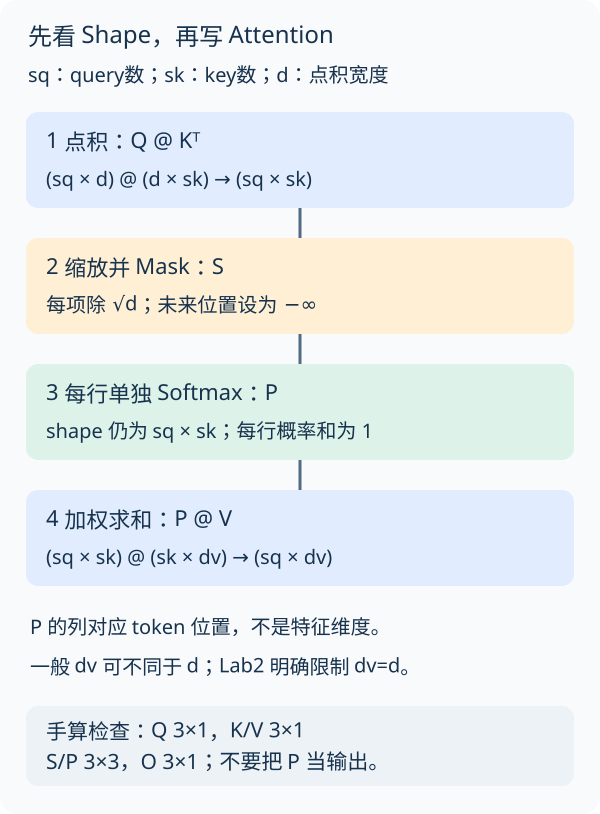
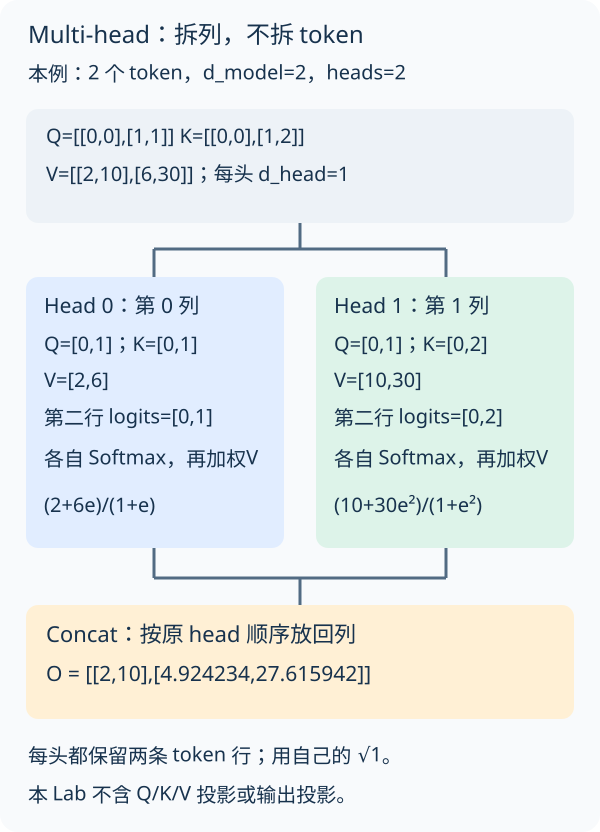

# Lab2：把Attention拆成八个能解释的小函数

阅读：[L3 数值算子](../../lectures/lec03.md)、[L5 Attention](../../lectures/lec05.md)、[L6 IO与在线状态](../../lectures/lec06.md)。先完成预备矩阵练习与Lab1。建议4–6小时分三个checkpoint；只用标准库，不需要GPU。交付自己的 `lab02.py`、中间矩阵、shape与成本账本、一个反例和checkoff回答。

## 0. 从最小成功开始

框架 [lab02.py](lab02.py) 给定八个公开接口；[test_lab02.py](test_lab02.py) 是公开测试。保留签名与测试，不把参考文件当成自己的提交。所有命令从含course的课程根目录执行；个人主页仓库先进入 `_courses/deepinfer`。

```bash
python course/tools/grade.py lab02 --question q1 --unlock
python course/tools/grade.py lab02 --question q1 --failfast
python course/tools/grade.py lab02 --question q1 --hint 1
```

将q1换成q2–q8逐题运行。不要等八题全写完才测试：先预测一个小例子，写一段，再让结果告诉你哪个阶段理解有误。L5对应Q1–Q6，L6对应Q7/Q8；先完成L7、L8，再统一做完整HW1/HW2。

## 1. 共享契约与贯穿全实验的例子

本Lab的Q是(sq,d)，K/V都是(sk,d)，d>0；一般attention可以dv不等于d，但本题明确取相等。非空矩阵保证为矩形，不要求你构建通用ragged张量验证器。数值有限、算术中间值可表示；仅Q3另允许mask用的−inf。matmul/transpose的空输入按框架返回[]，不模拟任意零轴shape。结果必须是新列表，不能修改输入；维度/计数参数必须是整数，拒绝bool。



| 阶段 | 输入 | 输出 | 检查点 |
| :--- | :--- | :--- | :--- |
| transpose | K(sk,d) | Kᵀ(d,sk) | 行列互换 |
| matmul | Q(sq,d)、Kᵀ(d,sk) | S(sq,sk) | 内维d相等 |
| scale/mask/softmax | S(sq,sk) | P(sq,sk) | 每行有效概率和为1 |
| matmul | P(sq,sk)、V(sk,d) | O(sq,d) | 对位置维sk求和 |

先用零logit热身：Q=`[[0],[0]]`，K=`[[1],[2]]`，V=`[[2],[6]]`。noncausal输出`[[4],[4]]`，causal输出`[[2],[4]]`。然后必须换成L5的非均匀例子：Q=`[[1],[2],[1]]`，K=`[[ln2],[ln4],[ln8]]`，V=`[[2],[6],[10]]`，causal应输出`[[2],[26/5],[54/7]]`。热身只帮助理解，不能用它证明权重计算正确。

## 2. Q1：每一格输出先单独算对

`matmul(a,b)`：A(m,k)@B(k,n)返回新C(m,n)；任一输入空则[]；非空内维不匹配ValueError。先只算一格点积，再加输出列循环，最后加输出行循环。每一格的累加器重新清零，每一行是独立列表，避免多行引用同一内层列表。

手算 `[[1,2,3],[-1,0,2]] @ [[1],[0],[-1]]`：第一格1+0−3=−2，第二格−1+0−2=−3，结果`[[-2],[-3]]`。这比只测2×2更能发现把n、k混用的错误。

检查点：结果是2×1；改out[0][0]不应改变out[1][0]或a/b。最小反例：`[[1,2]] @ [[1,2]]` 内维2和1不匹配，应报错，不允许zip静默截短后产出数字。

## 3. Q2：转置改变布局，不改变元素

`transpose(a)`：m×n返回新的n×m，[]返回[]。先问“输出第j行来自哪里”：来自输入第j列。外层遍历输入列，内层遍历输入行；不要只是交换原矩阵的两个元素。

`[[1,2,3],[4,5,6]]` 应为 `[[1,4],[2,5],[3,6]]`。检查两次转置回到原值，元素总数仍6；改转置后矩阵，不污染输入。最小反例：只测对称方阵会让“原样返回”蒙混过关，必须用这个非方形数据。

## 4. Q3：一行一个分母，mask项贡献为零

`softmax_rows(x)` 每行单独减max、取exp、除本行指数和；每行至少一个有限值，其他项可−inf。空行、全−inf、NaN或+inf抛ValueError；外层[]返回[]。−inf项概率为0，不修改输入。

先写只接受一行合法数据的小流程，再放进按行遍历。用`[[0,0],[0,ln2]]`，两行应为[1/2,1/2]与[1/3,2/3]。减max后的第二行指数为[1/2,1]，分母1.5，而不是沿用第一行的2。

检查点：给某一整行加1000，概率不变；`[1000,-inf,1000]` 应为[1/2,0,1/2]。最小反例：如果把全部行一起除以一个总和，每行和不再为1；如果对全−inf照常减max，会得到NaN，不能声称它是一个合法概率结果。

## 5. Q4：先确定允许集合，再归一化

`causal_mask(scores)` 只接受方阵，返回新方阵，j<=i保留，其余−math.inf；非方阵ValueError，[]返回[]。先画3×3网格：允许列分别[0]、[0,1]、[0,1,2]。对角线属于当前已知位置，不能误删。

最小反例：一行一列`[[3]]`应仍是`[[3]]`；若用了j>=i就把唯一合法项删掉。不要原地写scores，因为调试时还需要对照mask前后。应用反例：L5第二行先softmax再清零得到[1/21,4/21,0]，而正确是[1/5,4/5,0]；解释分母为什么不同。

**Checkpoint A**：Q1–Q4通过；独立写shape表；展示非方形转置、非法乘法内维和错误mask分母各一例。不要求一次写完attention。

## 6. Q5：组合，不重新发明四套循环

`attention(q,k,v,causal=True)` 先对空Q或空K返回[]；否则要求d>0、Q/K/V同head_dim、V非空且K/V同长度；causal时sq=sk。违反ValueError。矩形只在noncausal合法；decode绝对位置偏移不在本Lab内。

实现顺序是验证shape → 调Q2转置K → 调Q1得分 → 每项除√d → 按causal决定是否调Q4 → 调Q3得P → 调Q1做PV。每完成一步，把中间结果与第一节和L5手算对照。不要为了省打印直接把所有步骤塞进一个复杂表达式。

| 非均匀案例的阶段 | 你应看到什么 |
| :--- | :--- |
| 原始第二行S | [ln4,ln16,ln64] |
| mask后 | [ln4,ln16,−inf] |
| P第二行 | [1/5,4/5,0] |
| O第二行 | [26/5] |

检查点：把最后V从10改成100，前两行O不变，第三行改为414/7。最小反例：若输出只用了`P[row][0]*V[0][column]`而没有对所有位置求和，第一行测试可能通过，但第二行只得到2/5，不是26/5。调试时找**第一处**不同的中间结果，而不是在最终O上乱改系数。

## 7. Q6：每头独立，连续切列，按顺序拼接

`multi_head_attention(q,k,v,num_heads)` 先检查num_heads是正整数、三者序列长度相同，再对三者全空返回[]。非空须同d_model>0，且d_model可被num_heads整除；违反ValueError。每头默认causal，不含Wq/Wk/Wv/Wo投影。



按四步写：算head_dim；为每个head提取所有token的连续列切片；调用自己的Q5；把结果逐行放回相应列区间。例：一行[a,b,c,d]、两头是[a,b]和[c,d]，不是[a,c]和[b,d]。每头用√head_dim而非√d_model。

有区分力的验收输入：Q=`[[0,0],[1,1]]`，K=`[[0,0],[1,2]]`，V=`[[2,10],[6,30]]`，heads=2。第一行[2,10]；第二行分别 `(2+6e)/(1+e)` 与 `(10+30e²)/(1+e²)`。不要只测所有head完全相同的数据；那种数据抓不到交换head、直接返回V等错误。

**Checkpoint B**：Q5/Q6通过；能从图里指出token轴、特征轴和head轴；在不运行程序时说明未来V改动为何不改变过去输出。到这里才开始成本计数，不把成本公式当成算子正确性的替代。

## 8. Q7：有效FLOPs从配对数推出来

`attention_flops(batch,heads,seq_q,seq_k,head_dim,causal=True)` 所有维度须非负整数，拒绝bool，否则ValueError；causal要求sq=sk。每配对的QK与PV合计按4d FLOPs，忽略softmax、缩放和投影。full配对数sq×sk；causal为s(s+1)/2，包含对角线。

先在纸上列s=3的配对：第0行1对，第1行2对，第2行3对，共6；d=2时每对8 FLOPs，共48。full为9×8=72。接着乘batch和heads，而不是再把序列长度乘一次。零维允许数学零工作模型，不对应一个正常执行的非空attention张量。

检查点：s=1时causal和full相等；这能击穿“所有causal直接除2”的错误。大例b=1,h=8,s=128,d=64，full33,554,432，causal16,908,288。Python先完整matmul再mask仍执行稠密工作；本题causal数字是能跳过上三角时的有效工作，并非Python循环实际运算计数。

## 9. Q8：每个数组读写几次，逐项记账

`attention_bytes(...,bytes_per_elem=2,materialized=True)` 的维度及bytes_per_elem须非负整数，拒绝bool，否则ValueError。所有数组使用同一元素字节数；零字节只是允许的数学零模型，不是dtype。

| 数据 | 请求次数 | 元素数 |
| :--- | ---: | :--- |
| Q读、O写 | 各1 | 2×batch×heads×sq×d |
| K读、V读 | 各1 | 2×batch×heads×sk×d |
| S写/读、P写/读 | 共4 | 4×batch×heads×sq×sk |

materialized=True三行相加再乘元素字节数；False只保留前两行，是输入各读一次加输出写一次的**理想下界**。不是FlashAttention实际IO测量；L6的tile重读会让实际请求超过这个下界。

先做b=h=1,sq=sk=2,d=1,2B：Q/K/V/O16B；一个S容量8B；S/P四次读写32B；总48B；False为16B。再做矩形sq=2,sk=3,d=4,2B：前两行40元素，中间24元素，合计128B。这个矩形例子能抓到把sq和sk误当同一个长度的错误。

大例b=1,h=8,sq=sk=128,d=64,2B：True1,572,864B，False524,288B；单个S容量262,144B，中间四次流量1,048,576B。先写“容量”“请求流量”列名，再填数；同一个单位B，不代表在回答同一个问题。

**Checkpoint C**：Q7/Q8通过；说明dtype、忽略项、是否物化、是否有效causal四种假设；不要把估算值包装成profiler实测结果。

## 10. 分级提示和出口

<details>
<summary>提示一：shape正确，数值仍错，从哪里查？</summary>

按S→mask后S→P→O比较，找到第一处差异。S错查转置与缩放，P错查mask位置和逐行分母，O错查是否把所有key位置的贡献加完。不要用随机大矩阵代替可手算的小例子。
</details>

<details>
<summary>提示二：为什么修改结果会改变另一行？</summary>

可能用列表乘法重复引用同一个内层列表。每一行应独立创建，函数也不能返回原输入的可变子列表作为结果。请用非方形矩阵加一次结果修改来检验，而不仅比较初始值。
</details>

<details>
<summary>提示三：在线Attention里m、s、o是什么？</summary>

m是已看logit最大值，s是以m为基准的指数和，o是以同一基准计算的未归一化V加权和，最终output=o/s。L6给出了完整推导。不要把已归一化output与分子o混为一谈；两个split直接平均通常错误。
</details>

```bash
python course/tools/grade.py lab02
```

最后不用参考实现解释：为什么除√d；全−inf行为什么非法；未来V变动如何测因果性；两个head为什么有不同分母；causal有效工作为什么不是严格一半；False下界为什么不等于测得HBM字节。再完成L6的两个tile纸面合并。一个失败测试能说清原因为何，比只贴“全部通过”的截图更能说明掌握了知识。
