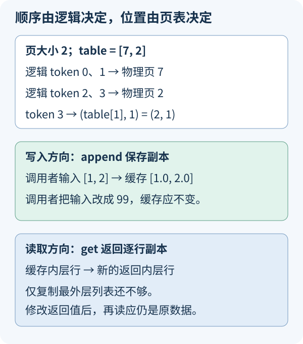

# Lab3：从列表对象到 Paged KV Cache

> **先修**：预备 2 的副本语义、Lab2、[L7 KV cache](../../lectures/lec07.md)；HW2 在本 Lab 之后。  
> **投入**：3–5 小时，分为“连续容器”“分页追加”“跨页读取”三个学习段。必做 Q1–Q4；前缀共享只作纸上选做，不是隐藏实现要求。
> **交付**：`lab03.py`、逻辑→物理地址表、一次副本或跨页错误的调试记录。

## 0. 学习路线、目录和 Python 类速查

本实验管理单条序列，物理页字典可按需增长。它没有有限池容量、引用计数或 GPU 内存；这些由第 5 周 Lab4 单独教学。先保证“内容读写正确”，再研究“有限资源归谁所有”，不要一开始把两个问题混在一起。

所有命令从**课程根目录 `deepinfer/`** 执行，即可以看到 `course/` 的目录；个人主页源码中的位置为 `_courses/deepinfer/`。Windows 使用 `python` 或 `py -3`，其他环境可以使用 `python3`，先选本机可用的一种。

`lab03.py` 已提供两个类的构造函数、长度、释放和统计方法；你实现四个 TODO。`test_lab03.py` 检查行为，参考文件为 `lab03_solution.py`。

给定构造器要求 head_dim/block_size 为正整数；get 的 start/end 也必须是整数，均不接受bool，否则 `ValueError`。向量值保证是有限数值，不要求给 NaN/Inf 设计策略。

`cache=KVCache(2)` 创建一个对象并调用 `__init__`。`self.k` 是属于这个对象的 K 列表；`cache.append(k,v)` 将 cache 自动作为 self 传入。`len(cache)` 调用 `__len__`。两个 cache 实例应各有独立状态。

```python
class Counter:
    def __init__(self):
        self.value = 0
    def add(self):
        self.value += 1
        return self.value

first_counter, second_counter = Counter(), Counter()
print(first_counter.add(), first_counter.add(), second_counter.add())
```

先预测输出，然后运行这个完整示例。应为 `1 2 1`；self 不是所有对象共享的一份状态。

每题流程：

```bash
python3 course/tools/grade.py lab03 --question q1 --unlock
python3 course/tools/grade.py lab03 --question q1 --failfast
python3 course/tools/grade.py lab03 --question q1 --hint 1
```

## 1. Q1：先建立一个可信的写入操作

先不考虑分页，只回答“一个 token 的两行数据怎样一起加入缓存”。不要边转换 K 边写入，再去检查 V；先验证两行，生成两份新行，最后提交。这个顺序保护长度同步。

实现 `KVCache.append(k,v) -> position`。构造器给定 head_dim>0，两个向量必须各有 head_dim 项；不满足抛 `ValueError`，且缓存状态不改变。保存 float 副本，返回追加前的长度。

完整行为例子：

```text
cache = KVCache(2)
append([1,2],[3,4]) → 0
append([5,6],[7,8]) → 1
len(cache) → 2
```

**状态不变式**：`len(k_storage)==len(v_storage)`，每行长度都等于 head_dim。先检查再修改，以免错误输入留下半个 token。

**指导性填空**：先在纸上标出 `old_length = ____`、`检查两行长度`、`new_k/new_v = 浮点副本`、`写入两个storage`、`return ____`。函数的成功路径要保持长度同步；失败路径应在第一次写入之前结束。

## 2. Q2：半开区间与双向副本保护

半开区间 `[start,end)` 包含 start，不包含 end，所以行数必须等于 `end−start`。start=end 表示没有元素，不代表错误；start<0、end<start、end>长度才越界。先在纸上写出 get(0,0)、get(0,2)、get(1,2) 分别应有 0、2、1 行。



图的下半部展示两个方向的保护：append 后修改原输入，和 get 后修改返回内层行，都不应影响内部缓存。只检查结果数值一次，不能证明复制语义。

`get(start,end) -> (K列表,V列表)`，区间 `[start,end)`。要求 `0<=start<=end<=len(cache)`，否则 `ValueError`。空区间合法。外层和各行都返回副本。

Q1 的例子中 `get(1,2)` 返回 `([[5,6]],[[7,8]])`。调用方把返回值第一格改为 99，再次 get 仍应得到 5。只复制外层不够，回顾预备 2。

`free` 已给出，调用后 `len==0`、`get(0,0)==([],[])`。Q1 的完整读写测试依赖 Q2，因此建议先写完这两个小方法，再运行两个题组。

**Checkpoint A**：连续布局测试通过；展示 append 输入副本和 get 输出副本各自防止什么错误。

**修错练习**：`return self.k[start:end], self.v[start:end]` 看起来已经做了切片，为什么调用方仍能修改缓存？用一个 token、一个维度构造最小反例，区分“外层列表副本”和“内层向量副本”，再修改实现。

## 3. 从连续索引到两步间接寻址

Paged 版本的四个状态：

| 属性 | 类型 | 作用 |
| :--- | :--- | :--- |
| blocks | 字典 | 物理编号 → 页内容 |
| block_table | 列表 | 逻辑页号 → 物理编号 |
| length | 整数 | 有效 token 数 |
| _next_block | 整数 | 下次分配编号 |

本 Lab 分配器按递增编号分配，但 gather 必须查表，不能假设物理编号总等于逻辑编号。测试会重新映射物理编号。

例如 block_size=2，table=`[9,2,7]`：

| token pos | logical=pos//2 | offset=pos%2 | physical=table[logical] |
| ---: | ---: | ---: | ---: |
| 0 | 0 | 0 | 9 |
| 1 | 0 | 1 | 9 |
| 2 | 1 | 0 | 2 |
| 3 | 1 | 1 | 2 |
| 4 | 2 | 0 | 7 |

## 4. Q3：跨过页边界时才分配

page size=2 时，追加位置 0、1 属于第一页，位置 2 开始第二页。判断新页的时机是**追加之前的 length**，不是先加一再判断。先填表，再把每行变成一小段代码：

| 追加前 length | length%2 | 是否新建页 | 追加后 length | 已分配槽位 | 浪费 |
| :--- | :--- | :--- | :--- | :--- | :--- |
| 0 | 0 | 是 | 1 | 2 | 1 |
| 1 | 1 | 否 | 2 | 2 | 0 |
| 2 | 0 | 是 | 3 | 4 | 1 |
| 3 | 1 | 否 | 4 | 4 | 0 |
| 4 | 0 | 是 | 5 | 6 | 1 |


实现 `PagedKVCache.append(k,v)`。本教学容器要求每次 k/v 等长，错配抛 `ValueError`；它没有构造时固定的 head_dim。输入为有限数值列表。

步骤框架：

```text
检查当前 k/v 长度
如果 length 位于新页起点:
    新建物理页，将其编号追加到 block_table
在最后一个物理页存入 k/v 的副本
返回旧 length，并使 length 增加 1
```

**预测**：block_size=4，先 append 四次，allocated_slots=4；第五次才分配第二页，allocated_slots=8，waste=3。最后一页未使用的 slot 不包含有效 token。

`free` 已提供：清 blocks、页表、length 与编号计数；释放后可从 position=0 重新使用。

## 5. Q4：跨页 gather 的完整手算（独立实现）

`get(start,end)` 的区间/副本契约与 Q2 相同。逐 token 计算逻辑页号和 offset，查 block_table，再访问 blocks。返回结果按逻辑 token 顺序排列。

用上表 hand trace `get(1,4)`：读取物理页 9 的 offset1，然后物理页 2 的 offset0/1。共三个 token；不能一次切某个物理页代替跨页读取。

再追踪 get(1,5)：访问位置为 1、2、3、4，对应 `(9,1),(2,0),(2,1),(7,0)`。返回四行，顺序依然是逻辑顺序，不是按物理 ID 大小排序。get(5,5) 是空结果；如果当前长度为 5，get(5,6) 必须拒绝，不能从尾页空槽中读出伪数据。

<details>
<summary>排错提示</summary>

若只在跨页时错，打印 pos、logical、physical、offset。若重编号测试错，检查是否直接用了 blocks[logical]。若修改返回值影响缓存，检查是否逐行复制。

</details>

**Checkpoint B**：Q3/Q4 和全量测试通过。通过的条件包含非连续物理页编号、尾页、空区间、释放后复用、复制语义。

**独立迁移**：把 page size 从4改为1和2，手算 `get(1,5)` 的访问路径，再运行全量测试。公开测试会对小缓存的所有合法 `[start,end)` 与独立列表结果比较，避免“只处理从0开始的读取”也能通过。

## 6. 容量与真实实现的连接

`allocated_slots=len(block_table)*block_size`，`waste=allocated_slots-length`。10 token、page=4 分配 12 slot，浪费 2；page=16 浪费 6；page=128 浪费 118。

Python 的列表长度表示有效内容，allocated_slots 表示概念上的页容量。它不直接测量 Python 对象内存或真实 GPU allocation。真实引擎可能使用跨层共享逻辑页表、分层物理张量等布局，需阅读具体 cache engine。

## 7. 独立自测、验收与下一阶段

盖住实现，先回答：① page size=1 时每次追加是否都分配新页？② free 后第一个 append 返回什么？③ 重排物理编号后，逻辑 token 顺序能改变吗？④ 修改 get 返回的第一行会不会影响下次读取？

<details>
<summary>先预测后核对</summary>

① 每次都跨到新页，槽位数等于长度、浪费为零。② 返回 0，状态已重新初始化。③ 不应改变，访问由页表保持逻辑顺序；若改变说明跳过了查表或排序了物理页。④ 不应影响，每行也必须独立复制。用至少两个不同 head_dim 的连续容器证明对象状态不共享。

</details>

交付代码、地址表、输入与输出两种副本证据，以及一个真实调试记录。保持原 Q1–Q4 和原验收方式，不新增评分分母。

```bash
python3 course/tools/grade.py lab03
```

必答：为什么 get 的返回副本重要？逻辑和物理编号为什么分开？page size 增大会怎样改变尾部浪费和页表长度？随后做 HW2 的分页与容量题。

**Optional 设计题**：画出两条请求共享前两页后的引用计数。若共享末页仍有空位，一个请求 append 时何时需要 copy-on-write？只写设计和状态图，不把没有引用计数的共享代码当作已完成实现。
