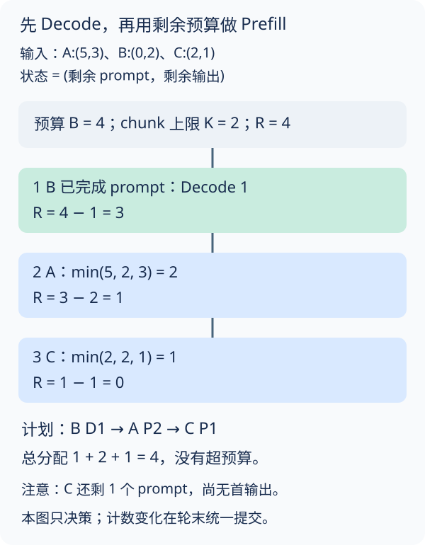

# Lab5：把“Decode 优先”变成可以独立验证的策略

先修 [L11](../../lectures/lec11.md)、[L12](../../lectures/lec12.md)。建议 2–3 小时，分“手算 → Q1 → Q2 → 反例解释”四段。只写两个纯函数：不执行模型、不推进时间、不修改请求。主文件 [lab05.py](lab05.py)，公开测试 [test_lab05.py](test_lab05.py)。先别看参考解；每题先写出预计结果，再运行自己的代码。

## 1. 实验台：谁负责什么

调度器像一张工作单的编写者。输入是轮开始状态，输出是本轮动作；真正改变状态的是 [Project2 Phase2](../../projects/project2_scheduler/README.md) 的执行器。两者分开，你就能区分“选错了工作”与“工作做完后计数减错了”。

active 必须为 list，每项 tuple/list 恰含 `(id,prefill_remaining,output_remaining)`。ID 是非空字符串、全列表唯一；prefill_remaining 是非负整数；output_remaining 是正整数。整数不接受 bool、float。token_budget、chunk_size 是正整数。非法输入统一 ValueError；即使预算耗尽也检查整个列表。空 active 合法，但参数仍必须合法。

每条记录的输出余量包含尚未发出的首输出。prefill_remaining>0 表示尚未完成 prompt；等于 0 才能 decode。已完成者不应该再出现在 active。函数不得修改输入，返回独立的新列表；输入顺序就是同阶段的 FIFO 顺序。

开始前口头回答：`("A",5,3)` 占几个并发位置？本轮能处理几个 prompt token？前者是 1，后者还需要预算和 chunk 才能决定。不能直接回答“5”。

## 2. Q1：先找出谁已准备好 decode

`decode_first(active,token_budget)` 返回 prefill_remaining==0 的 ID，按输入顺序，数量不超过预算。一条普通 decode 本轮消耗 1 个输入 token。Q1 不返回 prefill，不减 output_remaining，也不判断请求会在哪个时刻完成。

按以下子步骤实现，每步只添加一种责任：

1. 暂时只处理合法输入：扫描所有记录，选出 ready 的 ID。输入 `[P:(5,3),D:(0,2),E:(0,1)]` 应先得到 D、E，而非队首 P。
2. 限制返回数量：预算 1 得 `["D"]`，预算 2 或 3 得 `["D","E"]`。预算是上限，不要求凑够指定个数。
3. 在选择之前校验参数和所有记录，包括重复 ID、非法类型和列表尾部。
4. 保存输入的深拷贝，调用后比较；修改返回列表不应改变原 active。

| 手算输入 | 预算 | 预期 | 针对的错误 |
| :--- | ---: | :--- | :--- |
| 空列表 | 1 | 空列表 | 空输入被误当成非法 |
| 只有 P:(2,1) | 2 | 空列表 | 把 prefill 当 decode |
| P:(2,1)、D:(0,1) | 1 | D | 被队首未就绪请求阻塞 |
| D:(0,1)、X:(−1,1) | 1 | ValueError | 预算满后跳过尾部验证 |
| D:(0,1)、D:(2,1) | 1 | ValueError | 只在 ready 子集中查重 |

检查点：先别写 Q2，给上述每行一个断言。特别注意 Python 中 `isinstance(True,int)` 为真，但本题不把 True 当成整数；验证必须符合题目契约，而非只凭日常语感。

## 3. Q2：预算像账本，一笔一笔扣

`plan_step(active,token_budget,chunk_size)` 返回 tuple 列表 `(id,phase,count)`。先放 Q1 选中的 decode，每项 phase="decode"、count=1。再用剩余预算按原输入顺序处理 prefill，每条 count=`min(prefill_remaining,chunk_size,剩余预算)`；count>0 才添加 phase="prefill" 的计划。



照图逐笔记账：输入 A:(5,3)、B:(0,2)、C:(2,1)，budget=4，chunk=2。B 先消耗 1，R 从 4 变 3；A 获得 min(5,2,3)=2，R 变 1；C 获得 min(2,2,1)=1，R 变 0。预期输出：

```text
[("B","decode",1),("A","prefill",2),("C","prefill",1)]
```

推荐的实现顺序：先只生成 decode 计划和剩余预算；打印或断言 `sum(count)+remaining==token_budget`；再加入 prefill 的单次遍历；最后检查 phase 拼写、tuple 类型与顺序。不要在循环里同时更新 active；否则正在做的已经不是纯策略函数。

有三条不能“优化掉”的规则：每请求本轮最多出现一次；不回头给同一请求第二个 chunk；本轮完成 prefill 的请求不能再在本轮 decode。下表中的每个反例都能单独定位一种错误。

| 输入 / 参数 | 正确计划 | 错误实现可能做什么 |
| :--- | :--- | :--- |
| A:(9,3)，B=8，K=2 | A prefill 2 | 为填满预算给 A 做 8 |
| A:(1,3)，B=8，K=2 | A prefill 1 | 顺便再 decode，重复执行 |
| A:(2,1)，B=1，K=2 | A prefill 1 | 不足整块就拒绝尾部 |
| D:(0,1)、A:(5,2)，B=1，K=2 | D decode 1 | decode 后仍给 A 分预算 |

## 4. 渐进提示：卡住再展开

<details>
<summary>提示一：为什么需要先验证，再选择？</summary>

有效性是整个输入的性质，不是入选记录的性质。预算只影响工作计划，不应让同一非法列表在预算 1 时成功、预算 2 时才失败。先完整检查，可以避免 early return 隐藏尾部问题。
</details>

<details>
<summary>提示二：计划没有用满预算，是不是漏写循环？</summary>

不一定。只有 A:(9,3)、chunk=2、预算=8 时，本课只允许一份 chunk，所以剩 6 合法。预算是总量上限，单请求 chunk 是另一个上限。计划必须同时满足两者，不需要把每一单位都花完。
</details>

<details>
<summary>提示三：怎样检查没有暗中修改输入？</summary>

用含内层 list 的输入而不只是 tuple，调用前后做深比较。纯函数不应该修改剩余计数或排序原列表。返回后另加一个计划项也不应使 active 增加元素。项目还会进一步检查历史快照隔离。
</details>

## 5. 运行、定位和交付

从解压后含 course 文件夹的课程根目录运行；个人主页仓库内先进入 `_courses/deepinfer`。网站勾选不会执行 Python。

```bash
python course/tools/grade.py lab05 --question q1 --unlock
python course/tools/grade.py lab05 --question q1 --failfast
python course/tools/grade.py lab05 --question q2 --hint 1
python course/tools/grade.py lab05
```

如果计划顺序错，先只看阶段划分；count 错，逐笔列 R；只在异常测试失败，检查验证时机和类型；后一次调用受前一次影响，检查是否修改了输入。不要通过放宽测试或删掉异常记录“修好”实现。

Lab5 20 分保持不变：Q1 5、Q2 7；手算与预算解释 4；一次调试和新反例 4。交付自己的代码、完整账本、一个自己新构造的反例。如果首次通过，可以说明自己构造了什么反例，不必编造失败经历。验收时换一个未见过的输入，不运行程序先推导计划；做到这一步，再把自己的 Q2 迁移到项目。
