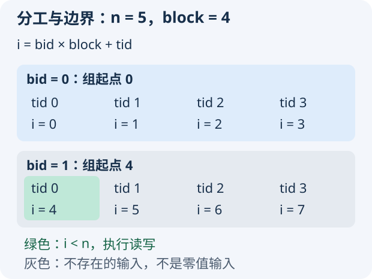

# 第 1 讲：从 Python 建立 GPU 执行模型

> **核心必修**：Python 函数、循环、列表；不要求 C++、指针、CUDA 或 GPU。  
> **先修检查**：能修复简单索引错误，能看懂测试中的输入与期望；不熟悉就先做 [预备单元](../prep/README.md)。  
> **建议投入**：分三次阅读，每次 30–45 分钟，另留 Lab0 动手时间；以能解释新输入为准。

## 阅读地图：一次只增加一个困难

本讲把“写循环”连接到“给线程分工”，不是要求你先认识整张 GPU。先修小测：`len([4,7,9])` 是多少，最后一个合法索引是多少？`[1,2]` 和它的副本是否应该互相影响？答案不稳时，先回 [预备 2](../prep/02-matrix.md)。

| 读到哪里 | 现在能做什么 | 对应练习 |
| :--- | :--- | :--- |
| 第 2–4 节 | 给每个元素找到唯一执行者，处理尾部 | Lab0 Q0、Q1、Q6 |
| 第 5–6 节 | 解释地址与不同分工 | Lab0 Q2；不急着比较速度 |
| 第 7–8 节 | 根据计数口径比较请求 | Lab0 Q3 |
| 第 9 节 | 带单位写出两个时间下界 | Lab0 Q4 |
| 全章 | 把加法改为独立缩放算子 | Lab0 Q5 |

本章所有 `python course/...` 命令在**课程根目录**运行，即能直接看到 `course` 文件夹的位置。离线包解压后进入这一层；若从个人主页源码仓库开始，先运行 `cd _courses/deepinfer`。Windows 可用 `.\course\run.ps1 lab00 --question q0`；其他系统根据已安装命令使用 `python` 或 `python3`。示例用 Python 按顺序模拟执行，不会启动 GPU。

## 1. 今天只解决一个问题

输入两个等长列表，让很多“编号工人”共同完成：

```text
a = [1, 2, 3, 4, 5]
b = [10, 20, 30, 40, 50]
c = [11, 22, 33, 44, 55]
```

你在预备单元已经会写逐项加法。这一讲不增加新的数学，而是改变“谁负责哪个元素”。完成后你应该能：

- 根据组号和组内编号，算出负责的元素位置。
- 解释为什么最后一组需要跳过某些编号。
- 跟踪一次读、读、写的地址。
- 区分请求字节数、触及的 line 数和 sector 数。

Tensor Core、occupancy、指针和 CUDA 语法都不是本讲验收条件。

## 2. 从一个循环到多组编号

先看你熟悉的写法：

```python
c = []
for i in range(len(a)):
    c.append(a[i] + b[i])
```

这里一个循环依次处理所有 `i`。GPU 的想法是让多个线程分别处理不同的 `i`。课程先用 Python 依次调用各线程的函数，以便观察地址；它并没有真的并行，也不能用它的运行秒数推断 GPU 性能。

四个术语先记用途，不背硬件规格：

| 名称 | 本讲怎样理解 | 代码里的编号 |
| :--- | :--- | :--- |
| thread | 负责一个元素的执行者 | tid，组内编号 |
| block | 一组 thread | bid，组号 |
| grid | 本次启动的所有 block | grid，组的数量 |
| warp | NVIDIA 上用于理解指令发射的一组 32 个 lane | 本讲用来分组计访存 |

演示中的每组只有 4 个线程，是为了方便手算；真实 NVIDIA warp 的大小仍然是 32。小 block 会使用不完整的 warp。



图中灰色格不是“值为零的输入”，而是根本不存在的输入。guard 的任务是在访问前判断身份是否有效，不是读完越界数据后再把输出改成零。thread 是执行身份，element 是数据位置；一个线程也可以在循环里处理多个元素，但本讲先限制为一个。

## 3. 推导索引，而不是背索引

假设每组 4 个线程。第 0 组负责 0–3，第 1 组负责 4–7，第 2 组负责 8–11。

```text
组起点 = bid * block_dim
元素位置 i = 组起点 + tid
```

`block_dim` 是每组的线程数，`grid_dim` 是组数。不要把它们当成同一个量。

索引公式还隐含两个承诺：没有漏掉有效元素，也没有把同一输出交给两个人。对任意合法位置 `i`，整数除法唯一给出 `bid=i//block_dim` 和 `tid=i%block_dim`。代回 `bid*block_dim+tid` 恰好还原 `i`，余数又保证 `0<=tid<block_dim`。这比“几个测试恰巧通过”更能说明分工正确。

| bid | tid | block_dim | i |
| ---: | ---: | ---: | ---: |
| 0 | 0 | 4 | 0 |
| 0 | 3 | 4 | 3 |
| 1 | 0 | 4 | 4 |
| 1 | 2 | 4 | 6 |

**停下来预测**：`bid=2, tid=1, block_dim=4` 应得到几？如果写成 `bid+tid`，哪些线程会重复处理同一个位置？

<details>
<summary>手算后检查</summary>

正确位置是 `2*4+1=9`。若写成 `bid+tid`，`(bid=0,tid=1)` 和 `(bid=1,tid=0)` 都得到 1；位置重复，另外一些位置则没人处理。

</details>

## 4. 为什么不能让最后一组随便访问

`n=5, block_dim=4`，需要两组。向上取整不是为了制造额外数据，而是为了提供足够的执行者。

```text
grid = ceil(n / block_dim) = ceil(5/4) = 2
```

| bid | tid | i | 是否小于 n | 动作 |
| ---: | ---: | ---: | :--- | :--- |
| 0 | 0..3 | 0..3 | 是 | 处理 |
| 1 | 0 | 4 | 是 | 处理 |
| 1 | 1 | 5 | 否 | 跳过 |
| 1 | 2 | 6 | 否 | 跳过 |
| 1 | 3 | 7 | 否 | 跳过 |

尾部条件是 `i < n`，不是 `i <= n`。长度 5 的合法索引为 0–4。

向上取整可只用整数：`grid=(n+block_dim-1)//block_dim`。为什么？将 n 写成 `完整组数*block_dim+余数`；余数为零不加组，非零才补一组。比如 n=8、block=4 得 2 组，n=9 得 3 组，n=0 得 0 组。若用 `n//block+1`，恰好整除和空输入都会多启动一组；若只用 `n//block`，尾部则无人负责。

**逐步练习 A**：n=9、block=4，先写三个组的起点，再圈出有效 i，最后写被跳过的 tid。不要直接写一句“加 guard 就好”。

<details><summary>核对 A</summary>

起点为 0、4、8；有效位置 0–8。最后一组只有 tid=0 有效，tid=1、2、3 对应 9、10、11，均跳过。有效位置恰有 9 个，每个出现一次。

</details>

下面的代码片段展示算法，完整可运行示例在 `walkthrough.py`：

```python
i = bid * block_dim + tid
if i < n:
    c[i] = a[i] + b[i]
```

运行示例，不需要先实现学生题：

```bash
python course/labs/lab00/walkthrough.py
python course/tools/grade.py lab00 --question q0
```

对照输出中的 `bid tid i action`。如果与预测不同，先解释其中一行，不要立即改整个程序。

## 5. 列表索引怎样变成内存地址

为数地址，tracer 把三个数组放进一条一维存储空间。这里地址的单位为 **word**，一个 word 规定为 4 字节：

```text
n=5
a 在 0..4
b 在 5..9
c 在 10..14
```

处理 `i=2` 时：

```text
读 a：地址 0+2=2，得到 3
读 b：地址 5+2=7，得到 30
写 c：地址 10+2=12，写入 33
```

为了记录访问，示例不直接操作 Python 列表，而是调用下面两个方法：

```python
left = device.load(a_addr + i)
right = device.load(b_addr + i)
device.store(c_addr + i, left + right)
```

把 `device.load` 理解成“读值并记一笔”，`device.store` 理解成“写值并记一笔”。现在不用阅读 `GPU` 类内部，也不用学习 C++ 指针。

再追踪容易暴露错误的最后一个有效元素 i=4：a 地址 4，b 地址 9，c 地址 14，读到 5 和 50，写入 55。三个数组合起来合法地址为 0–14。若错误地允许 i=5，a 的地址 5 虽然仍在总存储区内，却已经读成 b[0]；b 的地址 10 读到 c[0]；直到写 c 的地址 15 才真正越界。因此“没有立刻抛异常”不等于地址语义正确。Lab0 Q6 要修的是 guard，不能通过扩大数组掩盖错误。

**逐步练习 B**：n=3 时处理 i=1，三次访问的 word 地址分别是多少？换算 byte 地址后是多少？

<details><summary>核对 B</summary>

基址分别为 0、3、6；word 地址为 1、4、7，byte 地址为 4、16、28。读到的是三个数组各自的第 2 项，不是“第 4 个元素”。乘 4 只改变地址单位，不改变索引。

</details>

## 6. 结果相同，访存分组可以不同

连续分配使用 `i=bid*block_dim+tid`；另一种分配使用：

```text
i = tid * grid_dim + bid
```

例如 `n=12, block_dim=4, grid_dim=3`：

| bid | 连续分配：tid=0..3 | 跨步分配：tid=0..3 |
| ---: | :--- | :--- |
| 0 | 0,1,2,3 | 0,3,6,9 |
| 1 | 4,5,6,7 | 1,4,7,10 |
| 2 | 8,9,10,11 | 2,5,8,11 |

两种方案都覆盖 0–11，结果都可以正确。但同一组线程访问的地址距离不同。GPU 会把同一条内存指令、同一 warp 中落在同一 sector 的访问合并；地址分散通常需要更多 sector。

跨步方案也可以反推：给定 i，`bid=i%grid_dim`、`tid=i//grid_dim`。当 grid 非零且启动容量足够时，这仍是唯一分工。差别不是一个“会加错”、另一个“会加对”，而是同一条指令的相邻 lane 看哪些地址。结果数组仍按 i 写入；若把值按执行顺序 append 到输出，才会把分工变化误变成输出次序变化。

**不要先记“跨步一定慢几倍”**。当 grid=1 时两种分配相同；输入很小时访问也可能仍在少数 sector 内。后面用固定规模做可复现比较。

## 7. 三种计数，先分清单位

我们只讨论每 lane 读取一个 4 字节值的情况：

```text
word 地址 → byte 地址：word * 4
128B line 编号：word // 32
32B sector 编号：word // 8
```

同一 warp 的一次读取，数不同编号的个数：

| 32 个 lane 读取的 word 地址 | 有用字节 | line 数 | sector 数 |
| :--- | ---: | ---: | ---: |
| 0..31 | 128 | 1 | 4 |
| 16..47 | 128 | 2 | 4 |
| 1..32 | 128 | 2 | 5 |
| 0,8,16,...,248 | 128 | 8 | 32 |

第二行为什么不是 8 个 sector？16–47 对应 sector 2、3、4、5，恰好四个。跨两条 line 并不意味着必须传输两条完整 line。

Lab0 保留 `global_transactions` 这个旧字段名，但它准确的含义是“按 warp 指令累计触及的 128B line 数”。另外提供 `global_sectors`。这两个都不是 profiler 测得的实际 DRAM 读写量；模型不模拟缓存、写策略和时间。

一个可靠的手算顺序是：列有效 lane → 写每个 lane 的 word 地址 → 分别整除 32 和 8 → 数不同编号。不要把 line 数乘 4 当 sector 数，也不要把所有程序中的相同地址合并一次：不同 warp、不同内存指令必须分别计数。下一讲会用同一组地址检查这些区别。

## 8. 推导 vector add 的计数

每元素两次读、一次写，每值 4 字节：

```text
requested_bytes = n * (2+1) * 4 = 12n
FLOPs = n 次加法
```

`n=1024, block=128`，有 8 个 block，每 block 4 个 warp，总共 32 个 warp。a/b/c 起点都按 128B 对齐：

```text
连续：32 warps * 3 次访存 * 1 line = 96 lines
跨步：32 warps * 3 次访存 * 8 lines = 768 lines
```

两种的有用字节都是 `12*1024=12288`，但请求触及的 line 数不同。不能把这张表的比值直接叫实测 GPU 加速比。

## 9. 一个有条件的时间下界

设有效工作来自显存，先忽略缓存、启动和同步开销。硬件每秒最多搬 `BW` 字节、算 `P` 次浮点操作：

```text
memory_time = bytes / BW
compute_time = FLOPs / P
理想时间下界 = max(memory_time, compute_time)
```

假设搬 1GB、算 10GFLOP，BW=100GB/s，P=10TFLOP/s：

```text
memory_time = 1e9 / 100e9 = 0.01 秒
compute_time = 10e9 / 10e12 = 0.001 秒
下界为 0.01 秒；在这个模型下称为 memory-bound
```

两者不能直接相加来得到 Roofline 下界；而且下界不是性能保证。很小的任务可能受 kernel 启动延迟限制。这部分对应 Lab0 Q4，完成索引练习后再做即可。

为什么取 max？任一执行时间都不能小于完成必要搬运的时间，也不能小于完成必要计算的时间，因此必须同时满足两条不等式。max 是同时满足它们的最低要求；它没有证明两种工作一定完美重叠。现实时间可以更大。Lab0 相等时返回标签 `memory` 是接口约定，不表示另一限制消失。

**逐步练习 C**：同一模型若把字节减半但 FLOPs 不变，时间下界一定减半吗？用 1GB、1TFLOP、100GB/s、10TFLOP/s 检查。

<details><summary>核对 C</summary>

原来 memory=0.01s、compute=0.1s，下界0.1s。字节减半后 memory=0.005s，但 compute仍0.1s，下界不变。先定位哪条限制主导，再判断减少工作能否改变这个下界。

</details>

## 10. 现在做什么，哪些先跳过

### 10.1 先读懂骨架的“输入—工具—输出”

Lab0不要求你从零造GPU类。调用 `make_vector_gpu(a,b)` 会返回一个含五项的tuple；左侧的五个名字按位置接收它们。可以把它想成一个带固定栏位的包裹：设备对象、a起点、b起点、c起点、长度。改变名字本身不会搬动数组，弄错栏位则会让后续访问从错误基址开始。

内层的kernel也是普通Python函数。把 `kernel` 传给 `gpu.run` 表示“把这些步骤交给工具稍后调用”；写成 `kernel(...)` 则是立刻执行，并把本次返回值传过去。工具按线程身份填写tid/bid等参数；你在函数中只需算出该身份对应的位置，不必自己在kernel里再遍历所有线程，否则每个元素会被重复处理。

一次运行通常返回 `(c,stats)`：c回答“计算结果是什么”，stats回答“为了得到它记录了哪些访问”。stats是字典，例如 `stats["global_loads"]` 用字段名字取数，不是读取第global_loads号地址。Q3取两个运行结果中的同名字段再比较，不需要写第三个kernel。

### 10.2 用自己的小表观察调用过程

下面只产生身份与动作表，不读任何数据。它可以原样运行，帮助你在接触tracer前确认分工；不是Q1或Q5的完整答案：

```python
length = 5
block_size = 4
group_count = (length + block_size - 1) // block_size
for group_id in range(group_count):
    for local_id in range(block_size):
        position = group_id * block_size + local_id
        action = "work" if position < length else "skip"
        print(group_id, local_id, position, action)
```

前五行work，后三行skip。只把length改为4，整组有效且没有skip；改为0，不打印任何行。这三种情况分别验证尾组、整组、空输入，不能只挑一个看起来正常的长度。若你把guard写在函数返回之后，表中动作即使正确，真正读写仍可能没有被保护；应检查动作发生的代码位置。

### 10.3 从加法迁移到缩放，只改变真正不同的部分

vector_scale的分工、尾部判断、输出地址仍与加法相同；改变的是每个有效身份只读a、不读b，然后乘同一个factor并写c。于是每元素从两读一写变为一读一写。n=5时有5次load、5次store、40B请求。这是从算法动作推导计数，不是看到测试要求40便把stats写成40。

当输出正确而计数为0时，先怀疑绕过device直接对列表求值；当计数正确但结果排列错时，查是否按执行顺序append而不是按i存储；当仅尾组出错时，先检查guard与grid，而不是修改浮点容差。把这些现象分别对应到分工、访存和算术三层，后面的矩阵分块调试会继续使用同一方法。

进入 [Lab0](../labs/lab00/README.md)，按 Q0–Q6 做。每题只引入一项变化，先预测再运行。验收问题：

1. `n=10, block=4` 时，最后一组哪些 tid 应跳过？
2. 能否解释一个元素的两次读、一次写的地址？
3. 为什么 word 16 开始的 32 个连续值触及两条 line，但只有四个 sector？

<details>
<summary>自查要点</summary>

最后一组 bid=2，tid=0、1 处理 i=8、9；tid=2、3 跳过。读写基址分别为 0、n、2n。line 和 sector 的划分粒度不同，必须分别计算。

</details>

完成本讲核心后，可读 [第 2 讲](lec02.md) 的访存推导。它的 occupancy、profiling 与 CUDA 示例先选读。[第一讲进阶](lec01_gpu.md) 保留硬件吞吐、CUDA、float4 等材料，等补过 C++ 后再看，不计入当前完成条件。

离开本讲应保留三份证据：一个非整除长度的线程表、一条具体元素的读读写地址、一次单位齐全的下界推导。测试全绿但不能解释任一份时，只复习该小节，不必重做全部题。实际硬件的 warp/coalescing 约束见 [NVIDIA CUDA Best Practices](https://docs.nvidia.com/cuda/cuda-c-best-practices-guide/index.html#coalesced-access-to-global-memory)；本章编号和地址例子为课程独立手算模型。
