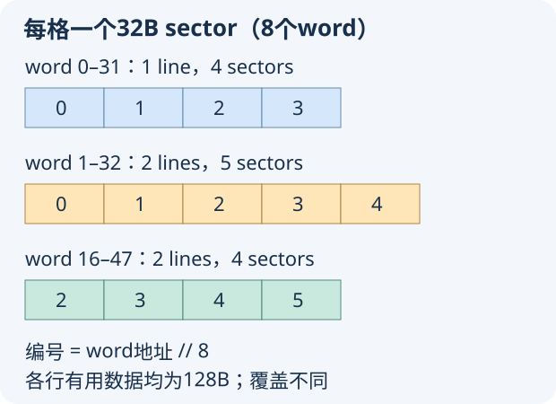

# 第 2 讲：合并访问、共享内存与 Occupancy

> **学习安排**：核心阅读两次，每次 30–45 分钟；后半硬件扩展另计。
> **课后**：实验 0 Q2/Q3  
> **学习分层**：先读第 1 节并做 Lab0；第 2 节 bank 为推导选读，第 3–5 节和 CUDA/profiling 练习留待补过 C++ 后再做。第一讲的进度不以这些进阶内容为门槛。  
> **一句话**：同一条 warp 访存指令触及的 sector 越少，有用字节占传输字节的比例通常越高；不要把 warp 请求、sector 和 cache line 当成同一个计数。

---

## 0. 本讲要解决的问题

**先修**：整数除法 `//`、取余 `%`、Lab0 的 lane/warp 和字节地址。初学者先掌握第 1 节与基础练习；CUDA 代码是桥接单元之后的阅读材料。

同样读 128 字节有用数据，为什么一个 warp 有时触及 4 个 sector，有时触及 32 个？

本讲建立三个可计算的模型：

1. **coalescing**：一个 warp 的访存会拆成多少 sector / 128B line？
2. **bank conflict**：shared memory 的一个 warp 访问会串行几拍？
3. **occupancy**：一个 SM 能同时驻留多少 warp？受什么限制？

第一次学完的证据是：给定 word 地址和活跃 lane，分别数清 line 与 sector，并说明计数不是实测时间。bank conflict 和 occupancy 是后置扩展，不作为 Lab0 的额外必做题。复杂 vector 指令和架构分配粒度需要另查手册。

| 阅读顺序 | 动手动作 | 课程题目 |
| :--- | :--- | :--- |
| 第 1.1–1.4 节 | 列地址、分桶、数不同编号 | Lab0 Q2/Q3；复习 Q1 尾部 guard |
| 第 1.5 节 | 手算变式，比较“请求”与“实际传输” | Lab0 checkoff；Quiz1 Q1 |
| 第 2 节 | 用 bank 表解释同址广播与异址冲突 | 理解性选读，无新增评分 |
| 第 3–5 节 | 只在具备 C++/CUDA 后做设备实验 | 选做，不阻塞 L3/Lab1 |

先修检查：word 9 对应 byte 多少？`9//8` 和 `9%8` 各表示什么？答案为36B、sector 1、sector内第1个word。若不清楚，先回 [L1 第7节](lec01.md)。所有命令在能看到 `course` 的课程根目录运行；源码仓库先 `cd _courses/deepinfer`，离线包直接进入解压根目录。

---

## 1. Global memory 的请求模型

### 1.1 Sector 与 line

本讲用 compute capability 6.0+ 的 **32B sector** 合并访问模型，并用 **128B line** 给地址分组。line 用于解释局部性，不能据此断言每次必从 HBM 搬 128B：

```
1 line = 128B = 4 sectors = 32 个 float32
1 sector = 32B = 8 个 float32
```

一个 warp 的 32 个 lane 发出 32 个地址。可用以下请求分组模型理解：

1. 把地址按 sector 分组；
2. 确定这条 warp 请求需要哪些 sector；
3. 如果多个 lane 落在同一 sector，合并成一个请求（前提是同一指令）；
4. 用 sector 数乘 32B 估计本层请求覆盖字节。缓存可能命中，所以它不直接等于 HBM 字节。[CUDA Best Practices：Coalesced Access](https://docs.nvidia.com/cuda/cuda-c-best-practices-guide/index.html#coalesced-access-to-global-memory)

### 1.2 Coalescing 的定量公式

设一个 warp 的地址为：

```
addr(lane) = base + lane * s   （单位：4B word）
```

以下先假设 base 按 128B 对齐、32 个 lane 都有效、每 lane 只访问一个 4B word，并分别数 line 和 sector，不假设整条 line 一定被搬运。

- `s=1`：32 个连续 word = 128B = 1 line = 4 sectors；有用 128B，传输 128B，效率 100%。
- `s=2`：跨度 64 word = 256B = 2 lines = 8 sectors；效率 50%。
- `s=4`：跨度 128 word = 512B = 4 lines = 16 sectors；效率 25%。
- `s=8`：跨度 256 word = 1024B = 8 lines = 32 sectors；效率 12.5%。
- 整数 `s>=8`：每个 lane 落在不同 sector，共 32 sectors；在本模型中效率为 12.5%。

用集合计数最可靠，既适用于非 2 的幂步长，也能处理错位：

```
word[lane] = base + lane * s
lines   = len({word // 32 for word in addresses})
sectors = len({word // 8 for word in addresses})
efficiency = 128B / (sectors * 32B)
```

> 这里的 `s` 是“相邻 lane 的 word 步长”。`s=1` 是连续访问，`s=gridDim.x` 是 Lab0 用来比较的跨步分配；它可以数值正确，但相邻lane的局部性可能更差。

### 1.3 例子：`i = tid * grid + bid`

在实验 0 的 `vector_add_strided` 中：

```cuda
int i = threadIdx.x * gridDim.x + blockIdx.x;
```

固定一个 block（`bid` 固定），一个 warp 的 `tid` 连续，但 `i` 的步长是 `gridDim.x`。若 `gridDim.x=8`，就是 `s=8`：一个 warp 的 load 会拆成 8 条 line / 32 个 sector，效率 12.5%。

同一问题的连续分工写法：

```cuda
int i = blockIdx.x * blockDim.x + threadIdx.x;
```

`s=1`。若首地址同时按128B对齐，一个warp的32个float落在一个line内；若仅按32B对齐，也可能跨两个line，但仍只需四个sector。两种索引方案都要保留有效范围判断；不能把请求布局的改进说成修复加法结果。

### 1.4 对齐的影响

即使 `s=1`，如果起始地址不在 128B 边界，一个 warp 仍可能跨两条 line：

```
base = 16 words（64B）
32 个连续 word -> 16..47
line 0: 0..31，line 1: 32..63
-> 2 lines，4 sectors，sector 有效字节占比 100%
```

sector 编号为 `word//8`，此处为 2、3、4、5。若从 word 1 而非 16 开始，地址 1..32 才会触及 5 个 sector。不要把 line 个数直接乘 4 当作实际 sector 个数。



图中每格是一个sector，不是一个lane。把起点从0移到16 word，只换了所处的sector，没有增加sector数量；移到1 word才多触及一个。对齐要求还取决于访问宽度、矩阵行stride和具体kernel，不能据此推出“所有张量或KV页都必须取某个固定大小”。

### 1.5 从地址表到一个可复核程序

先逐行算部分地址，体会为什么集合比“按跨度估计”可靠。base=0、s=3时：

| lane | word地址 | line编号（除32） | sector编号（除8） |
| ---: | ---: | ---: | ---: |
| 0 | 0 | 0 | 0 |
| 1 | 3 | 0 | 0 |
| 2 | 6 | 0 | 0 |
| 3 | 9 | 0 | 1 |
| 10 | 30 | 0 | 3 |
| 11 | 33 | 1 | 4 |
| 31 | 93 | 2 | 11 |

把中间lane补齐会发现sector 0–11都出现，共12个；line 0–2共3个。32个不同word的有用数据为128B，sector覆盖384B，占比1/3。不要因stride不是2的幂就改成近似公式。

下面是可直接用标准库Python运行的核对器，不需要tracer或GPU。先在纸上预测四行输出，再运行：

```python
def address_counts(base_word, stride_words, active_lanes):
    addresses = [base_word + lane * stride_words for lane in range(active_lanes)]
    lines = {address // 32 for address in addresses}
    sectors = {address // 8 for address in addresses}
    return len(lines), len(sectors)

for case in [(0, 1, 32), (1, 1, 32), (16, 1, 32), (0, 3, 32)]:
    print(case, address_counts(*case))
```

应分别得到 `(1,4)`、`(2,5)`、`(2,4)`、`(3,12)`。本例限定非负word地址、非负stride、0–32个活跃lane；它数地址桶，不模拟一次设备传输的全部细节。

**渐进自测**：①只有lane0–7有效且读取word0–7，几个sector？②32个lane都读word0，几个sector？③同一warp先读a再读b，地址恰好落同一sector，能把两条指令合并计一次吗？

<details><summary>核对与容易混淆的单位</summary>

①一个sector，实际请求了8个不同word，32B；不能仍以128B作有用数据分子。②也是一个sector，但只有4B不同的数据，32次lane读取不代表128B不同内容。③不能；统计单位包括指令身份。相同地址被不同指令读取，仍需分别记请求，至于缓存是否避免下层传输是另一个模型。

</details>

最后把模型应用回Lab0：对n=1024、block=128，连续布局96次line触及、384次sector触及；跨步布局768次line触及、3072次sector触及。二者请求的标量总数相同。第一次比较应交付地址表和计数，不是一个没有设备计时的“加速8倍”。

---

## 2. Shared memory 与 bank conflict

### 2.0 先分清“数据在哪里”和“谁在访问”

L1的word地址把所有数据画在一条存储线上，方便数请求。真实GPU还有多个层次：全局内存给不同block共享大规模数据；一个block可以协作使用自己的shared memory；线程用寄存器保留局部值。名字中都有memory，不意味着它们遵守同一种分桶规则。global访存这里按32B sector分组，shared标量访问下面按bank分组；不能把“触及四个sector”改名为“四路bank冲突”。

这两类优化也不同。让相邻lane读取相邻word，是让同一条指令用更少sector；把某个A值搬到shared后用于多个输出，是减少对全局层的重复读取。前者叫合并访问，后者叫复用。一个算法可能访存很连续却重复读很多遍，也可能读次数少却访问很分散；仅报告其中一个指标不能证明整套算法最优。L4会用矩阵tile专门练第二种变化。

**同一地址集合，不同lane顺序**：lane0–31按倒序读取word31–0，仍只触及sector0–3，和正序一样。再把lane顺序随机打乱，只要地址集合、指令身份和活跃lane不变，本模型计数仍然一样。所以“相邻lane必须严格升序”不是必要条件；真正要数的是哪些sector被访问。反过来，若同一线程分两条指令读取原来一条指令的地址，必须重新按指令分组，不应只比较整个函数访问过的集合。

**一个值得保留的反例**：仅lane0读word0时，覆盖一个32B sector，只有4B不同有效数据，占比12.5%；32个lane都读取同一word0也覆盖一个sector，但语义是32个消费者共享同一4B值。此时若把lane读取次数直接乘4当独特有用字节，会得出400%的“覆盖效率”。报告应说明算的是消费者请求量还是不同数据量，不能为了让比例好看换分子。

### 2.1 Bank 的地址映射

在本讲的 32-bit 标量访问模型中，shared memory 有 32 个 bank，相邻 4B word 映射到相邻 bank：

```
bank(addr) = (addr / 4) % 32
```

一个 warp 访问 shared memory 时，若多个 lane 落在同一 bank 的**不同地址**，硬件串行执行，称为 bank conflict。

### 2.2 冲突度公式

先不背公式，手算 `smem[lane*2]`。lane0读word0→bank0；lane1读word2→bank2；lane15读word30→bank30；lane16读word32→bank0。最后一项和第一项是同bank的**不同word**，不能广播。32个lane只覆盖16个bank，每bank承接2个不同地址，因此为2-way conflict。若所有lane都读word0，则是同址广播，不能套这个结论。

对 `smem[lane * s]`（word 地址）：

```
不同 bank 数 = 32 / gcd(s, 32)
冲突度       = gcd(s, 32)
```

前提是 32 个 lane 都访问、`s>0`、每 lane 一次 32-bit 访问。多个 lane 读取**同一个 word** 可广播；`smem[0]` 不是 32-way conflict。向量访问拆成多个事务时要逐事务分析。

例子：

| stride s | gcd(s,32) | 不同 bank | 冲突度 |
| ---: | ---: | ---: | ---: |
| 1 | 1 | 32 | 无冲突 |
| 2 | 2 | 16 | 2-way |
| 4 | 4 | 8 | 4-way |
| 8 | 8 | 4 | 8-way |
| 16 | 16 | 2 | 16-way |
| 32 | 32 | 1 | 32-way |
| 33 | 1 | 32 | 无冲突 |

### 2.3 二维 tile 的 padding

对行优先的 `smem[i][j]`，行 stride 为 `N`：

```
bank(i,j) = (i*N + j) % 32
```

若 `N=32`，固定 `j`、变化 `i` 时 `bank = j`，所有 lane 同 bank -> 32-way conflict。  
把行 stride 改成 `N+1=33`：

```
bank(i,j) = (i*33 + j) % 32 = (i + j) % 32
```

固定 `j`、变化 `i` 时 bank 随 `i` 变化 -> 无冲突。

> 注意：padding 改变的是“行 stride”，不是数组长度。对一维 `smem[lane*32]`，只把数组大小改成 `N+1` 没用；要改 index 或做 swizzle。

### 2.4 代码：转置的两种写法

以下是 kernel 阅读片段，需 host 驱动；固定 `block=dim3(32,32)`，n 为正且是 32 的倍数，grid 为 `(n/32,n/32)`。不满足该契约时需逐 load/store 加边界判断，barrier 仍由所有线程执行。此配置用于说明地址，不代表最优配置。

```cuda
// 朴素：读 coalesced，写 strided；或反过来
__global__ void transpose_naive(const float* in, float* out, int n) {
    int x = blockIdx.x * blockDim.x + threadIdx.x;
    int y = blockIdx.y * blockDim.y + threadIdx.y;
    out[x * n + y] = in[y * n + x];
}

// shared memory tiled + padding
#define TILE 32
__global__ void transpose_tiled(const float* in, float* out, int n) {
    __shared__ float tile[TILE][TILE + 1];
    int x = blockIdx.x * TILE + threadIdx.x;
    int y = blockIdx.y * TILE + threadIdx.y;

    tile[threadIdx.y][threadIdx.x] = in[y * n + x];
    __syncthreads();

    x = blockIdx.y * TILE + threadIdx.x;
    y = blockIdx.x * TILE + threadIdx.y;
    out[y * n + x] = tile[threadIdx.x][threadIdx.y];
}
```

分析：

- 读：`in[y*n+x]`，同一 warp 的 `x` 连续 -> coalesced；
- 写：转置后 `out` 的 `x` 连续 -> coalesced；
- shared：读 `tile[ty][tx]` 无冲突；写回时 `tile[tx][ty]` 的 bank 随 `tx` 变化，padding 避免 32-way；
- 没有 tiling 时，总有一侧是 strided。

---

## 3. Occupancy：可计算的上限

### 3.1 限制因素

一个 SM 能驻留的 block 数：

```
blocks_per_sm = min(
    max_blocks_per_sm,
    max_threads_per_sm // threads_per_block,
    regs_per_sm // (regs_per_thread * threads_per_block),
    smem_per_sm // smem_per_block
)
```

这里先假设 threads/block 是 32 的倍数，忽略寄存器/shared 的分配粒度。若 smem/block=0，就从 min 中删去该项，不能除以零。硬件资源按块分配和向上取整可能进一步降低驻留数。

再算 warp 数：

```
warps_per_sm = blocks_per_sm * threads_per_block / 32
occupancy    = warps_per_sm / max_warps_per_sm
```

### 3.2 例子

假设：`max_threads_per_sm=2048`，`max_warps=64`，`regs_per_sm=65536`，`max_blocks=32`。

| threads/block | regs/thread | smem/block | blocks/SM | warps/SM | occupancy |
| ---: | ---: | ---: | ---: | ---: | ---: |
| 256 | 32 | 0 | 8 | 64 | 100% |
| 256 | 64 | 0 | 4 | 32 | 50% |
| 256 | 32 | 48KB（SM 96KB） | 2 | 16 | 25% |
| 1024 | 32 | 0 | 2 | 64 | 100% |

> 具体上限查 `cudaDeviceProp`，实际驻留计算用 `cudaOccupancyMaxActiveBlocksPerMultiprocessor`；上式是解释限制来源的简化模型。

逐步核对第二行：256线程需要8个warp；每block寄存器用量为256×64=16384；65536个寄存器只能容纳4个block。线程资源本来允许2048/256=8个block，但较紧的寄存器约束将它降至4个，驻留32个warp，occupancy=32/64=50%。这叫“由资源上限推导”，不是已经测到执行中恰好有32个warp活跃。寄存器分配粒度、编译结果和动态停顿要另查。

### 3.3 Occupancy 不是目的

- 如果 kernel 是 memory-bound，需要足够多 outstanding load 来隐藏延迟；occupancy 太低会打不满带宽。
- 如果 kernel 是 compute-bound，少量高 ILP 的 warp 可能已经打满 tensor core；盲目提高 occupancy 反而降低每 thread 寄存器数，导致 spill。
- 检查指标：`sm__warps_active.avg.pct_of_peak_sustained_active`、`smsp__average_warps_issue_stalled_*`。

---

## 4. 性能分析：看哪些指标

用 `ncu --set full` 或选择 section：

| 指标 | 含义 | 诊断 |
| :--- | :--- | :--- |
| `gpu__time_duration.sum` | kernel 时间 | 基线 |
| `dram__throughput.avg.pct_of_peak_sustained_elapsed` | HBM 利用率 | 接近 100% -> memory-bound |
| `sm__throughput.avg.pct_of_peak_sustained_elapsed` | SM 利用率 | 接近 100% -> compute-bound |
| `l1tex__t_sectors_pipe_lsu_mem_global_op_ld.sum` | 全局 load sector 数 | 与理论值对比 |
| `l1tex__t_requests_pipe_lsu_mem_global_op_ld.sum` | 全局 load 请求数 | 请求/sector 比 |
| `smsp__sass_average_data_bytes_per_sector_mem_global_op_ld.pct` | sector 利用率 | <100% 说明有浪费 |
| `smsp__average_warps_issue_stalled_long_scoreboard_per_issue_active.ratio` | 长延迟（内存）stall | 高 -> 等内存 |
| `smsp__average_warps_issue_stalled_short_scoreboard_per_issue_active.ratio` | shared memory stall | 高 -> bank conflict |
| `sm__warps_active.avg.pct_of_peak_sustained_active` | occupancy | 低 -> 并发不足 |

判读顺序：

1. `dram__throughput` 高、`sm__throughput` 低 -> memory-bound，优化 traffic/coalescing；
2. `sm__throughput` 高 -> compute-bound，优化指令/tensor core；
3. 两者都不高 -> latency-bound，查 occupancy、依赖链、launch gap；
4. `long_scoreboard` 高 -> 内存延迟没被隐藏；
5. `short_scoreboard` 高 -> 检查 shared 等短延迟依赖，再结合 bank-conflict counter；该 stall 本身不能证明有 bank conflict。指标名随架构和工具版本变化，先运行 `ncu --query-metrics`。

---

## 5. 正确性与边界

- **shared memory 容量**：超过 `smem_per_block` 编译/launch 失败；动态 shared memory 需要 `cudaFuncSetAttribute`。
- **`__syncthreads()`**：所有 thread 必须到达；分支中调用会导致死锁/UB。
- **bank conflict 不是正确性问题**，只影响性能；但 padding 改变布局时要注意 index。
- **越界**：tile 转置在 `n` 不是 TILE 倍数时要边界检查，否则读写越界。
- **对齐**：`float4`/`int4` 访问要求 16B 对齐；shared memory 的 vector 访问同样。
- **同步与可见性**：`__syncthreads()` 的参与范围是block；fence提供指定范围的内存排序，不会让整个grid同时到达同一点；atomic也不自动成为grid barrier。跨block协作需要正确的协议、支持的协作同步或分开kernel，不能用一句“加fence”替代设计。

---

## 6. 仓库对照

- `deepinfer/model_executor/layers/tilelang_ops/cuda/norm.py`：`blk_d`、`vec_size`、`threads` 的选择逻辑；它同时考虑 vectorization、padding、occupancy。
- `.../cuda/load_paged_kv_cache.py`：block table 间接寻址下的 gather；看它怎么保证每个 warp 尽量连续。
- `.../cuda/state_cache.py`：环形 buffer 的 `%` 运算；为什么地址仍然按 bank 分布。
- `.../cuda/candidate_blocks.py`：稀疏索引下的访存模式。

---

## 7. 练习

### 基础

**先预测再运行**：`addresses=[1+lane for lane in range(32)]`，把 `len({a//32 for a in addresses})` 错当 sector 数会得出什么？

<details><summary>核对与最小修复</summary>

错代码得到 2（line 数）；sector 应按每 8 个 word 分组，得到 5。只修改除数，重新解释 128B 有用数据 / 160B sector 覆盖 = 80%。这正是 Lab0 模型的粒度需要先读清楚的原因。

</details>

1. 对 `s=1,2,4,8,16,32`，填表：lines、sectors、效率。
2. `smem[lane*8]` 的 bank conflict 是几路？改成 `smem[lane*9]` 呢？
3. 计算 256 threads、64 regs/thread、0 smem 的 occupancy（用上面的假设参数）。

### 进阶

4. 实现 tiled transpose（TILE=32），对比 naive 的 `ncu` sector 利用率。
5. 在 reduction kernel 中加入 shared memory，故意制造 bank conflict，再用 padding 修掉，测 `short_scoreboard` 变化。
6. 写一个 copy kernel，分别用 `float`、`float2`、`float4`，在 1MB–1GB 数据上测带宽；解释小尺寸的差异。

### 挑战

7. 用 `__shfl_xor_sync` 做 warp-level transpose，比较 shared memory 版本的 latency。
8. 用 `cudaOccupancyMaxActiveBlocksPerMultiprocessor` 扫 block size / regs，画 occupancy–bandwidth 曲线。

---

## 8. 面试追问

1. 一个 warp 读 32 个连续 int32，起始 word 16，要几个 sector/line？
2. `i = tid*grid + bid` 在什么条件下触及更多sector？为什么grid=1不是这样的反例？
3. bank conflict 的公式是什么？padding 为什么有效？
4. occupancy 受哪些资源限制？高 occupancy 一定快吗？
5. `long_scoreboard` 和 `short_scoreboard` 分别代表什么？
6. 如果 kernel 的 `dram__throughput` 只有 40%，你会先查什么？

---

## 9. 参考文献

- NVIDIA, *CUDA C++ Best Practices Guide*：Memory Optimizations、Execution Configuration。
- NVIDIA, *Nsight Compute Kernel Profiling Guide*。
- PMPP, chapters 5–6。
- CUTLASS docs：shared memory layout / swizzle。

---

## 10. 出口证据与下一步

### 只读地址还不够：先固定比较协议

写下一组比较时至少固定五项：同一数学任务、同一元素宽度、同一活跃lane集合、同一对齐、同一计数层。比如连续与跨步vector add都做同样n次加法，才能把请求变化归因于分工；若一侧多了一次复制，或尾组多读无效值，计数差就不再只有布局这一原因。实际设备实验还要固定数据规模、缓存状态、预热、计时边界和编译配置。

当理论sector增多但时间几乎不变时，不必把理论表删掉；可能任务被别的开销主导，或缓存避免了部分下层搬运。正确的报告把问题拆为“地址模型预测什么”“当前测量对象是什么”“还需要哪条证据区分解释”。本课tracer只能回答前一个问题，不能通过重复运行Python替代GPU性能测量。

第一遍不看答案完成三件事：用word1–32列出5个sector；解释word16–47为什么跨2个line却只触及4个sector；说明只有8个活跃lane时为何不能固定以128B计算有用数据。保留一张地址表，便于以后对照真实profiler的统计单位。bank与occupancy尚不熟可以记录待复习，不阻止进入数值算子。

- 完成 [实验 0](../labs/lab00/README.md) 的 Q2/Q3；
- 读 [第 3 讲](lec03.md) 的 reduction / softmax；
- 在 `notes/lec02.md` 填完第 7 节的表格。
