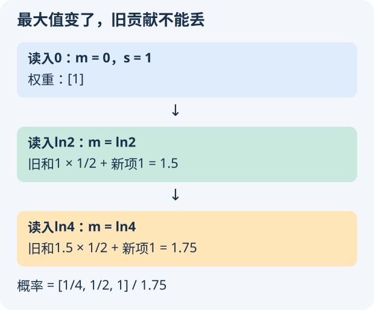

# 第 3 讲：从求和到稳定的 Softmax 与归一化

> **先修**：函数、循环、列表副本，以及 L1 的字节和请求流量；不需要 CUDA、PyTorch 或微积分。
> **安排**：分三次阅读和手算，每次约45分钟，再做 Lab1；以能解释新输入为准。
> **目标**：既能算出正确结果，也能解释计算顺序、稳定性和每一遍读取的用途。

## 0. 先知道这一章会用到什么

先在纸上求 `[2,-1,4]` 的和、`[3,4]` 的平方平均值。答案分别是5、12.5。若第二题误算为 `(3+4)/2`，先区别“先平方再平均”和“平均后平方”；这两种顺序通常不等价。

| 阅读 | 做什么 | 学完留下的证据 |
| :--- | :--- | :--- |
| 第1–2节 | Lab1 Q1；Project1 Q2 | 奇数长度的每轮归约表 |
| 第3–5节 | Lab1 Q2/Q3 | 一条online状态表与非均匀概率 |
| 第6–7节 | Lab1 Q4/Q5 | 均方、均值、方差的分步结果 |
| 第8节 | Lab1 Q6/Q7 | 明确是否含weight的读写账本 |
| 第9节 | Lab1全部与Quiz1相关题 | 一个自己设计的反例及其解释 |

所有命令在**课程根目录**运行：离线包解压后应直接看到 `course`；若从个人主页源码仓库开始，先 `cd _courses/deepinfer`。使用已安装的 `python` 或 `python3`，Windows也可用 `.\course\run.ps1 lab01 --question q1`。

本章用Python float算数，通常为64位；字节模型另假设设备张量为float32，每元素4B。它不是float32舍入模拟器。Lab1限定有限输入且平方、求和的中间值能表示；不要求你写任意大数库。

## 1. 求和：工作量与依赖链不是同一件事

串行求和要等上一步的累计值，才能做下一步。相邻树形归约则先把互不依赖的相邻项合并；奇数尾项暂时保留。对 `[1,2,3,4,5]`：

| 轮次 | 输入状态 | 本轮加法 | 输出状态 |
| ---: | :--- | :--- | :--- |
| 1 | 1,2,3,4,5 | 1+2，3+4 | 3,7,5 |
| 2 | 3,7,5 | 3+7 | 10,5 |
| 3 | 10,5 | 10+5 | 15 |

总共4次加法，而不是每轮都做5次。每做一次二元合并，值的数量减少1；从n个值变成1个，正好需要n−1次合并。最长依赖链却从串行n−1步变为树形 `ceil(log2(n))` 轮。n=5时是3轮。Python仍串行执行这些加法；树形列表只是表达将来可并行的依赖关系，不意味着本机已经并行加速。

实现前先处理空输入的契约：Lab1返回0.0。非空时复制输入，每轮创建新的列表。若边遍历旧列表边删项，会改变还没处理的索引；若直接覆盖输入，又违反保留输入的要求。这里的循环不变式是：**当前各部分和合起来，代表此前所有原始元素**。奇数尾项不可丢，也不能重复加入。

**暂停自测**：`[2,-1,4,3,-2,5,8]` 各轮是什么？第一轮有几次加法？

<details><summary>核对后再写Q1</summary>

第一轮 `[1,7,3,8]`，3次加法；第二轮 `[8,11]`，2次；第三轮 `[19]`，1次。合计6=n−1次。注意8是第一轮未配对尾项，不是额外补零得到的结果。

</details>

## 2. 为什么数学上相同，浮点结果不同

计算机只能保留有限位有效数字。非常大的数与小数相加时，小数可能被舍掉。Python中可以完整运行：

```python
values = [1e16, 1.0, -1e16, 1.0]
paired = (values[0] + values[1]) + (values[2] + values[3])
serial = 0.0
for value in values:
    serial += value
print(paired, serial)
```

输出通常为 `0.0 1.0`，精确实数和为2。树形和串行都可能损失信息，不能说“树形总比串行准”。本题测试树形顺序，是验证你实现了指定的并行结构；不是要把每个和变成最精确的和。实际设备若要求重复运行结果一致，还需固定归约次序、实现及配置；提高精度本身不能取代确定的执行规则。

多组求和也按同一账本：将5项分为 `[1,2,3]` 与 `[4,5]`，第一阶段各做2、1次加法，第二阶段再合并1次，共4次。不能先把第一阶段当作n−1，再额外加一次。若中间部分和写回显存，两遍模型要计读原始n项、写g个部分和、再读g项、写最终1项；float32共 `4*(n+2g+1)` B。

## 3. Softmax：先理解概率，再理解公式

假设三个候选有正权重 `[1,2,4]`。总权重为7，因此选择比例是 `[1/7,2/7,4/7]`。概率需要非负且和为1；除以同一个总和实现归一化。若给的是可能为负的分数（logits），直接除以分数总和不行，例如 `[-1,0,1]` 的总和为0。

softmax先用指数把有限分数变为正权重，再归一化：`exp(value)` 表示e的value次方，`exp(0)=1`，`exp(ln(2))=2`。本章只需要指数的乘法规则 `exp(a+b)=exp(a)*exp(b)`；不需要求导。

```text
logits:        [0, ln(2), ln(4)]
正权重exp:    [1, 2, 4]
权重总和:     7
概率:         [1/7, 2/7, 4/7]
```

这里“分数高”变为“权重大”，但不是最大项就一定概率1。所有分数相同，权重才相同；对n个相同分数得到1/n。输出长度仍为n，它没有把多个值归约成一个数，只有分母用到了归约。

## 4. 从溢出失败推导减最大值

直接计算 `math.exp(1000)` 在Python会抛 `OverflowError`。但 `[1000,1000]` 的概率明显应该各一半；错误在计算路径，不在数学答案。

对任意公共常数c，分子和分母都乘 `exp(-c)`，比值不变：

```text
exp(x_i-c) / sum(exp(x_j-c))
= exp(x_i)*exp(-c) / (exp(-c)*sum(exp(x_j)))
= exp(x_i) / sum(exp(x_j))
```

选c=max(x)，每个差值都不大于0，最大项的指数恰好为1，避免大的正指数溢出。对 `[1000,1000+ln2,1000+ln4]`，减最大值后为 `[-ln4,-ln2,0]`，权重为 `[1/4,1/2,1]`，总和7/4，仍得到 `[1/7,2/7,4/7]`。小概率可能下溢成0，这与整个分母溢出不是同一种问题。

可直接运行的最小稳定版本如下。此例先讲算法，Lab1的Q3随后改为复用Q2的online状态：

```python
import math

def stable_probabilities(values):
    if not values:
        return []
    maximum = max(values)
    weights = [math.exp(value - maximum) for value in values]
    normalizer = sum(weights)
    return [weight / normalizer for weight in weights]

print(stable_probabilities([1000.0, 1000.0]))
print(stable_probabilities([0.0, math.log(2), math.log(4)]))
```

分别得到 `[0.5,0.5]` 和约 `[0.142857,0.285714,0.571429]`。这个示例接受有限列表、保留输入；空输入返回新空列表。Lab2会另行定义包含−inf mask的输入域，不要把这里的简例直接当通用NaN/Inf处理器。

**自测**：概率和为1足以证明正确吗？若函数总返回 `[1/n]*n`，哪种输入会揭穿它？

<details><summary>核对</summary>

不够。`[0,ln2]` 应为 `[1/3,2/3]`；均匀输出仍然和为1但比例错。还应检查长度、有限性、非负、具体非均匀结果和整体平移不变。

</details>

## 5. 一遍求状态：最大值变了，旧和如何留下

如果先完整扫描一次求max，再扫描一次求指数和，最后扫描输出，是三次读取x。能不能边读边维护最大值与指数和？困难是读到更大的数后，旧权重的基准改变了。

定义处理前k项后的状态：`m_k=max(前k项)`，`s_k=sum(exp(x_j-m_k))`。s不是概率，也不是原始 `sum(exp(x_j))`；它是**相对于当前最大值的指数和**。

新值v到来，令 `m_new=max(m_old,v)`。旧的每一项可拆成：

```text
exp(x_j-m_new)
= exp(x_j-m_old) * exp(m_old-m_new)
```

所有旧项共享同一个缩放因子，因此不用逐项重算：

```text
s_new = s_old * exp(m_old-m_new) + exp(v-m_new)
```



| 读入v | 旧m、旧s | 新m | 旧和换基准 | 新项贡献 | 新s |
| :--- | :--- | :--- | :--- | :--- | :--- |
| 0 | −inf，0 | 0 | 0 | 1 | 1 |
| ln2 | 0，1 | ln2 | 1×1/2 | 1 | 1.5 |
| ln4 | ln2，1.5 | ln4 | 1.5×1/2 | 1 | 1.75 |

最初空状态为 `(−inf,0)`，读入有限首项时 `exp(−inf)=0`。若新值不超过旧最大值，缩放因子为1；比如随后加入0，新s就是1.75+1/4=2，m不变。

赋值顺序非常重要。先把旧m覆盖成新m，再计算 `exp(m-m_new)`，会把缩放因子错误变成1。Lab1 Q2要返回最终状态，Q3再读取x、按 `exp(x_i-m)/s` 生成概率。因此online状态一遍可求，**完整概率输出仍需要第二遍或保存足够输入**。

这是[Online normalizer论文](https://arxiv.org/abs/1805.02867)讨论的归一化状态思路；本章用短序列独立展开其代数，而不把论文硬件加速数值当作课程Python性能。

**独立迁移**：对 `[ln4,0,ln2]` 填状态表。最终概率要按输入顺序返回；别为了找max排序输入。

<details><summary>核对</summary>

m始终为ln4；s依次为1、1.25、1.75。最终概率为 `[4/7,1/7,2/7]`。同一组值换顺序可有不同中间状态，最终数学比例相同。

</details>

## 6. RMSNorm：平方、平均、开根、缩放

现在的目标不是把数变成概率，而是控制一行数值的整体尺度。RMS表示root mean square，按名字从后往前执行：平方→平均→开平方。

```text
mean_sq = sum(x_i*x_i) / n
denominator = sqrt(mean_sq + eps)
output_i = x_i / denominator * weight_i
```

对x=`[3,4]`、weight=`[1,2]`、eps=0.5，平方为 `[9,16]`，均方12.5，分母sqrt13，输出 `[3/sqrt13,8/sqrt13]`，约 `[0.83205,2.21880]`。weight逐元素乘，不能把权重总和当公共因子。RMSNorm的这一思路来自[RMSNorm原论文](https://arxiv.org/abs/1910.07467)。

eps放在根号内，且Lab1要求有限正数。全零输入时分母是sqrt(eps)，输出仍全零，避免0/0。两列表都空时返回[]，但eps和长度验证仍要先做。这里先检查再计算，不让空输入绕过非法参数检查。

当eps=0且缩放系数a>0时，分母也乘a，因此归一化部分比例不变。固定eps>0时，`sqrt(a²*mean_sq+eps)` 一般不等于 `a*sqrt(mean_sq+eps)`，只能近似缩放不变。整体加一个常数则更没有这种性质；不要把“缩放”与“平移”混为一谈。

## 7. LayerNorm：先减均值，再看偏差大小

LayerNorm先把中心移到0，再用偏差的均方缩放，最后逐元素乘weight并加bias：

```text
mean = sum(x)/n
variance = sum((x_i-mean)**2)/n
output_i = (x_i-mean)/sqrt(variance+eps)*weight_i+bias_i
```

对x=`[1,2,3]`、weight全1、bias全0：均值2，偏差 `[-1,0,1]`，平方 `[1,0,1]`，总体方差2/3。这里除以n，不是统计样本方差的n−1。令eps=1/3，分母就是1，输出 `[-1,0,1]`。把输入整体加10，均值也加10，偏差不变，因此本例输出不变。

| 操作 | RMSNorm | LayerNorm |
| :--- | :--- | :--- |
| 是否先减均值 | 否 | 是 |
| 根号内的量 | 原值的均方+eps | 偏差的均方+eps |
| 本Lab仿射参数 | weight | weight与bias |
| 常量输入 `[5,5]` | 通常非零 | 归一化部分为0，最终等于bias |

Lab1 Q5是独立迁移，不要仅给RMSNorm加一个bias就当LayerNorm。常量输入、非均匀weight、非零bias分别检查不同步骤。浮点实现还应避免把方差机械改成 `mean(x²)-mean(x)²`：两项很大但差很小时可能发生消减；本入门接口先按偏差平方计算，稳定单遍方差留待Welford等扩展。

## 8. 给每一次读写记账，而不是背“几pass”

float32的一行有n个元素。这里数x/y的请求，不计缓存命中、Python对象、exp时间或归约临时空间：

| softmax方案 | 每遍读取的工作 | x读几次 | y写几次 | 字节 |
| :--- | :--- | ---: | ---: | ---: |
| 三遍 | 求max；求分母；生成输出 | 3 | 1 | 16n |
| 两遍 | online求m/s；生成输出 | 2 | 1 | 12n |
| 输入驻留片上 | 一次搬入后在片上反复使用 | 1 | 1 | 8n |

所谓一遍不表示只进行一次数学操作，而是不再从所计内存层重读x；整行必须能驻留。n=4096时，三种分别为65536、49152、32768B。若只假设带宽2×10¹²B/s，两遍比三遍少16384B，对应带宽时间下界差8.192ns；启动、exp、归约等未计，不能承诺真实节省8.192ns。

Lab1 Q7的RMSNorm只计activation：驻留时读x写y为8n，需重读x时为12n。若weight也从该层读一次，两者都另加4n。例n=4，驻留时activation32B，含weight48B。所有数字都对，但必须写明口径；不能让含weight的实现与不含weight的模型直接比“多出50%”。

## 9. 从讲义过渡到自己的实现

### 9.1 三类测试，各自排除一种错误

数值函数不能只问“有没有异常”。第一层检查结构：长度是否一致、输出是不是新列表、输入有没有被修改。第二层检查已知答案：零logits得到均匀概率，`[0,ln2]`得到非均匀比例，常量LayerNorm得到bias。第三层检查性质：softmax整体平移不变、每个前缀的online状态符合定义。这些层次互补；例如返回正确shape的全零数组能过结构检查，却不能过概率检查。

浮点数通常按容差比较，而不是逐位相等。绝对误差看数值差本身，相对误差看差占参考量级的比例；接近零时相对误差单独使用不可靠。先检查值有限，再比较差；NaN会让简单的“大于容差”判断失去预期含义。容差要与数据类型、量级和算法相配，不是所有题都随意填1e−5。预备3练过的比较辅助函数只接受它声明的输入域，不能把简化工具当通用数值验证库。

例如两个合法概率分别是1/7与1/7附近一个极小舍入差，允许小误差合理；若一项变成1/3，就不能为了测试通过把容差扩大到0.2。先找第一个错误中间量：最大值是否对、旧s是否缩放、分母是否统一、是否对每项生成输出。逐步定位比换一种指数函数或重写所有循环更有效。

### 9.2 合并算子也需要一本读写账

未来可能先做residual add，再做RMSNorm。分开时，中间和写到所计内存层又被norm读回；融合可以在局部保留它，省掉这一次写和一次读。但如果调用者仍需要原始residual结果，或者权重和输出类型不同，账本必须增加对应项。不能只因函数名带fused就自动扣去固定字节。先画数据的产生者、消费者与保留位置，再讨论是否真的省了搬运。

先做Q1树归约，再Q2状态、Q3输出；然后Q4/Q5；最后Q6/Q7。每题只读对应契约与提示，不先复制答案。Lab的非空有限输入约定和显式异常要求优先于讲义示例的简化函数。

```bash
python course/tools/grade.py lab01 --question q2 --unlock
python course/tools/grade.py lab01 --question q2 --failfast
python course/tools/grade.py lab01 --question q2 --hint 1
python course/tools/grade.py lab01
```

完成后关掉答案解释：①奇数尾项为什么保留；②m变大时旧s为什么缩小；③softmax概率与RMSNorm结果为什么不是同一种归一化；④eps放在根号外为什么改变函数；⑤一次读取省了哪些字节，不能推出哪些时延。

综合自测：给 `[0,ln2,ln4]` 全部加1000，概率应不变；RMSNorm对相同平移却一般改变。对 `[7,7,7]` 做LayerNorm，最终结果应等于bias。给一个代码返回均匀概率、一个方差错除n−1、一个online先覆盖m的实现，各构造一条最短失败输入。留下“输入—期望—第一个错误状态—修复”的记录。

## 10. 后置硬件阅读：保留边界，不抢跑

本章核心不需要CUDA。完成C++桥接后再研究warp shuffle、block归约、多block部分和、融合residual+norm。理解映射时先问：谁计算局部值、谁持有最终值、哪些线程需要结果、在哪里同步？满warp的shuffle规约通常5轮；只在lane0持有正确结果的辅助函数不能未经广播就用于全block softmax。

跨block两遍方案多出部分和写读；atomic方案可能引入冲突与不确定的浮点相加顺序。低算术强度常提示大规模归约可能受带宽限制，但小任务、exp吞吐、并行度和启动开销仍可能主导；不要把“Reduction一定memory-bound”当脱离条件的结论。

后续Attention会复用本章状态：m仍是当前最大分数，s仍是相对m的指数和；再添加一个未归一化的加权值和o，最终输出为o/s。此时不要求实现o，也不要把s称为最终概率。先确保能独立解释本章两个状态，L5/L6再增加新的累加器。

接下来读 [L4 矩阵乘与tiling](lec04.md)，将Project1 Phase1已有算子组合起来。HW1的KV/量化依赖L7/L8，**此时不要求提前做**；后续 [L5](lec05.md) 会把本章概率加权与矩阵乘连接成Attention。
