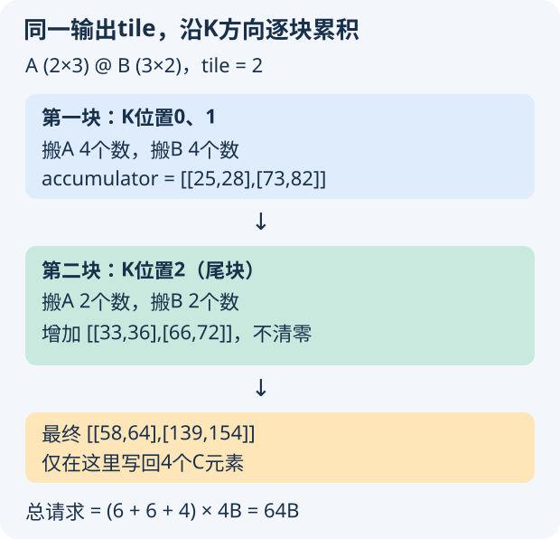

# 第 4 讲：从一个点积到可验证的 Tiled GEMM

> **先修**：预备2的矩阵乘、L1的请求字节、L3的归约与浮点比较；不要求GPU。
> **安排**：分三次完成手算与小程序，再做Project1 Phase2；不要在Python跑8192维矩阵验证公式。
> **主问题**：不改变矩阵乘的数学结果，怎样减少跨“全局内存”边界的重复读取？

## 0. 入口检查与学习地图

先不看代码：`(2,3)@(3,4)` 的结果shape是什么？输出 `[1][2]` 应用A哪一行、B哪一列？答案是 `(2,4)`，用A第1行和B第2列相乘相加，索引从0开始。若还不能手算一格，回 [预备2](../prep/02-matrix.md)，不要同时调试矩阵规则和分块规则。

| 本章部分 | 对应实现 | 完成证据 |
| :--- | :--- | :--- |
| 第1–2节 | Project1 Q5朴素矩阵乘 | 每格独立累计、矩形shape |
| 第3–4节 | 先手算，不写完整引擎 | 同一输出块跨两个归约块的状态 |
| 第5–6节 | Q7请求模型 | 有效尾块、整数向上取整 |
| 第7节 | Q9显式搬运，再Q6包装 | 读取计数与参与乘法的数据一致 |
| 第8–9节 | Q8模型与实验报告 | 不把Python耗时当GPU时延 |
| 第10节 | 硬件扩展选读 | 能区分算法复用与CUDA实现 |

Project1题号保留兼容，推荐顺序为 **Q1–Q5 → Q7 → Q9 → Q6 → Q8**，不是按编号逐项往下做。所有命令在含 `course` 的课程根目录运行；个人主页源仓库先 `cd _courses/deepinfer`，离线包直接进入解压根。

## 1. 一格输出就是一个点积

本章研究 `C=A@B`，不读旧C、不加bias。GEMM通常还可表达alpha/beta等参数，但课程接口先限定这个简单问题。设A为M×K、B为K×N：

```text
C[row,col] = sum(A[row,inner] * B[inner,col] for inner in 0..K-1)
```

M是输出行数，N是输出列数，K是每格需要累积的长度；三者可以完全不同。用下面一组数贯穿本章：

```text
A = [[1,2,3],      B = [[ 7, 8],
     [4,5,6]]           [ 9,10],
                        [11,12]]
```

C[0,0]=1×7+2×9+3×11=58；C[0,1]=1×8+2×10+3×12=64；C[1,0]=4×7+5×9+6×11=139；C[1,1]=4×8+5×10+6×12=154。

每开始一格必须将accumulator清零，做完K次贡献再写出。放到inner循环内清零只保留最后一项；放到整个矩阵外清零则把不同格子的值混起来。输出各行必须独立，不能用 `[[0]*N]*M` 共享同一行列表。

本课程性能模型按一次乘加为2 FLOPs，因此 `F=2*M*N*K`，例子为24。若精确数数学点积会有K次乘法和K−1次必要加法；性能表采用“每轮乘加2次”的统一约定，不能在不同算法比较时偷偷更换。模型忽略索引、循环、校验和内存计数器开销。

## 2. 数学一样，读法可以不同

朴素三层循环计算每个C格时，重新读A的一整行、B的一整列。例子的4个输出格，每格读3个A和3个B，共24次输入标量读取；最后写4次C，float32请求量 `(24+4)*4=112B`。

但A只有6个数、B只有6个数、C只有4个数，容量合计仅64B。为什么请求量能大于容量？因为A[0,0]在算C[0,0]和C[0,1]时分别被读了一次；同一值可以被反复访问。容量数“要容纳几份数据”，流量数“跨边界发生了几次搬运”。

| 口径 | 本例元素次数 | 本例float32字节 |
| :--- | ---: | ---: |
| A/B/C容量合计 | 6+6+4=16 | 64 |
| A/B各读一次、C写一次的理想下界 | 16 | 64 |
| 朴素请求 | 2×2×2×3+2×2=28 | 112 |

两个64数值相等，但概念不相同。容量是静态空间，第二行还假设数据复用足够好。设备有缓存时，请求不一定都到HBM；Python计数器也不是测DRAM字节的仪器。接下来的优化目标先限定为课程的显式load/store请求。

## 3. 一个输出tile：先一起搬，再反复用

tile就是一个小矩形块，不是新运算。先把本例整个2×2输出当一个tile。对K维按2分块，第一块inner=0,1，第二块inner=2。输出块始终是同一个，只是累积的K区间向前移动。



第一轮将A的 `[[1,2],[4,5]]` 与B的 `[[7,8],[9,10]]` 搬入局部列表。A[0,0]=1可同时用于本地C[0,0]和C[0,1]；B[0,0]=7可用于本地C[0,0]和C[1,0]。这才是复用：**搬入一次，局部乘法用多次**，不是仅把循环头改名成tile。

```text
初始 accumulator = [[0,0],[0,0]]
第一轮增加        = [[25,28],[73,82]]
第一轮结束        = [[25,28],[73,82]]
第二轮增加        = [[33,36],[66,72]]
第二轮结束        = [[58,64],[139,154]]
```

第二轮搬A的 `[[3],[6]]`、B的 `[[11,12]]`，只是深度1的尾块。第一轮搬4+4个数，第二轮搬2+2个数，共12次输入读取，最终写4个数，64B。相对朴素112B减少了输入重复读取，乘法数量没有变。

下面是可以直接运行的**固定2×3乘3×2演示**，只展示一个输出tile，不是Q9完整答案，也没有计数器：

```python
left = [[1, 2, 3], [4, 5, 6]]
right = [[7, 8], [9, 10], [11, 12]]
accumulator = [[0, 0], [0, 0]]
for inner_start in range(0, 3, 2):
    depth = min(2, 3 - inner_start)
    left_tile = [row[inner_start:inner_start + depth] for row in left]
    right_tile = [row[:] for row in right[inner_start:inner_start + depth]]
    for row in range(2):
        for col in range(2):
            for inner in range(depth):
                accumulator[row][col] += left_tile[row][inner] * right_tile[inner][col]
    print(inner_start, accumulator)
```

两行分别输出0与第一轮矩阵、2与最终矩阵。注意accumulator在 `inner_start` 循环之前创建。循环不变式是：进入下一轮时，accumulator已经包含所有更早K区间对当前输出块的贡献。

**暂停自测**：如果每个K块开始都清零，会留下哪一张矩阵？如果每轮都写回C，数值也许正确，但违反哪项计数契约？

<details><summary>核对</summary>

清零后只留下 `[[33,36],[66,72]]`。每轮写回会写8次而非4次；本项目要求所有K块完成后每个有效C元素只写一次。若还从全局读旧C累计，又引入模型没有的读取。

</details>

## 4. 从一块扩大到整张矩阵

大矩阵需要多个输出行块、列块。外层先选输出块的起点 `(row_start,col_start)`，内层沿K扫。对每个输出块，重新创建独立accumulator；A tile大小为rows×depth，B tile大小为depth×cols，局部输出为rows×cols。

```text
选择输出行块
  选择输出列块
    accumulator清零一次
    逐个K块：搬A块、搬B块、用局部数据累计
    把这个输出块写回一次
```

例如M=3、N=4、K=5、tile=2，有2个行块、2个列块、3个K块。最后一个输出行块只有1行，最后一个K块只有1项。每个范围都独立取剩余长度：`rows=min(tile,M-row_start)`，`cols=min(tile,N-col_start)`，`depth=min(tile,K-inner_start)`。不能用rows代替depth，也不能因某一轴整除就省掉另两轴的边界。

这里局部索引和全局索引是两套坐标。局部A[row,inner]对应全局A[row_start+row,inner_start+inner]；局部B[inner,col]对应全局B[inner_start+inner,col_start+col]。画出一格的两个坐标，比一次打印整个矩阵更容易定位尾块错误。

## 5. 为什么读取量会减少：推导而非背公式

先看方阵n×n，令q=ceil(n/tile)为每个方向的输出块数。A中的任意一个元素属于某个行和K位置；每个输出**列块**都需要它，因此总共读取q次。B中的任意一个元素被每个输出**行块**使用一次，也是q次。C不管怎么分块都只有n²个最终元素。

```text
naive_elements = 2*n³ + n²
tiled_elements = 2*n²*q + n²
q = (n+tile-1)//tile
bytes = elements * dtype_bytes
```

这里假设不同输出tile之间不共享缓存、尾块只搬有效元素、局部列表访问不计全局请求。可整除时q=n/tile，才得到输入读量约为朴素的1/tile；总请求还包含不能省掉的C写回，因此连整除情形的总字节比也不严格等于tile。

完整核对n=3、tile=2：输出块有2行×2列，各A元素读2次，共18；B同样18；C写9，共45元素=180B。朴素为54读+9写=63元素=252B。若把ceil错误换成1.5，会得到36元素=144B，虚构了半个输出块。

| n=3 | tile=1 | tile=2 | tile=16 |
| :--- | ---: | ---: | ---: |
| 输出行/列块数q | 3 | 2 | 1 |
| A读取 | 27 | 18 | 9 |
| B读取 | 27 | 18 | 9 |
| C写入 | 9 | 9 | 9 |
| 总字节 | 252 | 180 | 108 |

tile大于n后只剩一个输出块，不能继续无限降低请求。108B恰好是A/B各读一次、C写一次的下界。对n=0，纯模型函数返回零；但实际矩阵接口拒绝空矩阵，这不是冲突：模型允许零工作，嵌套空列表不能表达通用二维shape。

## 6. 矩形推导：不要把三条轴都写成n

矩形M×K乘K×N时，A每个元素重复ceil(N/tile)次，B重复ceil(M/tile)次：

```text
A_reads = M*K*ceil(N/tile)
B_reads = K*N*ceil(M/tile)
C_writes = M*N
```

M=3、K=5、N=4、tile=2时：A读3×5×2=30，B读5×4×2=40，C写12，共82元素=328B；朴素共 `(2*3*4*5+3*4)*4=528B`。K维的三块只是把相同K区间分段扫完，不额外乘三。若再乘ceil(K/tile)，就把已经含K的读取重复计算。

**渐进自测**：①本例tile=1的计数是否回到朴素？②tile=8能到多少B？③只交换M/N，不交换A/B大小，能否直接复用读取计数？

<details><summary>核对</summary>

①A60+B60+C12=132元素，即528B。②A15+B20+C12=47元素，即188B。③不能机械复制A/B各自计数；每个矩阵元素数和对应复用方向都要重新定义。总公式在同步转置整个问题时有对称性，单个读取项的含义没有消失。

</details>

## 7. 接上Project1：让证据来自真实读写

### 7.1 一个输入契约，不是猜shape的技巧

Project1的矩阵要求至少一行一列、每行等长、内维匹配，元素为有限数且中间值可表示。空矩阵、锯齿矩阵和不匹配内维应按契约抛ValueError；tile与dtype字节数按题目要求是正整数，不能让True作为整数1混进来。Lab2另有空列表返回约定，不表示一个接口可以任意套另一个接口的错误处理。

先完成验证，再创建内存对象或进入循环。若只看第一行长度，而第二行短一项，错误可能很晚才表现为IndexError；那时你容易误以为是尾块逻辑坏了。把结构问题挡在入口，才能让内部每次load的含义明确。验证不应该修改矩阵；将输入直接转置或原地补零，会把布局方便建立在破坏调用者数据之上。

### 7.2 数值和计数要相互独立地核对

固定的一个样例只能证明一个输入。自己的第二组例子应包含负数、非方阵，以及M/K/N中至少一个尾块；再把tile改成1和大于全部维度。tile=1检查是否退化成每格读取；大tile检查是否到达读一次下界；中间大小检查取整。输出接近参考值但计数比公式高，可能是局部值未复用；计数恰好相同但输出错，则可能是搬了正确数量的错误位置。

最强的解释不是“统计字段等于公式”，而是能指出某个A值在哪里被load、放进哪个局部格、供哪些乘法消费。比如第一块的A[0,0]=1参与两个输出列，使用时不再load；换到下一个输出列块，按本模型才需重新load它。这样你能从程序结构预测统计，也能从统计反查结构，而不是让两者共享同一个可能错误的计算公式。

Q7实现方阵公式。随后Q9用提供的 `MatrixMemory`，只通过 `load_a/load_b` 将数搬到局部tile，再真正用这些数计算；全部K块完成后用 `store_c` 写回，最后返回output和stats。构造前可以验证shape，构造后不能绕过内存对象直接读a/b元素。

“先调用load做计数、但乘法仍直接读a/b”不是实现复用，只是造了好看的统计。测试会替换load的返回行为，检查被搬入的数是否参与计算。反之，计数正确也不足以保证数值正确：例如把B的局部行列弄反，读取次数可能完全一样。因此数值oracle与访问账本是两条独立证据。

Q9通过后，Q6只调用Q9并取矩阵结果。这样对外接口、测试与实验使用同一个引擎，不会出现“测试一个实现，实验另一个实现”。

```bash
python course/tools/grade.py project1 --question q7
python course/tools/grade.py project1 --question q9 --failfast
python course/tools/grade.py project1 --question q6
```

排错时按第一个错误阶段定位：shape先错查契约；首个K块正确、第二块错查累加器生命周期；只在尾块错查三条边界；数值对但计数高查是否重复load或中途store。不要先改公式配合错误计数器输出。

## 8. Roofline：请求减少，不等于时间同比减少

算术强度AI是FLOPs除以选择的字节模型，不是shape自带的固定常数。方阵float32的理想读一次流量为12n²，按2n³ FLOPs得到AI=n/6；tiled实现若有跨块重读，AI更低。设备缓存可能又改变实际HBM口径。

给定带宽BW、匹配计算精度和单元的峰值P：

```text
memory_seconds = bytes/BW
compute_seconds = FLOPs/P
lower_bound = max(memory_seconds,compute_seconds)
ridge = P/BW
```

例如虚构加速器P=100TFLOP/s、BW=1000GB/s，拐点为100FLOP/B。某算法100GFLOP、2GB，AI=50，搬运下界2ms、计算下界1ms，总下界2ms。把字节减到0.5GB后，搬运只需0.5ms，但计算仍需1ms，总下界1ms，只改善2倍，不是4倍。

这还只是下界。小shape可能根本不能充分利用硬件，启动、同步、局部内存容量和额外计算都会影响时间。不能拿FP32标量峰值判断BF16 Tensor Core kernel，也不能把Python wall time除以GPU下界声称“设备利用率”。Project1 Q8相等时返回memory是接口标签；物理上两条约束同时活跃。

## 9. 一个可独立完成的实验闭环

先只测小shape，完整测试后运行项目固定协议：

```bash
python course/projects/project1/experiment.py --sizes 3 8 17 --tiles 1 2 8 16 --seed 61 --warmups 2 --repeats 7 --output course/projects/project1/experiment.csv
```

先预测，再看CSV。n=3、tile=16的请求应到下界；n=17、tile=8会有尾块。若tile变大后Python反而更慢，保留结果：Python列表分配、循环、计数器方法调用都在计时范围内，请求减少不能消除这些成本。7次重复的最近秩p90是最大样本，不足以代表稳定的尾延迟分布。

报告至少对照一行数字与手算：写出A_reads、B_reads、C_writes、字节、FLOPs、AI、两个下界，再分别说明“实际测了什么”和“尚未测什么”。不运行1024/4096/8192的大Python乘法；这些尺寸只计算模型表即可。

**出口迁移题**：给A=`[[2,-1,3]]`、B=`[[4,0],[5,2],[-1,1]]`，tile=2，手算每个K块的贡献、最终值及请求量，再用自己的Q9核对。

<details><summary>核对</summary>

第一块贡献 `[3,-2]`，尾块贡献 `[-3,3]`，最终 `[[0,1]]`。一个输出块，A读3、B读6、C写2，共11元素=44B。原始A/B保持不变；中间贡献不是两个独立输出，不能直接拼接。

</details>

## 10. 后置硬件桥接：同一个思想，不同的约束

真实GEMM常把全局数据搬到shared memory，再利用寄存器中的局部累加器；block、warp、thread可各负责不同层级tile。Tensor Core执行小块矩阵乘加，但操作数分散在指定寄存器布局里，不等于把Python列表交给一条指令。分块复用与硬件映射是两个学习阶段。[NVIDIA CUTLASS的GEMM说明](https://docs.nvidia.com/cutlass/latest/media/docs/cpp/efficient_gemm.html)给出了这种层级组织的官方解释。

移植时要重新检查：尾块load填零但不能提前退出而跳过barrier；消费shared tile之前等待写入完成；覆盖shared缓冲之前等待所有消费者完成。增大tile虽改善复用，也增加shared/寄存器用量，可能降低并发。双缓冲尝试重叠搬运与计算，但不是免费省掉等待；矩阵规模、资源约束与测量共同决定选择。

完成本章应能不看公式解释一次复用和一次尾块，而不是背“tile越大越好”。继续做 [Project1](../projects/project1/README.md) 的对应checkpoint，再读 [L5 Attention](lec05.md)。硬件Tensor Core、TileLang、split-K等扩展留在后置路线，不影响当前纯Python验收。
