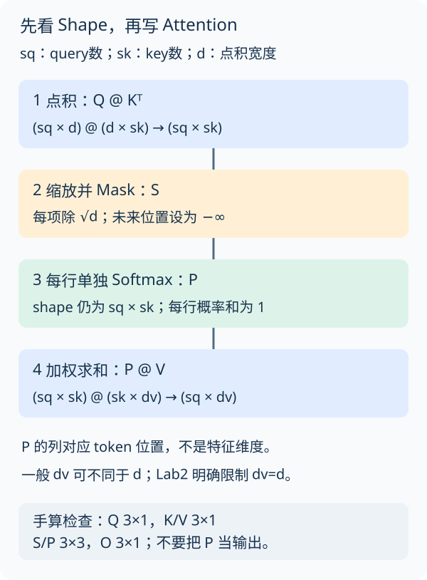
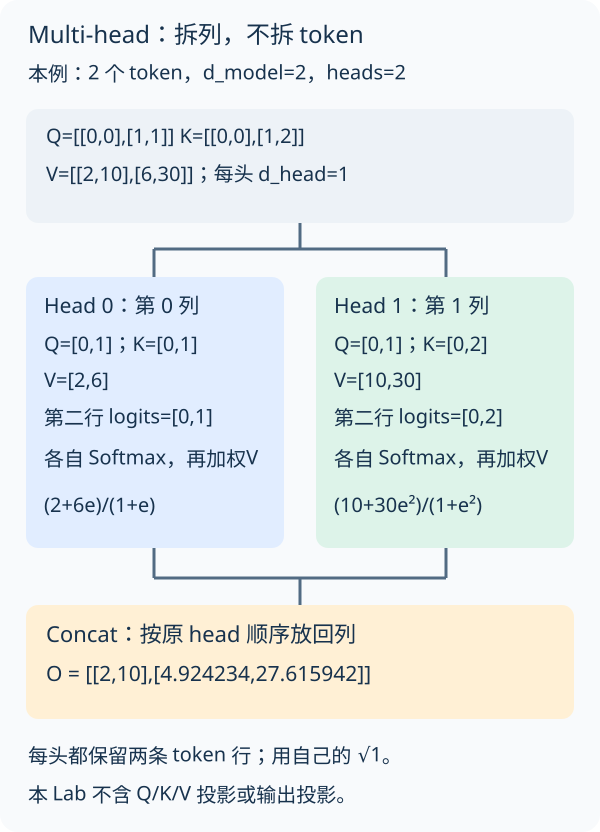

# 第 5 讲：从零实现 Attention，先让每个数字有来路

先修：预备矩阵练习、[L3 的稳定 softmax](lec03.md) 与 Lab1。建议分两次学习，每次 60–90 分钟。先做 [Lab2 Q1–Q6](../labs/lab02/README.md)，再读成本部分与 [L6](lec06.md)；先完成 L7、L8，再统一做完整 HW1/HW2。本讲不要求 PyTorch、CUDA 或 GPU。

学习目标不是背下 `softmax(QKᵀ/√d)V`，而是能用一张纸算出 S、mask 后的 S、P 和 O；解释为什么某个概率必须为零；把多个 head 正确拆开再拼回去。最后再问：这些正确运算花了多少工作、搬了多少数据？

## 1. 先把“关注”翻译成矩阵

一条 query 想从若干位置的信息中取一个加权平均。K 为每个可查看位置提供用于打分的向量，V 为该位置提供真正要汇总的内容；Q 与 K 点积决定权重，V 决定最后加权的数值。K 和 V 属于相同位置，所以它们的行数必须相同；Q 的行数则是“有几条查询”。

一般单头形式为 Q:(sq,d)、K:(sk,d)、V:(sk,dv)。分数 S=`QKᵀ/√d` 是 `(sq,sk)`；逐行归一化得到同 shape 的 P；O=`PV` 是 `(sq,dv)`。P 的每行是在 sk 个位置上的概率，**不是 d 个特征上的概率**。本 Lab 为聚焦基本循环，进一步规定 dv=d；一般 attention 并不要求 dv 必然等于 d。



读图时用手遮住输出 shape，独立做两次矩阵乘的内维检查。`Q(sq,d) @ Kᵀ(d,sk)` 消去 d；`P(sq,sk) @ V(sk,dv)` 消去 sk。写成 `Q@K`，可能在偶然的方形例子里不报 shape 错，却已经改变了数学含义。

在代码之前先写一个小点积：

```python
def dot_product(left, right):
    if len(left) != len(right):
        raise ValueError("dimensions must match")
    return sum(left_value * right_value for left_value, right_value in zip(left, right))

assert dot_product([1, 2], [3, 4]) == 11
```

这个片段假定列表元素合法，只说明“一格分数”的来源。给输出的每一行、每一列重复这一过程，就是 Lab2 Q1；把 K 的行变成列，是 Q2。先做好这两件小事，比直接调试四层 attention 嵌套循环更容易定位错误。

## 2. 为什么要除以根号 d

在一个用于解释尺度的简化假设下，各分量独立、均值 0、方差 1，q 与 k 也独立。单项 q_r k_r 的均值为 0，方差为1；d个独立项相加，点积方差变成 d，标准差变成 √d。除以 √d 后方差回到1附近，而不是除以 d 把标准差压成1/√d。

这里的独立假设是解释，不是宣称训练后所有 Q/K 都严格服从标准正态分布。一个直接数值检查是 q=[1,2]、k=[3,4]：点积11，d=2，缩放分数为11/√2≈7.778，不是11/2。head_dim改变时要改变缩放，不能因为最终模型宽度为4096就让每个小head都除√4096。

大分数差会使 softmax 更尖锐；但减最大值与除√d解决的不是同一问题。前者是**保持同一个概率分布的数值稳定变换**；后者通常会改变概率分布，是 attention 定义的一部分。不能因为做了稳定 softmax 就省掉缩放。公式与多头结构来自 [Attention Is All You Need](https://arxiv.org/abs/1706.03762)。

## 3. 案例一：非零、非均匀的完整 Q/K/S/P/V/O

取 d=1，三个 query 和三个 key；V也只有一列。使用自然对数，可以让指数权重成为易手算的2、4、8，而不是一串难记的小数。

```text
Q = [[1], [2], [1]]
K = [[ln(2)], [ln(4)], [ln(8)]]
V = [[2], [6], [10]]
```

第一步：乘出完整分数，因√1=1，不需要再改数值：

```text
S = [[ln(2), ln(4),  ln(8)],
     [ln(4), ln(16), ln(64)],
     [ln(2), ln(4),  ln(8)]]
```

注意第二行 Q=2，使每个 logit 翻倍，`2ln(4)=ln(16)`，不是把 softmax 概率直接乘2。第二步：同起点 causal 自注意力只允许第i行看0到i列，得到：

```text
masked_S = [[ln(2), -inf,   -inf],
            [ln(4), ln(16), -inf],
            [ln(2), ln(4),  ln(8)]]
```

第三步：逐行做稳定 softmax。第一行只有一个允许位置，概率必为1。第二行减去ln16，指数为[1/4,1,0]，和为5/4，归一化成[1/5,4/5,0]。第三行减ln8，指数为[1/4,1/2,1]，和7/4，得到[1/7,2/7,4/7]。

```text
P = [[1,   0,   0],
     [1/5, 4/5, 0],
     [1/7, 2/7, 4/7]]
```

第四步：每个概率乘对应位置的V，再把位置贡献相加。O0=1×2=2；O1=(1×2+4×6)/5=26/5=5.2；O2=(1×2+2×6+4×10)/7=54/7≈7.714286。输出仍然是三行一列，不是一行三个位置权重。

检查点有四个：S/P为3×3、O为3×1；每行P和为1；未来位置概率为0；O每行落在可见V的最小与最大值之间。最后一条来自非负且和为1的权重，是发现求和或分母错误的便宜检查，但单靠它不能证明正确。

## 4. 案例二：先 softmax 后清零，为什么不等价

仍看上例第二行。如果先对完整 `[ln4,ln16,ln64]` 归一化，权重为 `[1/21,4/21,16/21]`。随后把未来的第三项清零，变成 `[1/21,4/21,0]`，行和仅5/21；输出为26/21≈1.238，甚至小于可见V最小值2。正确值是26/5。

原因不是“未来值参与了最后的加权”那么简单：即使把未来的V贡献删掉，**未来logit仍留在归一化分母里**。正确做法是先排除其分数，再对允许集合归一化。若在概率清零后重新归一化，数学上可以恢复本例，但这增加无必要工作，而且极端分数下先前下溢的信息未必能恢复；本课要求直接 mask 后 stable softmax。

现在只把V最后一行从10改成100。正确causal输出的前两行应完全不变，最后一行变成 `(2+12+400)/7=414/7`。这是“未来值不影响过去”的变形测试。只检查输出shape，或者只用所有V相同的数据，通常抓不到这类错误。

同起点方形causal包含对角线，因此每行至少能看自己；若以后叠加padding使某行全部为−inf，则没有合法归一化分母，Lab2 Q3明确报错。矩形decode还要处理绝对位置：已有past=4、sq=1、sk=5时，当前query可以看全部5个key，不能套用局部j>0只留下第一列。Lab2只接受方形causal；矩形只在noncausal中合法，不暗中猜对齐方式。

## 5. 从单头到多头：先拆列，再各自计算，最后按列拼回

真实模型通常先做学习到的Q/K/V投影，再把最后一维拆成多个head。Lab2 Q6只练拆分、单头attention和拼接，不含Wq/Wk/Wv/Wo。给定num_heads=h，必须有d_model能够整除h，d_head=d_model/h。

一行 `[a,b,c,d]` 拆成两个head，应该是 `[a,b]` 与 `[c,d]`，不是 `[a,c]` 与 `[b,d]`。每个head都看到同一套token位置，但在不同特征子空间里打分；每个head单独softmax，并用自己的√d_head。拼接只恢复列布局，不再对head概率归一化。



读图先沿head0计算，再沿head1计算。两个head的token行不能串到一起。最后一格是列拼接，不是把两个标量相加或平均。

### 案例三：两个不同的head，抓住“看起来shape正确”的错误

Q=`[[0,0],[1,1]]`，K=`[[0,0],[1,2]]`，V=`[[2,10],[6,30]]`，heads=2，所以每头d=1。head0取各行第0列，第二行可见分数[0,1]，输出 `(2+6e)/(1+e)≈4.924234`；head1取第1列，分数[0,2]，输出 `(10+30e²)/(1+e²)≈27.615942`。第一行只能看自己，所以两个head输出2、10。

最终输出为 `[[2,10],[4.924234,27.615942]]`。若直接返回V，第二行会是[6,30]；若把两头混在一个softmax里，两个分母会串起来；若按√d_model=√2缩放，概率也不同。这个有区分力的例子比“所有行、所有head都相同”的测试更能揭露布局错误。

## 6. 案例四：先数有效配对，再数 FLOPs

按一次乘加算2 FLOPs、dv=d、忽略softmax/缩放/投影。每个query-key配对，QK点积约2d，PV对输出累计约2d，合计4d。full配对数sq×sk；方形causal有效配对数是1+2+…+s=s(s+1)/2。

```text
full FLOPs = 4 × batch × heads × sq × sk × d
causal有效 FLOPs = 4 × batch × heads × d × s(s+1)/2
```

先从s=3、d=2、batch=heads=1检查：full有9对、72 FLOPs；causal有6对、48 FLOPs。48不是72的一半，因为对角线保留。长序列下才接近一半；先算完整矩阵再mask的Python参考实现依旧做稠密工作，不能把“有效工作”伪装成实际执行量。

再放大到batch=1、heads=8、s=128、d=64：full=33,554,432，causal有效=16,908,288 FLOPs。这个只包含attention两个乘法，不含投影。标准MHA且输入输出都为d_model时，四个方阵投影忽略bias共4d_model²参数；不要把参数容量和本次attention计算量加到同一栏。

## 7. Prefill 与 Decode：带着假设谈瓶颈

Prefill常有sq=sk=s，许多query能复用K/V；decode常有sq=1、sk为已知上下文长度，一次只新增一个query。假设单batch、单头、d=dv、bf16、K/V各从HBM读一次、忽略小Q/O和额外开销，decode约4skd FLOPs，读K/V约4skd字节，AI≈1 FLOP/B。若这远低于匹配dtype的设备ridge，模型提示带宽限制；小shape、启动开销、缓存复用、GQA或并行不足会改变实际瓶颈，因此不能无条件宣布所有decode都memory-bound。

同样bf16且Q/K/V/O各访问一次、不物化S/P的理想prefill下界为8sd字节。full AI上界为s/2，causal有效AI上界为(s+1)/4。s=4096时full为2048 FLOP/B，s=128仅64；真实tile重读会降低AI。这里是模型比较，不是把上界当成profiler测得的吞吐。L6将解释为什么“不物化S/P”仍不等于所有输入只读一次。

## 8. 第二遍阅读：参数化变体与真实仓库

MHA每个Q head对应自己的KV head；MQA让所有Q head共享一组KV；GQA取中间数量。固定层数、序列长度、head_dim和dtype时，KV容量正比于KV head数，32减到8是四分之一；这是模型结构选择，不是可以在任意既有权重上无损切换的开关。参见 [GQA 原论文](https://arxiv.org/abs/2305.13245)。

MLA通过压缩latent表示减少KV缓存，实际还要考虑位置编码等分量；不能只把MHA的头数公式套过去。其结构与投影见 [DeepSeek-V2 原论文](https://arxiv.org/abs/2405.04434)。本周不实现这些变体，先把单头、多头和计账做对。

若另外有完整DeepInfer源码，可沿 `deepinfer/model_executor/layers/attention_backend.py` 看prefill/decode接口，再看 `models/v4_modules/mla_attn.py`、`index_attn.py` 的shape与索引。课程离线包不含完整推理仓库，找不到这些路径不影响实验。优先画输入输出形状，不要求逐行看懂硬件kernel。

## 9. 自测、反例与出口

基础：Q是2×3，K是4×3，V是4×3，S/P/O分别多大？这个输入能用Lab2的causal=True吗？

应用：案例一只把Q第二行从2改成1，第二行输出变成多少？先写出允许的两个指数权重，再算输出。

解释：为什么减max不改变概率，而除√d会改变概率？为什么所有V相同的测试发现不了许多softmax权重错误？

<details>
<summary>展开解析</summary>

S/P为2×4，O为2×3；矩形只可noncausal。Q第二行改1后权重为2、4，即1/3、2/3，输出(2+12)/3=14/3。减同一个max让分子分母同时乘相同系数，比例不变；缩放logit改变相对差值。若所有V相同，任何和为1的错误权重也会给出同一V，所以必须使用非均匀数据和因果性变形测试。
</details>

出口任务：不用参考答案重算案例一，标出第一个可能出错的中间矩阵；再通过Lab2 Q1–Q6并解释一个自己构造的反例。接着读[L6](lec06.md)完成Q7/Q8的成本账本。先把“计算正确”和“计算代价”分开，再考虑更快的实现。
