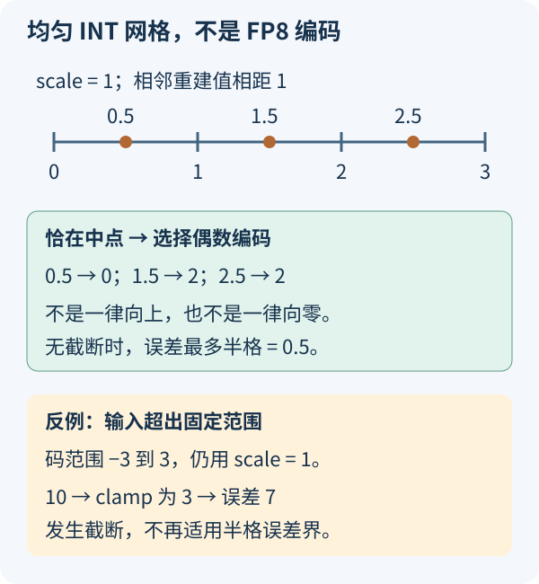
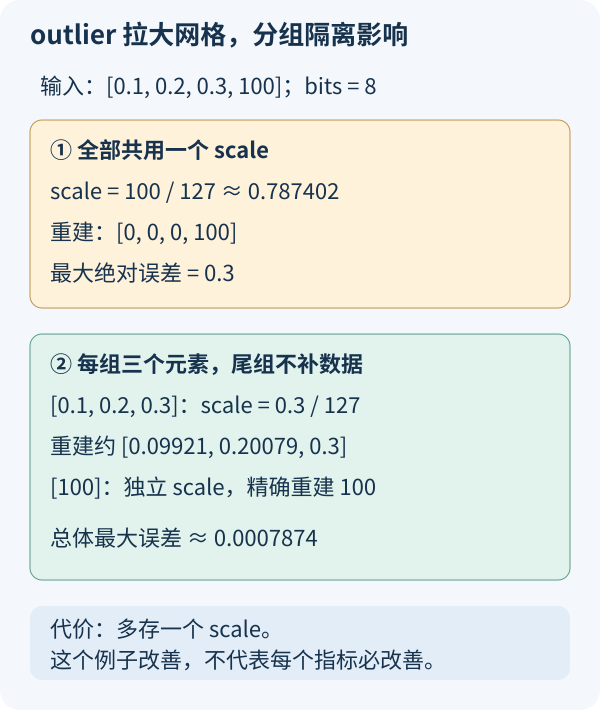

# 第 8 讲：量化——从数轴、误差到存储预算

先修：[L7 KV cache](lec07.md)、绝对值、列表切片、二进制位与整数除法。建议 90–120 分钟，分两次完成“数轴与误差”和“分组与系统代价”。本讲必修使用**对称均匀整数网格**，对应 [HW1 Q6–Q8](../hw/hw01/README.md)；FP8/FP4 编码、硬件 GEMM 为概念拓展，不要求自行实现完整浮点编码器。

学习目标：亲手量化一组数；解释最近偶数舍入；证明半格误差界并给出失效反例；比较 outlier 和分组；把 payload、scale 元数据与端到端效果分开。L7、L8 都完成后再统一做 HW1/2，不用提前猜后面还没学的量化题。

## 1. 为什么减少位宽不是免费压缩

一个 bf16 元素占 2 B，若换成 1 B 编码，数据载荷可减少一半。但有限的编码不能精确保留所有原始实数，必须选择哪些数能表示、其他数映射到哪里，以及怎样恢复近似值。量化同时面对三个问题：存多少、误差多少、执行时是否真的更快。

低位宽可能降低搬运量，也可能让支持该格式的硬件提高计算能力；若瓶颈不是这些，或者额外转换和 scale 读取抵消收益，就未必加速。先建立可验证的数值模型，再谈性能，不从位宽直接推导速度。

## 2. 两种编码必须分开

浮点数通过符号、指数、尾数分配数值；规格化非零数可写成 `(-1)^sign * 1.mantissa * 2^(exponent−bias)`。指数影响范围，尾数影响同一量级附近的间距。整数均匀量化则先取一个整数编码 q，再乘统一 scale，网格间距恒定。

| 格式 | 位结构 | 本讲要知道的区别 |
| :--- | :--- | :--- |
| FP32 | 1 符号 + 8 指数 + 23 尾数 | 常用高精度计算格式 |
| FP16 | 1 + 5 + 10 | 范围较窄、同量级有效位较多 |
| BF16 | 1 + 8 + 7 | 指数范围接近 FP32，尾数更短 |
| FP8 E4M3 / E5M2 | 1 + 4 + 3 / 1 + 5 + 2 | 两种指数/尾数取舍，特殊值规则不同 |
| 对称 INT 网格 | 符号整数编码与外部 scale | 等距，不是 FP8 浮点编码 |

FP8 的指数使间距随量级变化，`round(x/scale)` 不是 FP8 cast。FP8 的两种格式与特殊值定义见 [FP8 Formats for Deep Learning](https://arxiv.org/abs/2209.05433)。具体硬件转换还涉及饱和、次正规数和 NaN/Inf，本章不靠整数程序假装实现了这些规则。

## 3. 在数轴上建立量化流程

HW1 约定 bits 为 2–16 的整数且排除 bool，取对称编码范围：

```text
qmax = 2**(bits-1) - 1
qmin = -qmax
amax = max(abs(value))
scale = amax / qmax
quantized = clamp(round(value / scale), qmin, qmax)
reconstructed = quantized * scale
```

这是本作业的对称约定：例如 bits=3 使用 −3 到 3，不使用有符号二进制通常还可表示的 −4。scale 的单位是“原值单位 / 编码格”；value/scale 先把实数换成格数，round 找最近格，再乘 scale 返回原单位。

空输入或全零输入没有有效 amax，不能让 scale=0。约定 scale=1.0，编码全零或空，仍能精确恢复。clamp 负责不越过允许编码边界；它不能恢复已损失的信息。



读图时区分整数 q 和原值：上面只用 scale=1 便于观察；一般情况下原值间距是 scale。半格恰好与两个网格点等距，必须有确定的平局规则。

## 4. 手算一：普通数与边界

输入 `[-1,0,1]`、bits=3。qmax=3，amax=1，scale=1/3。除以 scale 得 `[-3,0,3]`，都已是整数，所以编码相同；重建再次得到 `[-1,0,1]`，最大绝对误差 0。

这并不表示 3-bit 能精确表示区间内所有数。换成 `[0,0.2,1]`，scale 仍为 1/3：

| 原值 | 除以 scale | 整数码 | 重建 | 绝对误差 |
| :--- | :--- | :--- | :--- | :--- |
| 0 | 0 | 0 | 0 | 0 |
| 0.2 | 0.6 | 1 | 1/3 | 2/15≈0.133333 |
| 1 | 3 | 3 | 1 | 0 |

所以 round-trip 最大误差是 2/15，而不是平均值，也不是相对误差。这个非零案例能抓住“永远返回 0”的假实现，单用精确端点案例抓不到。

边界：输入 `[0,0]` 时 scale=1、编码 `[0,0]`、误差 0；输入 `[]` 时编码空、scale=1、误差 0。但是 `bits=True` 或 bits=1 即使配空输入仍须拒绝，不能在验证之前直接返回。

### 4.1 最小可运行例子

这个片段只量化一个已知合法的数，故不是完整作业答案：

```python
scale = 1 / 3
original = 0.2
code = round(original / scale)
reconstructed = code * scale
print(code, reconstructed, abs(original - reconstructed))
```

预期约为 `1 0.3333333333333333 0.1333333333333333`。改变 original 但保持 scale 不变，观察它怎样被吸向网格点；超过允许范围的情况还要加 clamp，下一节讨论。

## 5. 手算二：半格不是“一律四舍五入”

Python `round` 对恰好位于中点的值采用最近偶数：`round(0.5)=0`、`round(1.5)=2`、`round(2.5)=2`；负数同样如此，`round(-1.5)=-2`。依据见 [Python round 文档](https://docs.python.org/3/library/functions.html#round)。这不是总向零，也不是总远离零。

令输入 `[0.5,1.5,2.5,3]`、bits=3。最后的 3 令 amax=3，所以 scale=1；结果：

| 原值 | 两个最近整数 | 选择偶数码 | 重建误差 |
| :--- | :--- | :--- | :--- |
| 0.5 | 0、1 | 0 | 0.5 |
| 1.5 | 1、2 | 2 | 0.5 |
| 2.5 | 2、3 | 2 | 0.5 |
| 3 | 精确为 3 | 3 | 0 |

最大误差正好 scale/2。这些输入用二进制可精确表示，适合测试平局；一般十进制小数在二进制浮点中可能略偏中点，不能用手写小数外观断定实际执行必为精确平局。

## 6. 误差界为什么是半格，又什么时候失效

相邻重建值的距离是 scale。任意位于两点之间的 x，选最近一点，最远发生在中点，距离为 scale/2。因此在**均匀网格、最近舍入、x 位于可表示范围、没有 clipping**的条件下：

```text
abs(x - reconstructed) <= scale / 2
```

相对误差再除以 abs(x)，因此接近零时可能很大；x=0 时相对误差分母为零，需要另定口径，HW1 不计算它。

失效反例：固定 scale=1、q 范围 −3 到 3，把 x=10 输入进去。round 得 10，clamp 成 3，重建 3，误差 7，远大于 0.5。这不是推导错了，而是输入超出覆盖范围，clipping 条件被破坏。若对包含 10 的新列表重新计算 amax，scale 会变，必须用新 scale 判断，不能混淆固定 scale 与重新校准。

浮点计算自测可加很小容差，但不能把容差放大到掩盖错码。最大误差为 0.49 时满足半格界，并不能单独证明每个 q 正确；要结合确定输出案例验证。

## 7. 手算三：outlier 怎样让小数消失

输入 `[0.1,0.2,0.3,100]`，bits=8。qmax=127，per-tensor 的 scale=`100/127≈0.787402`。前三项除以 scale 约为 0.127、0.254、0.381，都舍入为 0；编码 `[0,0,0,127]`，重建 `[0,0,0,100]`，最大绝对误差 0.3。

极端值把网格拉粗，普通小值被压到同一点。这里 amax 并不“算错”，问题是所有数共用一种间距。

现在按 G=3 分组：第一组 `[0.1,0.2,0.3]`，第二组只有 `[100]`。第一组 scale=`0.3/127`，编码 `[42,85,127]`，重建约 `[0.0992126,0.2007874,0.3]`；第二组 scale=`100/127`，编码 127，重建 100。总体最大误差约 0.000787402，比 0.3 小得多。



图中第二组是一个元素的尾组，不填充额外数据。实际系统可能规定固定长度槽位或 scale 对齐，计算存储时须另外计入；不能把 Python 列表长度当硬件分配字节。

### 7.1 分组并不保证最大实际误差每次都下降

换成 `[-1,0,1,100]`，G=2：第一组精确重建 −1、0；第二组的 1 仍受 100 影响，变成约 0.787402，误差约 0.212598。全张量时 −1 和 1 都有这个误差，所以分组改善了 −1，却没降低全局最大误差。

细分组后各组 amax 不增大，因此半格**最坏误差上界**不会增大；但单个数的网格位置改变，实际误差不保证单调降低。再给一个更强反例：`[1,2,3]`、bits=3，全张量 scale=1，三个数全部精确。分成 `[1,2]` 和 `[3]` 后，第一组 scale=2/3，1 除以 scale 恰为 1.5，最近偶数舍入成 2，重建为 4/3，误差反而变成 1/3；组内的半格上界确实从 1/2 降到 1/3，却不能保证实际误差从原来的 0 继续下降。

因此 G=3 的例子能改善并不推出“任何分组都会改善所有指标”。比较时应同时看最大、平均误差和后续任务效果，并计 scale 开销。

## 8. 手算四：把 scale 元数据算回去

假设一种格式每 32 个数共享 1 B scale，每个数是 4-bit payload。32 个编码是 16 B，加 scale 为 17 B；bf16 同组是 64 B，所以压缩比为 `64/17≈3.7647`，不是 4。再有尾组或对齐，比例还可能变化。这个是明确存储假设的例子，不是把 HW1 的 Python 整数对象当作 4-bit 存储。

回到 L7 参数 L=32、Hkv=8、D=128、S=4096、N=1：bf16 载荷 512 MiB；1 B/元素载荷 256 MiB；0.5 B/元素载荷 128 MiB。后两者都只是 payload，scale、打包、对齐必须另列。不要把“载荷减半”写成“总显存减半”：模型权重和 workspace 可能完全没变。

## 9. 拓展：scale 为什么有时不能提出矩阵乘

若 sA、sB 都是标量，数学上 `(Aq*sA)@(Bq*sB)=(Aq@Bq)*(sA*sB)`。如果沿归约维度 K 每组有不同 scale，求和项的系数不同，就不能统一挪到最后。

最小反例：两项原始乘积都是 1，第一项 scale 乘积为 1，第二项为 10，正确加权结果是 `1*1+1*10=11`。先把裸乘积相加得到 2，最后只乘第一组 scale 会得 2，乘第二组会得 20，两者都错。需要逐组缩放再合并，或使用支持相应布局的 kernel。

真实 FP8/FP4 的表示、scale 格式、累加精度与硬件指令必须共同核对。更高精度累加通常有助于控制累加误差，但本课不能仅凭输入位宽声称某个长 K 必须使用某种唯一实现。CUDA 的转换细节可查 [FP8 转换文档](https://docs.nvidia.com/cuda/cuda-math-api/cuda_math_api/group__CUDA__MATH__FP8__MISC.html) 与 [FP4 转换文档](https://docs.nvidia.com/cuda/cuda-math-api/cuda_math_api/group__CUDA__MATH__FP4__MISC.html)。

## 10. 从量化误差到模型效果的距离

权重、激活、K、V 的误差会通过不同计算路径影响输出。局部最大误差小，不保证 logits、任务准确率或长上下文检索不变；局部误差较大，也不能直接换算任务分数下降多少。最小可信评估应保持同一数据、模型和推理设置，先查数值误差，再比较端到端指标。

可以设计只量化 K、只量化 V、改变 group size 的对照，但需要真实模型执行才有端到端结论。本课标准库作业只验证编码、重建、误差计算和容量模型，不能发布“已证明真实 FP8 精度无损”的结论。

## 11. 常见错误、自测与出口

| 现象 | 先检查 |
| :--- | :--- |
| 全零输入除零 | 是否约定 scale=1 |
| 半格输出与测试不符 | 是否写成一律向上而非 ties-to-even |
| 最大误差看起来过小 | 是否误用了平均值或漏算某个元素 |
| 改 G 后重建错位 | 量化和重建是否用同一组边界 |
| 报告压缩比总是整数倍 | 是否漏算 scale、尾组与固定内存 |

自测：① bits=3 的 `[0,0.2,1]` 最大误差为何非零？② scale=1 时 −0.5、−1.5、−2.5 分别舍入到哪里？③ 固定 scale=1、码范围 −3 到 3，输入 10，为何不满足半格界？④ 分组后某些元素更准，为何最大误差可能不变？

<details>
<summary>核对数值和适用条件</summary>

① 0.2 映射到 1/3，误差 2/15。② 依次 0、−2、−2，平局选偶数。③ clipping 导致重建 3、误差 7，破坏不截断条件。④ 例如 `[-1,0,1,100]` 按两元素分组，−1 恢复精确，但 1 仍与 100 同组，仍决定全局最大误差。

</details>

迁移自测：32 个 4-bit 数加 1 B scale 的总量是多少？如果一个模型量化后 payload 降一半，但权重与 workspace 保持不变，总内存是否也降一半？为什么 INT 网格测试通过不代表 FP8 cast 正确？

<details>
<summary>迁移解析</summary>

总量 17 B；总内存还包含不变项，所以通常不是减半。整数网格没有实现浮点指数、尾数、特殊值和饱和编码，验证的是另一个明确定义的数值模型。

</details>

完成后做 [HW1](../hw/hw01/README.md) 的 Q6–Q8 与量化书面题，并和 Q3/Q9 的预算计算连接；再做 [HW2](../hw/hw02/README.md) 的流量、分页与共享分析。你应该能从空白纸推导一个案例、指出错误实现会在哪里失效，而不只是复述“低精度更省”。
