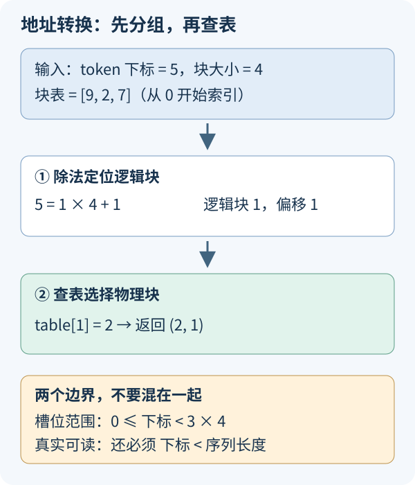
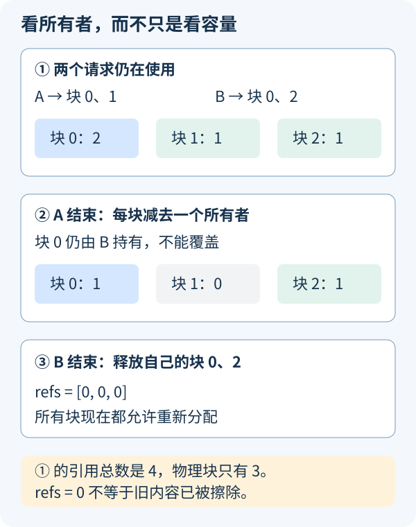

# 第 9 讲：从单请求分页到共享块池

这不是一堂“把公式背下来”的课。我们要从一个会出错的内存管理办法出发，逐步得到能解释、能手算、能实现的共享块池。先修：[第 7 讲](lec07.md)、[Lab3](../labs/lab03/README.md)、[HW2](../hw/hw02/README.md)。建议分两次学习：第一次 60–80 分钟完成地址和容量，第二次 60–80 分钟完成所有权与实现准备；[Lab4](../labs/lab04/README.md) 另留 2–3 小时。不需要 GPU。

学完后，你应该能不用参考答案完成四件事：画出任意 token 的地址转换；预测分配是否成功；解释共享块什么时候可回收；设计一个能抓住“失败却改坏状态”的测试。

## 1. 为什么“一条请求一个列表”还不够

在 Lab3 中，只要序列继续增长，就能继续创建新的块。Python 字典帮助我们理解分页，但现实中的设备内存不会随字典一起无限增长。假设所有请求共用一个只有 3 块的池，每块能放 4 个 token 对应的 KV 槽位：请求 A 长 5，需要 2 块；请求 B 长 4，需要 1 块；再来一个长 1 的 C，已经没有第 4 块可用。

最直接的办法是“满了就多加一个编号”。这对教学字典可行，对有限设备却没有意义。第二个办法是“请求一结束，把它使用的块全部设为空闲”。如果一个块只属于一个请求，这样似乎正确；一旦另一个请求还在复用它，就会覆盖仍在使用的数据。

因此有两个不同的问题：**还有没有位置**，以及 **谁还在用这个位置**。前者需要容量账本，后者需要所有权账本。本讲只模拟这两本账，不存真实 KV、不实现 attention kernel，也不包含并发锁、换出、抢占和实际设备内存分配。

## 2. 先把数量与单位分开

| 名称 | 代码记号 | 单位与含义 |
| :--- | :--- | :--- |
| 真实序列长度 | length | 已经属于这条序列的 token 数 |
| 块大小 | B / block_size | 每个物理块能容纳的 token 槽位数 |
| 块池容量 | capacity | 物理块个数，不是 token 数 |
| 逻辑位置 | t / token_index | 从 0 开始的序列 token 下标 |
| 块表 | block_table | 每个逻辑块对应哪个物理块 ID |
| 引用数 | refs[block_id] | 当前仍拥有此块的所有者数量 |

“槽位”表示空间，“token”表示实际数据。长度 5、块大小 4 的请求申请 2 块，共有 8 槽，但只有 5 个位置有效。物理 ID 只是编号：块 9 不代表第 9 个 token，更不代表大小为 9。

复习 Python：`7 // 4 == 1` 是整除，`7 % 4 == 3` 是余数，`divmod(7, 4)` 返回 `(1, 3)`。所有数量必须是整数且排除 bool；Python 中 `isinstance(True, int)` 为真，所以本课数量验证使用 `type(value) is int` 的语义。

### 2.1 为什么容量要向上取整

分配 pages 块必须满足 `pages * B >= length`，而且 pages 尽可能小。写成 `length = quotient * B + remainder`，其中 `0 <= remainder < B`：余数为 0 时需要 quotient 块；余数大于 0 时还得多一块。因此非负整数长度的结果是：

```text
pages = (length + B - 1) // B
slots = pages * B
waste = slots - length
```

使用整数运算，不要先除成浮点数再取整；大整数的最后一个 token 可能因此丢失。单条非空请求的尾部浪费在 0 到 B−1 之间。**分页减少分配粒度导致的问题，不会让尾块永远没有浪费。**

## 3. 手算一：从 token 走到物理块

把序列按 B 个位置切成一组，`t // B` 告诉我们落在第几组；`t % B` 告诉我们在组内走几格。再查块表，才得到物理块。以 `table=[9,2,7]`、B=4 为例：



读图时沿上到下的箭头走：第一步只做序列内算术，不知道物理布局；第二步才查 `table[1]`。结果 `(2,1)` 是物理块 2 的第 1 号槽，不是物理块 1 的第 2 号槽。

| t | t // 4 | t % 4 | table[t // 4] | 返回值 |
| :--- | :--- | :--- | :--- | :--- |
| 0 | 0 | 0 | 9 | `(9,0)` |
| 3 | 0 | 3 | 9 | `(9,3)` |
| 4 | 1 | 0 | 2 | `(2,0)` |
| 5 | 1 | 1 | 2 | `(2,1)` |
| 11 | 2 | 3 | 7 | `(7,3)` |

t=4 是下一个块的起点，偏移归零。t=12 则产生逻辑块 3，超过块表末尾，必须拒绝，不能再取模绕回头部。

若真实长度只有 10，t=10 虽然落在已分配的 12 槽内，却没有有效 token。Lab4 的 `locate` 没有收到 length，所以只检查槽位范围；请求层必须额外检查 `t < length`。同样，`(物理块,偏移)` 还不是 GPU 字节地址；真实布局还要考虑层、K/V、head 和元素大小等信息。

### 3.1 最小可运行观察程序

在临时 Python 文件或交互式解释器运行以下片段。它只展示映射，不含完整输入验证，不能直接作为 Lab4 答案提交。

```python
block_size = 4
block_table = [9, 2, 7]
for token_index in [3, 4, 5]:
    logical_block, offset = divmod(token_index, block_size)
    print(token_index, (block_table[logical_block], offset))
```

预期依次输出 `3 (9, 3)`、`4 (2, 0)`、`5 (2, 1)`。把表改为 `[7,9,2]`：逻辑块和偏移不变，物理块改变。这个实验将“位置分组”和“物理放置”分开。

## 4. 手算二：有限分配与失败原子性

`refs=[0,0,0]` 表示三个块都无人使用。申请 2 块，本课规定选择最小空闲 ID，所以返回 `[0,1]`，同时变成 `[1,1,0]`。再申请 2 块，只能找到块 2，不能满足整次申请，应抛 `MemoryError`，而且仍保持 `[1,1,0]`。

若先把块 2 标为占用，再发现不足，就得到 `[1,1,1]`：调用者没有收到成功结果，不知道该释放哪个 ID，空间却消失了。正确思路不是出错后尽力修补，而是把操作分为：验证参数；只读收集候选；确认可行后统一修改。

```python
refs = [1, 1, 0]
candidates = [block_id for block_id, owners in enumerate(refs) if owners == 0]
requested = 2
print(candidates, len(candidates) >= requested, refs)
```

输出 `[2] False [1, 1, 0]`，容量判断之前没有写入发生。这里的“原子性”仅指**单线程函数失败时不留下部分更新**，不保证多线程同时进入时安全。

边界：`allocate(0)` 成功返回 `[]`，状态不动；容量 0 的池也能完成这个操作。`allocate(-1)` 是参数无意义，不是空间不足，因此抛 `ValueError`，不要把所有失败都归成一种异常。

## 5. 手算三：两个请求为什么不能各自清零

A 的块表是 `[0,1]`，B 复用 A 的完整前缀块 0，再有自己的尾块 2。前缀已经写满，以后不会被这两个请求修改。`retain([0])` 新增一个所有者，不是分配第二份内容。



逐行核对所有者集合和 refs：引用数不是历史上分配过多少次，而是此刻有多少所有者。它可以大于 1，空闲判断只能看是否等于 0。

| 步骤 | 活动所有权 | refs | 可重新分配的 ID |
| :--- | :--- | :--- | :--- |
| 初始 | 无 | `[0,0,0]` | 0,1,2 |
| A 申请两块 | A→0,1 | `[1,1,0]` | 2 |
| B retain 块 0 | A→0,1；B→0 | `[2,1,0]` | 2 |
| B 申请尾块 2 | A→0,1；B→0,2 | `[2,1,1]` | 无 |
| A 结束 | B→0,2 | `[1,0,1]` | 1 |
| B 结束 | 无 | `[0,0,0]` | 0,1,2 |

关键不变式是 `refs[block_id] == 此刻持有该块的所有者数量`。另一条是“被引用的物理块数 + 空闲块数 = capacity”。注意不是 `sum(refs) + 空闲块数 = capacity`：在 `[2,1,1]` 中引用总数是 4，但物理块只有 3。

反例：A 结束时把 `[0,1]` 都直接设为 0，结果是 `[0,0,1]`。新请求 C 可能分到块 0 并写入自己的数据；B 仍指向它，接下来读到的是 C 的内容。“空闲 + 占用 = 3”仍成立，但所有权已经错误。**总量正确不是数据安全的充分条件。**

## 6. 手算四：为什么必须整批验证

设 `refs=[1,0]`，调用 `release([0,1])`。块 0 合法，块 1 已空闲，不能再释放。若一边验证一边递减，处理完块 0 后变成 `[0,0]`，随后在块 1 抛异常，就破坏了约定。正确结果是抛 `ValueError`，refs 仍为 `[1,0]`。

检查一批 ID 时，必须先确认：输入是列表；每个 ID 是整数且排除 bool；在池范围内；当前 refs>0；整批无重复。全部通过后才更新。`release([0,0])` 不能被当作减两次，因为每次调用代表一个所有者的一组不同块。空列表合法，`retain([])` 和 `release([])` 返回 `None`。

你可以用两个小列表验证“先检查”与“边查边改”的差别，不需要构造复杂服务器。最有效的调试输入往往只是一个合法元素后面接一个非法元素。

## 7. 组合小部件，但不要跨越模型边界

一次请求的流程现在可以拆成：计算需要几块 → 在有限池中取得 ID → 存成请求块表 → 访问时地址转换 → 共享时增加引用 → 结束时释放自己的所有权。每步都能单独测试。

不过 Lab4 不判断前缀是否相同，没有内容索引。`refs=0` 表示允许重新分配，**不等于物理字节已擦除，也不等于存在可安全命中的缓存条目**。下一讲才增加内容有效性和淘汰视角。

还有一个限制：本课只共享完整、不可变的前缀块。如果 A、B 共享未满尾块，随后各自追加不同 token，单纯增加引用数不能隔离写入，需要复制后再写等机制。本讲识别这个问题，但 Lab4 不要求实现写时复制。

## 8. 常见错误与定位路径

| 现象 | 先检查什么 | 最小输入 |
| :--- | :--- | :--- |
| 边界映射错块 | 是否混淆物理 ID 与偏移 | table=`[9,2,7]`，t=4，B=4 |
| 分配失败后空间减少 | 是否在确认容量前写入 | `[1,1,0]` 再申请 2 |
| 共享内容被覆盖 | release 是否直接清零 | `[2,1,1]` 释放 `[0,1]` |
| 守恒式总不相等 | 是否误用了引用总数 | refs=`[2,1,1]` |
| 非法批次改变状态 | 是否逐个验证、逐个写入 | `[1,0]` 释放 `[0,1]` |

先记录调用前数组副本，再写期望异常和期望数组，最后执行一次调用。不要只检查抛了异常，也要比较异常后的状态。这比直接追踪几十步长轨迹更容易找到第一处错误。

## 9. 自测：先盖住解析

1. B=4，length=9，需要几块？多少槽有效，多少浪费？
2. `table=[5,1]`，t=5，B=4，映射到哪里？若 length=5，能读这个 token 吗？
3. refs=`[2,1,0]`，释放 `[0,1]` 后怎样？再申请 2 块选择谁？
4. `retain([0,99])` 中第一个 ID 合法，为什么也不能先给它加一？

<details>
<summary>基础解析：算术、边界和所有权</summary>

第 1 题需要 3 块、12 槽，9 槽有效、3 槽浪费。第 2 题映射为 `(1,1)`，但 length=5 时有效下标仅 0–4，请求层应拒绝 t=5。第 3 题先得到 `[1,0,0]`，再分配 `[1,2]`，最终 `[1,1,1]`。第 4 题整次调用失败，没有真正新增所有权，提前加一会让引用数多算一次。

</details>

5. 两个请求共享块 0，一个结束后，给出正确 refs 与错误清零 refs。为什么容量守恒抓不到错误？
6. Lab4 能证明一个空闲块仍存着正确旧前缀吗？还缺什么？

<details>
<summary>进阶解析：总量与内容有效性</summary>

只有这个块时，两个所有者对应 `[2]`，一个结束后应为 `[1]`，错误清零为 `[0]`。两者都能让“占用块 + 空闲块 = 1”成立，但后者违背实际所有者数量。Lab4 没有内容及内容索引，不能证明旧前缀有效；还需内容身份、计算配置及覆盖/失效状态。不能把空闲性测试冒充缓存正确性测试。

</details>

## 10. 练习出口与真实系统对照

进入 [Lab4](../labs/lab04/README.md)，按 allocate → retain → release → locate 实现，每题先预测再测试。完成标准不是仅仅看到绿灯，而是能脱离代码解释四条轨迹，并构造一条失败后状态不变的反例。

分页式 KV 管理和共享的研究背景见 [PagedAttention 原论文](https://arxiv.org/abs/2309.06180)。关注它解决的内存管理问题，不把特定配置下的性能数字照搬为本模拟器结果。Python 账本没有 GPU 执行时间，因此这里只证明地址和生命周期行为，不能证明吞吐提升。下一步：[第 10 讲](lec10.md)。
