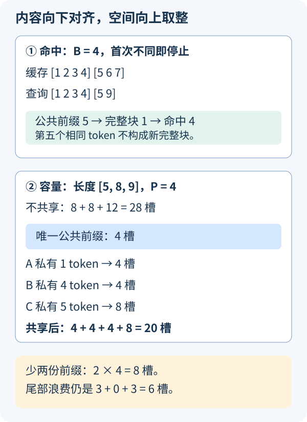

# 第 10 讲：前缀命中、共享与淘汰

先修：[第 9 讲](lec09.md)、[Lab4](../labs/lab04/README.md)、HW2 的逐请求分页。建议用 90–120 分钟分段学习，再用 2–3 小时完成 [HW5](../hw/hw05/README.md)。你需要纸笔和标准 Python，不需要 GPU。

本讲回答三个独立问题：**哪些旧内容真的能复用？共享后少占多少空间？空间不够时哪些块可以先覆盖？** 学完应能给出各自的输入、输出、反例和边界，而不只是说“前缀缓存更快”。

## 1. 相同文字为什么不一定是相同计算

很多请求以同一段系统提示开头，重复计算和存储这部分 KV 可能没有必要。但不能简单建立“文字片段 → KV”的字典：因果 Transformer 的后续位置表示受前面上下文影响，单独一块 token 相同，不足以证明各层 KV 相同。

缓存 `[1,2,3,4,5,6]`，新请求 `[9,2,3,4,5,6]`，后五个 token 一样，却从首位开始就有不同上下文。本课安全规则是只复用**从位置 0 开始完全相同的前缀**，不是最长公共子串。这个保守规则不因后缀相同就认定缓存可用。

本课假设模型、tokenizer、位置约定、推理配置和有关输入条件一致，token ID 是确定的非负整数。实际服务还要隔离模型版本、LoRA、多模态内容和租户条件。vLLM 用父块标识、当前块 token 和附加条件组合缓存身份，说明单独的块文字并非全部条件。见 [vLLM 前缀缓存设计](https://docs.vllm.ai/en/v0.21.0/design/prefix_caching/)（核对：2026-10-24）。作业不使用哈希，而是完整比较 token，先把语义教清楚。

## 2. 先约定变量和单位

| 记号 | 含义 | 单位 |
| :--- | :--- | :--- |
| B | 正整数块大小 | token 槽 / 块 |
| common | 最长公共前缀长度 | token |
| hit | 可复用的完整前缀长度 | token |
| P | 只保留一份的共享前缀长度，要求 B 对齐 | token / 槽位 |
| length_i | 第 i 条请求总长度 | token |
| refs | 各物理块活动引用数 | 所有者数 |
| last_used | 比较新旧的时间戳，不是耗时 | 同一时钟单位 |

“命中请求数 / 请求总数”“命中 token / 输入 token 总数”“命中块数 / 某种候选块数”不是同一指标。先算绝对数量，再明示分母，避免一句命中率混淆三个问题。

## 3. 手算一：公共前缀与完整块

cached=`[1,2,3,4,5,6,7]`，query=`[1,2,3,4,5,9]`，B=4。不要凭视觉猜答案，逐对比较：

| 下标 | 缓存 | 查询 | 动作 | 已确认 common |
| :--- | :--- | :--- | :--- | :--- |
| 0 | 1 | 1 | 继续 | 1 |
| 1 | 2 | 2 | 继续 | 2 |
| 2 | 3 | 3 | 继续 | 3 |
| 3 | 4 | 4 | 继续 | 4 |
| 4 | 5 | 5 | 继续 | 5 |
| 5 | 6 | 9 | 立即停止 | 5 |

common=5，其中完整块数=`5//4=1`，因此 hit=4：

```text
hit = (common // B) * B
```

这和容量取整正好相反：分配空间必须足够，所以向上；已知可复用内容不能夸大，所以向下。向上得到 8，会把未证明相同、甚至查询中不存在的位置算进去；返回 5，又违背本课只复用完整块的规则。



读图先看上半部：第 5 个相同 token 不能单独凑成第二个完整块。下半部换成长度 `[5,8,9]` 的容量题；两部分共享 B=4，但命中长度和已分配槽位不是同一个量。

### 3.1 最小可运行观察程序

以下只处理合法样例，用来观察停止位置，不包含 HW5 的完整验证：

```python
cached = [1, 2, 3, 4, 5, 6, 7]
query = [1, 2, 3, 4, 5, 9]
common = 0
for cached_token, query_token in zip(cached, query):
    if cached_token != query_token:
        break
    common += 1
print(common, common // 4 * 4)
```

预期输出 `5 4`。把 query 首个 token 改为 9，变为 `0 0`；把 query 缩成 `[1,2,3]`，变为 `3 0`。`zip` 只比较两者共同拥有的位置，不能越过较短序列末尾。

## 4. 手算二：边界和反例

边界一：cached=query=`[1,2,3]`、B=2。common=3，完整块只有 1，hit=2。内容全部相同也不表示本规则把所有 token 都算命中，最后一个 token 不构成完整块。

边界二：cached=`[]`、query=`[1]`、B=2。没有可比较位置，hit=0。但是 cached=`[True]`、query=`[]` 不是合法的空交集，因为 bool token 被禁止。必须先验证完整输入，再做快速返回；只遍历 `zip` 会因另一边为空而漏检。

反例：cached=`[9,2,3,4]`、query=`[1,2,3,4]`、B=2。第二个块都是 `[3,4]`，但 common 仍为 0，hit=0。若把每个块独立放进集合搜索，会错误返回 2。这条测试比泛泛提醒“考虑上下文”更能保护实现。

## 5. 手算三：共享不能先把所有长度相加

现在假设三条请求已经确认能共享长 P=4 的完整前缀，总长度 `[5,8,9]`，B=4。注意这是容量计算，不是又一次命中计算。

不共享时各条独立申请：

| 请求 | 总长度 | 页数 | 槽位 | 尾部浪费 |
| :--- | :--- | :--- | :--- | :--- |
| A | 5 | 2 | 8 | 3 |
| B | 8 | 2 | 8 | 0 |
| C | 9 | 3 | 12 | 3 |
| 合计 | 22 | 7 | 28 | 6 |

共享后前缀只保留一份 4 槽，每条私有后缀仍属于不同请求，不能把 A 的剩余尾槽直接当作 C 的尾槽：

| 请求 | 私有长度 length_i−P | 私有页数 | 私有槽位 | 尾部浪费 |
| :--- | :--- | :--- | :--- | :--- |
| A | 1 | 1 | 4 | 3 |
| B | 4 | 1 | 4 | 0 |
| C | 5 | 2 | 8 | 3 |
| 合计 | 10 | 4 | 16 | 6 |

总量=`4+16=20`，比 28 少 8。节省来自删掉两份重复前缀，每份 4；尾部浪费仍是 6，没有消失。

### 5.1 从表格推导公式

先对每条求私有长度，再分别向上取整，最后求和：

```text
private_length_i = length_i - P
private_slots_i = ((private_length_i + B - 1) // B) * B
shared_slots = P + sum(private_slots_i)
```

当请求集合非空、P 是 B 的倍数、所有 length_i≥P 时，P/B 是整数，原来的每条页数就能拆成“前缀页数 + 私有页数”。所以对 n 条请求：

```text
unshared_slots - shared_slots = (n - 1) * P
```

这只适用于“一组请求内部共享一份，没有额外常驻副本”的口径。HW2 某个情景有额外保留的前缀，因此必须重新数副本，不能只因变量同名就照搬。

反例：lengths=`[1,1]`、P=0、B=4。正确需要 4+4=8 槽。先合成 2 再取整只得到 4，相当于偷偷允许两个独立请求共用可写尾块，而本题没有这种机制。

## 6. 手算四：把特殊情况代入

- 全长就是前缀：`[4,4]`、P=4、B=4。两个私有尾长都是 0，各需 0 页，总量是唯一前缀的 4 槽，不是 8 或 12。
- 无共享：`[5,8,9]`、P=0、B=4。公共部分占 0，私有部分就是全部请求，返回 28，退回普通逐请求分页。
- 无请求：`[]`、P=4、B=4。没有请求持有前缀，返回 0，不保留幽灵缓存；但 P=1、B=4 仍非法，因为公共参数要先验证。
- 前缀太长：`[3]`、P=4、B=4。不能用负的私有长度继续算，抛 `ValueError`。
- 大整数：length=`2**60+1`、P=0、B=16。`2**60` 正好整除 16，多 1 个 token 需新页，总槽位=`2**60+16`。先转浮点可能丢失这个 1。

前两项是公式的退化检查，第三项是空集合约定，后两项保护输入约束和数值精度。掌握这些例子以后，再写函数就不容易被公式外形误导。

## 7. 手算五：无人引用不等于没有内容

refs 只回答“此刻谁在用”。引用归零后允许覆盖，但旧 KV 字节和内容索引可能仍在，覆盖前也许还能复用。必须区分三种情况：

| 状态 | 活动引用 | 有效缓存内容 | 按本题规则能否淘汰 |
| :--- | :--- | :--- | :--- |
| 活动共享块 | refs>0 | 可能有 | 不能 |
| 保留内容的空闲块 | refs=0 | 有，尚未覆盖 | 可以 |
| 普通空闲块 | refs=0 | 无有效索引或内容 | 可以重新分配 |

HW5 仅返回候选顺序。先筛选 refs=0，再按 `(last_used, 物理ID)` 升序排列。refs=`[1,0,0,0]`、last_used=`[0,9,3,3]`：

1. 块 0 时间最早，但仍有所有者，先排除。
2. 候选 1、2、3 的时间分别为 9、3、3。
3. 块 2、3 同样旧，以 ID 打破平局，结果 `[2,3,1]`。

直接排序全部块会得到 `[0,2,3,1]`，优先覆盖仍在用的块，这是错误。按 refs 排序也不对：引用数决定资格，不代表时间。空输入返回 `[]`；全部 refs>0 也返回 `[]`，后者表示没有合法候选，不是允许强行覆盖最旧活动块。

**返回候选不等于已经淘汰。** 函数不改 refs、不删缓存条目。真正覆盖时还要让旧内容索引失效，否则后续请求会把新内容认成旧前缀。vLLM 的真实管理还维护空闲队列和索引；本题排序是明确的教学约定，不宣称逐步复现整个引擎。

## 8. 组合这些组件时还缺什么

纸上可以画出链条：找可复用前缀 → 保护命中块 → 算新尾部需要多少块 → 不足时选无人引用候选 → 使旧索引失效再复用 → 请求结束减少引用。但“小函数都正确”不代表整条事务链正确：例如查到命中后、取得引用前覆盖同一块，旧身份就失效了。

所以 HW5 实现三个纯计算函数，Lab4 实现所有权操作；[Project2 Phase1](../projects/project2/README.md) 先处理固定容量下的准入与释放，暂不接入前缀缓存。分阶段是为了先建立可验证不变式。未来集成还要定义索引失效时机、引用保护、失败回滚和增长期间容量约束；第 6 周调度模拟也不会自动补上内存机制。

## 9. 从计算数字到正确结论

两组负载各有 2 条请求，每条输入 100 token，每组只有 1 条命中。第一组命中 4 token，第二组命中 80 token。请求命中率都为 1/2，token 命中率却是 4/200=2% 与 80/200=40%。不报分母就不能比较。

节省 KV 槽位也不直接等于 TTFT 下降同样比例。排队、模型输出所需计算、实际 kernel 与运行时开销是不同环节。hit 只描述可复用 KV 的 token 数，不保证能完全跳过模型执行。报告应写“在本容量模型下少 8 槽”，不要写成“推理加速 28.6%”。

## 10. 自测、调试与出口

1. `[1,2,3,4,5]` 对 `[1,2,3,9]`、B=2，common 与 hit 各是多少？
2. lengths=`[6,7]`、P=4、B=4，共享和不共享各多少槽？
3. refs=`[0,2,0]`、last_used=`[7,0,7]`，候选顺序是什么？

<details>
<summary>基础解析：向下、向上和资格筛选</summary>

第 1 题 common=3，hit=2。第 2 题私有尾长 2、3，各 4 槽，共享总量 4+4+4=12；不共享 8+8=16，少一份 4 槽前缀。第 3 题块 1 不能选，块 0、2 同时间，以 ID 得 `[0,2]`。

</details>

4. 为什么 `[1,1]`、P=0、B=4 不能只分 4 槽？
5. refs=0 且时间很旧，能断定没有有效内容吗？
6. 命中过的块后来被其他分配覆盖，仅重用旧 ID 为什么不安全？

<details>
<summary>进阶解析：独立尾部和内容身份</summary>

两个可写尾部各需要一页，不能偷偷合并。refs=0 只表示无人活动引用，内容可能有效也可能已失效，要看缓存元数据。物理 ID 可反复分配，旧 ID 不保证旧内容仍在，因此使用期间要保护引用、覆盖时要清理旧索引。当前作业不实现这条组合事务，不能宣称解决了其并发正确性。

</details>

调试时先定位层次：Q1 查第一个不同位置和完整块对齐；Q2 列每条私有长度、页数、槽位；Q3 先列候选再列排序键，不要同时改三层。完成 [HW5](../hw/hw05/README.md) 的手算、独立反例和修复记录后，再进入 [Project2 Phase1](../projects/project2/README.md)。能说清“本题算到了什么，还没算什么”，才算完成本讲。
