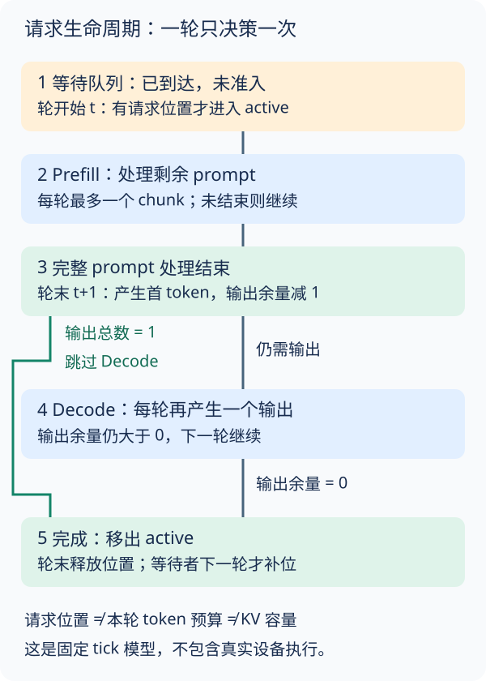
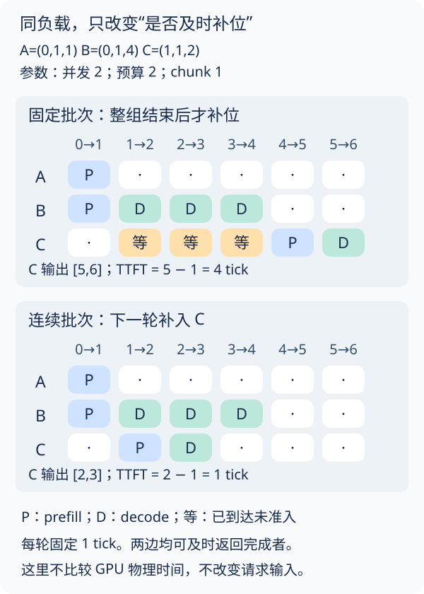

# 第 11 讲：Continuous batching，从一条请求到一轮调度

先修：[L9：分页 KV](lec09.md)、[L10：前缀缓存](lec10.md)、[Project2 Phase1](../projects/project2/README.md)。建议分两次学习，每次 50–70 分钟；准备纸笔，不需要 GPU。本讲先把时间和状态讲清楚，再做 [Lab5 Q1](../labs/lab05/README.md)；预算分配与指标留给 [L12](lec12.md)。

读完后，你应能独立完成三件事：给相同请求画出固定批次与连续批次的完整时间线；从轮开始状态推导轮末状态；解释一个输出 token 到底在哪一次计算后产生。不能只背“continuous batching 吞吐更高”。

## 1. 从一个空着的请求位置开始

你和朋友同时点餐：你的餐已做好，朋友还要等很久。假如厨房规定“这批所有人的餐都做好，才能接下一批”，即使你用过的位置已空出来，后面的人也只能等。更灵活的规则是：每完成一个工作阶段，就重新查看哪些位置空闲，把已到达的新订单补进去。

这个类比只说明**补位边界**。语言模型不是为每位用户准备一台独立机器；同一轮的多条序列通常共同组成执行批次，实际代价还受模型、硬件和上下文长度影响。我们的第一步是把复杂物理执行拿掉，用确定性小模型研究“下一轮谁能工作”。

这里把固定批次定义为：选定一组请求后，在这一组全部结束前不补入新成员；已经完成者仍可以立即返回结果。连续批次则在每轮边界重新准入，早结束者留下的位置可以在下一轮补入。并不是所有叫 static batching 的实现都采用完全相同规则，因此后面的比较只对这里明确写出的两种策略负责。

[Orca 原始论文介绍](https://www.usenix.org/conference/osdi22/presentation/yu)把调度粒度从整条请求缩小到一次迭代。本课借用这一核心思想，不复现论文的 selective batching 或分布式执行架构。Continuous batching 也不是“随时打断正在运行的 GPU kernel”：本模型只允许在迭代边界改变成员。

## 2. 先修复习：为什么生成一次回答要运行多轮

一个请求可以写成 `(id, arrival, prompt_tokens, output_tokens)`。例如 `("A", 0, 3, 3)` 表示时刻 0 到达、prompt 有 3 个 token、要求生成 3 个输出 token。prompt 不是输出；`output_tokens` 也不是 prompt 与输出的总和。

先回想自回归关系：模型根据已知上下文预测下一个 token。Prefill 处理 prompt 各位置，完整 prompt 的最后位置产生用于预测首个输出的 logits。因此**最后一段 prefill 完成时，首个输出就可以产生**。此后普通 decode 每轮再产生一个输出。我们省略采样细节，只记录输出出现的时刻。

设 prompt 长度为 P，输出长度为 O。每个 prompt 位置处理一次，共 P 个输入 token；首输出来自 prefill，剩余 O−1 个输出分别需要一次 decode。因此本周的计账工作量是：

```text
prefill 工作 = P
decode 工作 = O - 1
合计处理的输入 token = P + O - 1
```

这不是 FLOPs 公式：不同上下文下的 token 计算成本不相等，也没有计入模型权重或采样。它只是检查模拟器是否漏做或多做工作的守恒量。若 O=1，只做 prefill 就结束；若你额外执行一次 decode，便会凭空多产一个 token。



读图时沿纵向走一遍：等待不消耗本轮 token 预算；进入 active 后仍可能没有得到计算份额；prefill 的剩余量变为 0 才能产生首输出；输出长度为 1 的请求走直接结束的分支。最后回答：释放一个请求位置，等不等于清空所有可复用 KV？结合 L10，答案是否定的，活跃引用和缓存保留是两种责任。

## 3. 为小模型建立一份不能含糊的契约

活动状态写作 `(id, prefill_remaining, output_remaining)`。例如 `(A,3,2)` 表示还需处理 3 个 prompt token，并且还没有产生的输出有 2 个。`output_remaining` 包含尚未产生的首 token，不是“剩余 decode 次数”。`prefill_remaining=0` 且输出未完成的请求才属于 decode 阶段。

| 数量 | 单位 | 限制的对象 | 不代表什么 |
| :--- | :--- | :--- | :--- |
| max_active | 请求数 | 活动集合最多容纳多少条请求 | 不是显存字节数 |
| token_budget | 输入 token/轮 | 这轮 prefill 与 decode 的分配总量 | 不是跨轮 KV 容量 |
| chunk_size | 输入 token/请求/轮 | 单条 prefill 本轮最多处理多少 | 不是整个批次上限 |
| KV capacity | 块或字节 | 跨轮保留的上下文状态 | 本阶段尚未建模 |

一个请求本轮做 4 个 prefill token，只占一个请求位置。四条请求各做一次 decode，共消耗 4 个本轮 token；它们过去的上下文可能有数万 token。把这两种 4 混成一件事，就会得到“预算合法所以显存一定够”的错误结论。

每轮定义为 `[t,t+1)`：轮开始决策，轮末提交。所有计划中的动作共享这个区间，并非先做完第一条，再另加一轮做第二条。执行顺序固定为：到达入队 → FIFO 准入 → 取一次状态生成计划 → 执行 → 在 t+1 记录输出和完成 → 下一轮补位。所有轮都长 1 个虚拟 tick，不是 1 毫秒。

## 4. 案例一：只做一条请求，也容易差一轮

输入 A=`(0,3,3)`，`max_active=1, token_budget=2, chunk_size=2`。括号内省略 ID，依次是到达、prompt、输出。

| 区间 | 轮开始 A 的状态 | 本轮计划 | 轮末 A 的状态 | 输出事件 |
| :--- | :--- | :--- | :--- | :--- |
| 0→1 | (3,3) | prefill 2 | (1,3) | 无 |
| 1→2 | (1,3) | prefill 1 | (0,2) | 首 token，时间 2 |
| 2→3 | (0,2) | decode 1 | (0,1) | 第二 token，时间 3 |
| 3→4 | (0,1) | decode 1 | 完成，移出 active | 第三 token，时间 4 |

第一轮处理了两个 prompt token，却没有产生两个输出。第二轮尾段只有一个 token，照样执行，不能要求凑满 chunk=2。总工作为 2+1+1+1=5，恰好等于 3+3−1；输出列表是 `[2,3,4]`。

现在只把输出长度改为 1：前两轮不变，时间 2 产生首 token 后立即完成；第三、四轮都不存在。这个改动是发现“prefill 后总要再 decode 一次”错误的最小反例。

## 5. 案例二：固定批次与连续批次，用完全相同的输入比较

请求 A=`(0,1,1)`、B=`(0,1,4)`、C=`(1,1,2)`；两种策略都取 `max_active=2, token_budget=2, chunk_size=1`。都采用 decode 优先、同阶段 FIFO、同样的 1 tick 轮长、prefill 结束产生首输出、轮末返回结果。**唯一变化是：第一组尚未全部结束时，是否补入 C。** 不更换负载，也不让某一侧偷偷多用预算。



读图：每列是一个区间；P 表示一次 prefill，D 表示一次 decode，空白不是“该请求还在计算”。橙色等待格是 C 已到达却未准入。先只看 C，再回看 B：连续补位提前了 C，却没有减少 B 所需的轮数。

| 区间 | 固定批次计划 | 连续批次计划 | 关键边界 |
| :--- | :--- | :--- | :--- |
| 0→1 | A P1，B P1 | A P1，B P1 | A 完成；B 还要 3 个输出 |
| 1→2 | B D1 | B D1，C P1 | C 到达；连续批次此时准入 |
| 2→3 | B D1 | B D1，C D1 | 连续批次的 C 完成 |
| 3→4 | B D1 | B D1 | B 完成，第一组终于全部结束 |
| 4→5 | C P1 | 已全部完成 | 固定批次现在才准入 C |
| 5→6 | C D1 | 已全部完成 | 固定批次的 C 完成 |

两侧 A 的输出都是 `[1]`，B 都是 `[1,2,3,4]`；固定批次 C 为 `[5,6]`，连续批次 C 为 `[2,3]`。C 到达时间为 1，所以等待首输出的时间是 4 与 1，而不是 5 与 2。三请求的平均首输出等待为 `(1+1+4)/3=2` 和 `(1+1+1)/3=1` tick。都产生 7 个输出，若观察窗口均从 0 到各自全部完成，输出吞吐为 7/6 和 7/4 token/tick。

这组数字证明的是**在这些假设下补位减少了空闲份额**，不是 GPU 吞吐提高了固定倍数。若只有 A、B，没有 C 可以补入，两种策略的轨迹相同；如果真实批次变大导致每轮变慢，物理时间的结论也必须重新测量。

## 6. 从纸面走向程序：先分开决策与执行

不要上来就写完整 while 循环。先写一个接受合法状态的最小观察器：

```python
def ready_ids(active):
    ready = []
    for request_id, prefill_remaining, output_remaining in active:
        if prefill_remaining == 0:
            ready.append(request_id)
    return ready

assert ready_ids([("P", 5, 3), ("D", 0, 2)]) == ["D"]
```

这个片段可以单独运行，但不是 Lab5 的完整答案：它还没有预算、输入验证或异常契约。第二步只给列表加预算截断；第三步把验证放到选择之前；最后用空列表、非法尾部、重复 ID 检查。不要一边扫描一边修改输入：策略只回答“想做什么”，执行器才回答“做完后变成什么”。

执行器也先只实现一条合法记录的 prefill，再加入“刚好变成 0 就发出首输出”的判断，随后加入 decode，最后才处理准入和多请求。轮开始的计划生成后就固定了：即使 A 本轮完成 prefill，也不能重新扫描一次把 A 加入 decode，否则 A 会在同一 tick 产生两次输出。

## 7. 案例三：等待、首输出和补位一起出现

输入 A=`(0,3,2)`、B=`(1,1,1)`、C=`(1,1,2)`；`max_active=2, token_budget=3, chunk_size=2`。这是项目的精确手算基准，B 和 C 同时到达，按原输入顺序先准入 B。

| 区间 | 本轮准入 | 计划 | 轮末 active | 轮末 waiting | 输出 / 完成 |
| :--- | :--- | :--- | :--- | :--- | :--- |
| 0→1 | A | A P2 | A:(1,2) | 空 | 无 / 无 |
| 1→2 | B | A P1，B P1 | A:(0,1) | C | A,B / B |
| 2→3 | C | A D1，C P1 | C:(0,1) | 空 | A,C / A |
| 3→4 | 无 | C D1 | 空 | 空 | C / C |

第一轮用掉 2/3 预算：A 达到单请求 chunk 上限，又没有其他活动请求，所以剩下 1 并非错误。第二轮用掉 2/3：两个 prompt 都到末尾，无需凑数。B 在时刻 2 完成后，C 才能在从 2 开始的一轮准入；不能把 C 塞回 1→2 的同一个计划。最终 A=`[2,3]`、B=`[2]`、C=`[3,4]`。实际处理量是 2+2+2+1=7，对照 `(3+2−1)+(1+1−1)+(1+2−1)=7`。

## 8. 第 5 周的页池应放到哪里

Phase1 的问题是“现有块够不够接纳这条请求”，Phase2 的问题是“已接纳请求本轮各执行多少工作”。未来完整引擎需要在准入和执行前检查内存：生成计划 → 估算新增 KV 块 → 预留成功才提交执行 → 完成时释放活跃引用 → 按缓存策略决定是否保留可复用页。如果预留失败，应该留在等待或撤销本次预留，不能先写一半状态再假装整轮成功。

本阶段没有调用 Phase1 的池，`max_active` 仅控制请求数；新增 token 的页分配、共享尾页写入、抢占与回滚都未接入。这种分离让你先定位时间状态错误，而不是同时调试两套状态机。完成这一周后，你应能在架构图上标出将来的连接点，但不应声称项目已满足显存安全。

## 9. 自测：遮住表格，再解释

1. A=`(0,3,1)` 的第一输出时间是多少？还要 decode 吗？
2. 案例二把 C 的到达改为 4，连续批次还有补位优势吗？
3. `[("P",5,3),("D",0,2),("E",0,1)]`，预算 1 时谁被选中？为什么不是 P？
4. 两请求到达时间相同，能否按 ID 排序？
5. 用一句话解释“每轮只决策一次”保护了什么。

<details>
<summary>完成手算后展开解析</summary>

第一题沿用案例一参数：时间 2 完成 prefill 并结束，不再 decode。第二题两策略都到时刻 4 才有 C 可用，C 都在 4→5 prefill、5→6 decode，没有收益。第三题选 D，阶段优先于原列表中 prefill 的位置，同阶段仍保持顺序。第四题不能，合同要求同到达时间保留原输入次序，名字不应暗中成为优先级。第五题它保证本轮新状态不能反过来为自己争取本轮第二次执行，防止重复输出与过早补位。
</details>

本讲出口检查：不看参考实现，把案例三四行状态完整复述，再为 O=1 写一个回归测试。能解释“为什么”，再进入 [L12](lec12.md)；若仍混淆 prompt 与输出，先重做案例一，而不是继续堆调度代码。
