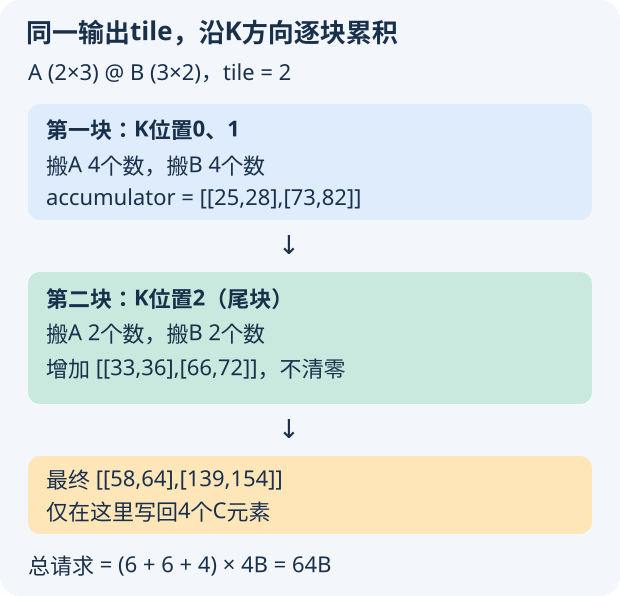

# Project 1：Kernel Zoo——从正确性到访存证据

> **建议时间**：12–16 小时，按三个 checkpoint 分配，不要求连续完成。  
> **先修**：[Python 预备课](../../prep/README.md)、[Lab0](../../labs/lab00/README.md)、[Lab1](../../labs/lab01/README.md)、[第四讲](../../lectures/lec04.md)的矩阵乘法与 tiling。  
> **交付**：9 个函数、实验 CSV、`report.md`、调试记录和 5 分钟讲解。全部必做部分只用 Python 标准库，无需 GPU。

你已经在 Lab 中练过逐元素计算、归约、softmax 和 RMSNorm。现在把自己的实现组合成一个小型算子库，再回答一个需要证据的问题：**分块怎样减少从“全局内存”读取标量的次数？这种减少能支持什么性能结论？**

本项目借鉴 CS61A Hog 的文件导览、分阶段依赖、公开测试和实验报告组织方式。课程内容为原创，不代表 UC Berkeley 的官方课程或质量认证。关键的新增任务是显式搬运和复用 tile；把 Lab 的代码重新抄一遍并不是项目的全部。

## 1. 先认识文件，再写代码

| 文件 | 你的职责 |
| :--- | :--- |
| `project1.py` | 唯一需要补实现的代码；保留函数名和参数，可以新增私有辅助函数 |
| `memory.py` | 已提供的标量请求计数器；阅读，不修改 |
| `experiment.py` | 已提供的实验驱动；阅读，不修改 |
| `test_project1.py` | 公开的算法、输入契约和计数器使用测试；不修改 |
| `test_project_tools.py` | 已提供工具的回归测试；不修改 |
| `report_template.md` | 复制为自己的 `report.md`，填入证据和解释 |
| `project1_solution.py` | 完成尝试后对照；不要导入或复制成学生文件 |

所有命令从**课程根目录**运行，即直接包含 `course` 的位置；离线ZIP解压后进入这一层，个人主页源仓库先 `cd _courses/deepinfer`。下文用 `python`；WSL中可替换为 `python3`，Windows可使用已安装解释器、`py -3`或 `.\course\run.ps1 project1 --question q1`。

### 先修到checkpoint的路线

| 先完成的阅读/练习 | 本项目实现顺序 | 本次新增能力 |
| :--- | :--- | :--- |
| Lab0与L3、Lab1 | Q1–Q4 | 迁移本人算子，统一输入契约 |
| 预备2、L4第1–2节 | Q5 | 矩形点积与逐格累计 |
| L4第3–6节、两个K块的图 | Q7 | 用尾块手算推导请求模型 |
| L4第7节、下面的内存API | Q9 → Q6 | 显式搬运、真实复用、共用引擎 |
| L4第8–9节 | Q8 → 实验 → 报告 | 分开数值、请求、Python时间与模型 |

题号不重新编号。尤其Q6依赖Q9，先做Q7/Q9再回Q6是有意的路线，不代表学生漏做。每到一个checkpoint先看本阶段证据，后续未实现函数失败不会抹掉前一阶段已完成的工作。

**Problem 0：工具检查（不计分）**

```bash
python -m unittest discover -s course/projects/project1 -p test_project_tools.py -v
python course/tools/grade.py project1 --list
python course/tools/grade.py project1 --question q1 --unlock
```

第一条应在你还没实现任何函数时通过。第二条列出题目。第三条先让你预测结果；它不修改学习记录，也不会阻止你直接跑测试。

先检查一次初始状态：

```bash
python course/tools/grade.py project1 --question q1 --failfast
```

此时看到 `NotImplementedError` 是正常的：工具能运行，学生函数还没写。不要为了让它变绿而改测试。

## 2. 路线与共同契约

按下面的顺序做，**题号用于固定评分接口，不是实现顺序**：

```text
Q1 → Q2 → Q3、Q4 → Q5
                     ↓
            Q7 手算模型 → Q9 搬运引擎 → Q6 包装接口
                                           ↓
                                     Q8 → 实验与报告
```

Q1–Q5 可以复用你自己完成的预备课/Lab1 代码，在报告注明来源与为本项目修改的地方。只使用标准库；不使用 NumPy/PyTorch、不导入参考解法。Q2 要保留成对树形归约。Q9 必须通过 `MatrixMemory` 搬入 A/B 局部 tile 后计算，不能用公式伪造计数。

共同约定：

- 数值输入是有限实数；本项目不要求处理字符串、复数、NaN/Inf 元素，也不要求对超出 Python float 范围的中间结果做缩放处理。
- 所有函数保留输入，返回新列表；矩阵输出的每一行必须独立。
- 向量允许空列表。矩阵统一要求至少一行、一列、每行等长，且 A 的列数等于 B 的行数；空矩阵、锯齿矩阵、非列表矩阵和内维不符都抛 `ValueError`。这样避免用 `[]` 猜测一个无法表达的二维 shape。
- `n`、`tile`、`dtype_bytes` 是整数参数，`bool` 不算合法整数。所有规定的错误输入都抛 `ValueError`，无需匹配报错文本。
- 算术使用 Python float；请求量用每标量 4 bytes 建模。**这不是 float32 舍入模拟器**。

每题的固定循环是：先做预测 → 写下输入输出 → 实现 → 单题测试 → 解释失败原因。把命令中的 `q1` 换成对应题号：

```bash
python course/tools/grade.py project1 --question q1 --unlock
python course/tools/grade.py project1 --question q1 --failfast
python course/tools/grade.py project1 --question q1 --hint 1
```

提示分 1/2/3 级。只有卡住时再逐级打开；完整测试通过以后还要完成 checkpoint 的解释。

## 3. Phase 1：正确的 reference kernels（约 4–5 小时）

| 题号 / 修改函数 | 输入与输出 | 错误输入、限制与手算例子 |
| :--- | :--- | :--- |
| Q1 `vector_add(a,b)` | 等长向量 → 对应元素相加的新向量；空 → `[]` | 长度不同抛错。`[1,-2]+[3,5] → [4,3]` |
| Q2 `sum_reduce(x)` | 相邻两项相加、奇数尾项保留，每轮减半 → 一个 float；空 → `0.0` | 不用 `sum`、`math.fsum` 或线性累加替代树。`[1,2,3,4,5] → [3,7,5] → [10,5] → [15]` |
| Q3 `softmax(x)` | 减最大值后取指数、归一化；空 → `[]` | 可复用 Q2。`[1000,1000] → [0.5,0.5]`；输出长度不变 |
| Q4 `rmsnorm(x,weight,eps)` | `x[i]*weight[i]/sqrt(mean(x²)+eps)`；两空向量 → `[]` | 长度不同或 eps 非有限/≤0 抛错，空输入也先检查 eps。`x=[3,4]` 的均方为 12.5 |
| Q5 `matmul_naive(a,b)` | A(m,k) @ B(k,n) → C(m,n)，每格一个点积 | 按共同矩阵契约；`[[1,2,3]] @ [[4],[5],[6]] → [[32]]` |

**为什么测试树形顺序？** 浮点加法不能随意换括号。例如 `[1e16,1,-1e16,1]`，相邻成对归约得到 0，普通从左到右累加得到 1，精确实数和为 2。树形归约适合并行，不意味着所有输入下更精确。请自己推演每轮，再运行 Q2。

**Checkpoint 1**

```bash
python -m unittest discover -s course/projects/project1 -p test_project1.py -k TestPhase1 -v
```

验收需要三项证据：Q1–Q5 测试通过；手算一条长度为 5 的归约和一个 (2,3)@(3,2)；解释为什么 `[[0]*n]*m` 会造成共享行。此阶段不要求后续题目通过。

## 4. Phase 2：先推导，再让访问次数可观察（约 5–6 小时）

### Q7：请求量模型 `matmul_traffic`

输入：`n>=0`、`tile>0`、`dtype_bytes>0`，满足整数规则。输出：两个整数 `(naive_bytes,tiled_bytes)`；`n=0` 返回 `(0,0)`。非法参数抛错。

我们只统计 A/B 的标量读取和 C 的最终写回，不统计局部 tile 访问、不读旧 C。假设没有跨输出 tile 的缓存复用；尾块只搬有效元素：

```text
q = ceil(n / tile) = (n + tile - 1) // tile
naive_elements = 2*n³ + n²
tiled_elements = 2*n²*q + n²
bytes = elements * dtype_bytes
```

推导：朴素方法有 n² 个输出，每格读 2n 个标量、写 1 个。分块后，每个 A 元素会被每个输出列块使用一次，共 q 次；B 元素会被每个输出行块使用一次，也是 q 次。C 仍只写一次。当 n 能被 tile 整除时，读量才简化为 `2*n³/tile`。

**手算核对**：n=3、tile=2，q=2，A/B 各读 18 次，C 写 9 次，共 45 次，float32 请求量 180 bytes；naive 为 252 bytes。tile=16 时只需一个输出块，最少 108 bytes，而不是把 n³/16 直接代入。

### Q9：显式 tile 引擎 `matmul_tiled_profile`

输入与 Q5 相同，另有正整数 tile。输出 `(C,stats)`，其中 stats 严格包含：

```python
{"a_reads": ..., "b_reads": ..., "c_writes": ..., "requested_bytes": ...}
```

构造一个 `memory = MatrixMemory(a,b)` 后，数值读取只能通过 `load_a(i,p)`、`load_b(p,j)`；结果写回只能通过 `store_c(i,j,value)`。最后返回 `memory.output` 和 `memory.stats()`。输入矩阵可以在构造前用于验证 shape，之后不要直接读取其元素。

| 提供的 API | 返回 / 副作用 |
| :--- | :--- |
| `load_a(i,p)` | 返回 A 的一个数，A 读取次数 +1 |
| `load_b(p,j)` | 返回 B 的一个数，B 读取次数 +1 |
| `store_c(i,j,value)` | 写一个 C 元素，写次数 +1 |
| `stats()` | 返回当时计数的副本；bytes = 4 × 总次数 |
| 非法下标 | 抛 `IndexError`；负下标也非法，失败的操作不计数 |

用如下骨架组织程序。省略处由你补齐：

```text
验证输入，构造 memory
对每个输出行块 i0：
  对每个输出列块 j0：
    创建独立的局部 C accumulator，初值为 0
    对每个归约块 k0：
      计算 rows、cols、depth，尾块不能越界
      通过 memory 将 A 的 rows×depth 子块搬入局部列表
      通过 memory 将 B 的 depth×cols 子块搬入局部列表
      只访问局部列表，累加到同一个 C accumulator
    全部 k0 完成后，将 C 块每个有效元素写回一次
返回矩阵和统计
```

**循环不变式**：进入下一轮 k0 前，accumulator 已经包含所有更早归约块对当前 C tile 的贡献。把 accumulator 放到 k0 循环里初始化，会丢失前面块；每轮 k0 都写回则违反一次最终写回的计数契约。

**完整的小例子**：A=`[[1,2,3],[4,5,6]]`，B=`[[7,8],[9,10],[11,12]]`，tile=2。只有一个输出 tile，但有两个归约 tile。第一轮产生 `[[25,28],[73,82]]`，第二轮增加 `[[33,36],[66,72]]`，最终 C=`[[58,64],[139,154]]`。A/B 各搬 6 个标量，C 写 4 个，总请求量 `(6+6+4)*4=64` bytes。



动手顺序建议：先只实现这组固定shape的手算过程，在自己的草稿中观察每轮accumulator；接着加入输出行/列块；最后加入三个方向各自的尾块。正式Q9仍须通过Memory读取和写回，不能把讲义中的固定列表演示原样当答案。若数字正确但计数错，先数load/store发生在哪一层循环，而不是给stats字典填公式。

矩形矩阵可用于自查，m/k/n 都不能偷换成同一个 n：

```text
A_reads = m*k*ceil(n/tile)
B_reads = k*n*ceil(m/tile)
C_writes = m*n
```

Q9 的测试会替换 memory 的读取行为，检查搬入的数是否真的用于乘法；只调用计数器、实际仍直接读 a/b 的实现不符合抽象约定。它也会用独立的 `math.fsum` oracle 检查有符号小数和三个维度都有尾块的情况。

### Q6：面向调用者的接口 `matmul_tiled`

Q9 完成以后，让 Q6 调用 Q9 并只返回矩阵。Q6 和 Q9 共享同一套合法输入、错误行为与计算引擎，不要再写另一份循环。这样实验和用户调用检验的是同一份算法。

**Checkpoint 2**

```bash
python course/tools/grade.py project1 --question q7
python course/tools/grade.py project1 --question q9
python course/tools/grade.py project1 --question q6
```

交付 n=3/tile=2 的计数推导、上面矩形例子的手算和测试结果。再只计算模型表的 n=1024/4096/8192、tile=16/32/64；**不要用 Python 真跑这些立方规模的矩阵乘法**。单位选择十进制 MB=`1e6 bytes`，在表头写清楚。

## 5. Phase 3：实验、Roofline 与解释（约 3–5 小时）

### Q8：`estimate_time` 返回理论时间下界

输入 bytes_moved/flops 必须有限且非负；bandwidth_gbps/peak_tflops 必须有限且正，否则抛错。输出 `(seconds,bound)`：

```text
memory_seconds  = bytes_moved / (bandwidth_gbps * 1e9)
compute_seconds = flops       / (peak_tflops * 1e12)
lower_bound     = max(memory_seconds, compute_seconds)
```

bound 为较慢资源的 `"memory"` 或 `"compute"`；相等时返回 `"memory"`，包括零工作量返回 `(0.0,"memory")`。例如 1e9 bytes、1e12 FLOPs、100 GB/s、10 TFLOP/s 得 0.1 秒和 `"compute"`。

默认的 1000 GB/s 和 100 TFLOP/s 是**虚构加速器**。你可以用它完成必做部分，但必须标注假设。使用真实 GPU 时，算力必须匹配数据类型、SIMT/Tensor Core、稠密/稀疏口径；规格链接和查询日期写进报告。模型没有启动开销、占用率和流水线细节，不能把下界写成预计真实耗时。

### 固定协议，生成可复核 CSV

Q6–Q9 完成后：

```bash
python course/projects/project1/experiment.py --sizes 3 8 17 --tiles 1 2 8 16 --seed 61 --warmups 2 --repeats 7 --output course/projects/project1/experiment.csv
```

同一个 n/seed 在不同 tile 下使用相同输入。驱动用独立 oracle 校验**每一次**调用，校验在计时外；校验数值、输入未被修改、每种请求的计数和模型是否一致。默认相对容差 1e-9、绝对容差 1e-10。所有 case 通过后才写 CSV。重跑命令会覆盖同名结果，要比较版本时换一个输出名。

CSV 记录种子、warmup、重复次数、Python/平台、学生代码/计数器/驱动的 SHA256、所用带宽和峰值。计时区间包括 Python 函数、内存计数器、局部缓冲分配和返回，排除了输入生成与正确性校验；p90 用最近秩 `ceil(0.9*r)`。7 个样本的 p90 是最大样本，不能当作可靠的尾延迟估计。需要时间稳定性分析时增加 repeats，记录后台负载和电源状态。

| 指标 | 它回答什么 | 不能推出什么 |
| :--- | :--- | :--- |
| `requested_bytes` | 本算法跨 memory 抽象边界请求了多少标量字节 | 实际 GPU DRAM 传输了多少字节 |
| `request_reduction_ratio` | naive 模型字节 / tiled 模型字节 | GPU 的加速比 |
| `cpu_instrumented_median_ms` | 带计数器的 Python 执行耗时 | GPU kernel 延迟、设备峰值利用率 |
| `model_ai_flop_per_byte` | 约定 FLOPs / 模型字节 | 硬件 profiler 的实测 AI |
| `model_lower_bound_s` | 指定虚构/真实资源假设下的时间下界 | 同一台 CPU 或 GPU 的实际耗时 |

GEMM 统一按乘加为 2 FLOPs 计 `2mnk`。softmax 涉及指数、最大值与除法；若在报告中给“等价 FLOPs”，要单列 exp 次数、说明约定，不可直接假定 exp 与一次 FMA 吞吐相同。必做报告包含 vector_add、softmax 和 matmul 的模型，实测只要求上述小矩阵实验。对 vector_add，float32 的最小请求量是每元素两读一写；其他算法请明确你选择了几遍读写及是否融合。

**Final checkpoint**

```bash
python course/tools/grade.py project1
```

测试通过 + CSV 可复现 + 报告有证据 + 完成 checkoff。参考解可由 `--solution` 在临时目录测试；它验证课程材料，不代表你的实现完成。实验驱动也提供 `--solution`，用于遇到工具问题时对照，CSV 会标明实现来源。

## 6. 报告与评分

复制 [report_template.md](report_template.md) 为 `report.md`。正文建议 2–3 页，原始 CSV 和调试记录作为附录；不用预填“tiling 一定加速”这样的结论。

| 项目 | 分数 | 可观察的验收证据 |
| :--- | ---: | :--- |
| Phase 1 正确性 | 25 | Q1–Q5 契约与公开测试；各题 5 分 |
| Phase 2 抽象与正确性 | 30 | Q7 尾块模型 10；Q9 数值/真实搬运/一次写回 15；Q6 复用接口 5 |
| Phase 3 模型 | 10 | Q8 单位、异常输入、边界/同值规则 |
| 实验与报告 | 25 | 可复现命令与原始结果 5；推导/手算 5；口径与假设 5；用数据支撑结论并解释反例 5；局限与下一步实验 5 |
| 口头或文字 checkoff | 10 | 以下 5 题，每题 2 分：准确解释 1 分，举自己结果中的证据 1 分 |

本表是项目内部 100 分自评，折算为 Unit 1 总评的 30%。测试通过是必要证据，不自动代表实验/报告得分；没有 GPU 不扣分。可选 GPU 部分不作为必做项的加分捷径。

Checkoff（可录 5 分钟视频或写逐题回答）：

1. 指出自己 Q9 中 accumulator 的生命周期，并用两个 k tile 的例子说明为什么不会丢失贡献。
2. n=3 时 tile 从 2 改成 16，为什么请求量有下界，不会持续按 1/tile 下降？
3. 你的计数器字节、Python 时间和模型下界分别属于什么实验对象？哪两个数不能直接相除声称“GPU 加速”？
4. 如果 softmax 的长度从 4096 到 128K，哪些计算/访存/启动因素变了？哪些结论需要真实硬件数据才知道？
5. 你会优先优化端到端推理中的哪个算子？列出需要先测量的占比、瓶颈和 Amdahl 上界，不用猜一个通用答案。

## 7. 可选 GPU 延伸与项目保存

先做一次限定范围的源码阅读，每个位置只回答一个问题，不要求读懂整个引擎：

| 学过的抽象 | 仓库文件与定位符号 | 阅读问题 |
| :--- | :--- | :--- |
| Q2/Q4 归约与 RMSNorm | `deepinfer/model_executor/layers/tilelang_ops/cuda/norm.py` 中 `norm_tl`、`T.reduce_sum`、`T.rsqrt` | 找到平方和、除以 d、加 eps、倒数平方根，标出与自己公式对应的位置 |
| Q3 稳定归一化 | `deepinfer/model_executor/layers/tilelang_ops/cuda/fused_sample.py` 中 `fused_sample_tl`、`new_max`、`sum_v` | 为什么分块后改变最大值时，要修正旧的指数和？先描述问题，在线算法在后续单元学习 |
| Q5/Q9 矩阵乘接口 | `deepinfer/model_executor/layers/linear.py` 中 `bf16_gemm_nt`、`apply_weight_bf16` | 调用传入了哪些张量？权重存储 shape 为什么需要关注转置？区分调用封装和真正 GEMM 实现 |

完成核心后选 vector_add 和 softmax/rmsnorm 中一个移植到 TileLang。对照 Python reference；根据 dtype 说明绝对/相对容差，先检查误差再报告时间。同 shape、dtype、设备、预热策略与计时边界比较；CUDA 计时需要事件或正确同步，不能用未同步的主机时间。记录编译时间是否排除、warmup 10 次、正式 100 次及中位数/p90。CPU→GPU 传输如有测量，单列出来。

这部分是后续 GPU 单元的桥梁。Python 的列表 tile 表达复用思想，但没有模拟 shared memory 容量、bank conflict、线程调度或 Tensor Core 布局；不要把相同循环顺序当成已经完成 GPU 实现。

保存 `project1.py`、`report.md`、实验结果和 `notes/project1.md`。调试记录至少一条：最小失败输入 → 期望/实际 → 原因 → 修复 → 回归命令。仓库当前忽略 `*.csv`；如果用 Git 保存实验，需显式 `git add -f course/projects/project1/experiment.csv`，或者把 CSV 作为报告附件单独保留。

这里“保存”指自己的学习副本或报告附件，不要求将个人作业上传到公共课程仓库。使用Git时先确认仓库根目录；个人主页源码仓库中的路径是 `_courses/deepinfer/course/...`，上述短路径是相对于课程根目录的路径。公共发布包不会收集个人report或实验CSV。

若实验很慢，先缩小 n 和 repeats；若 tile 越大 Python 时间反而更长，保留结果并解释计数器/解释器/分配成本，不要删除不符合预期的数据。后续阅读从 [第四讲](../../lectures/lec04.md)和 [CS61A Hog](https://cs61a.org/fa26/projects/hog/)的项目组织方式开始。
