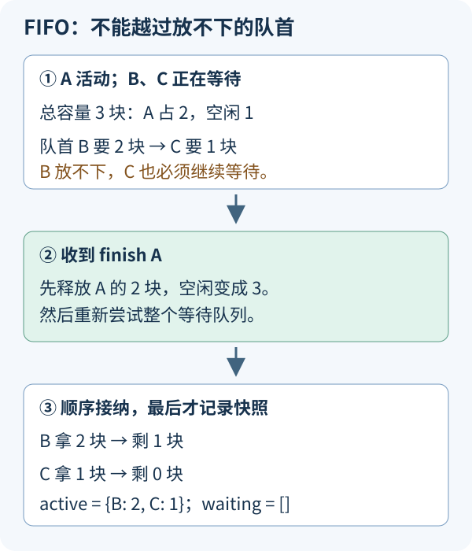

# Project2：Mini Engine · Phase1 请求生命周期

这一阶段把输入事件变成可解释的状态机：有限容量下的 FIFO 准入、等待、结束、释放。先修 Lab4、HW5，预计 3–4 小时，纯 Python，无 GPU。[Phase2 逐迭代调度](../project2_scheduler/README.md) 是独立下一阶段，不改变这里的接口或验收条件；Sampling、模型执行与真实设备 benchmark 不在本阶段。

## 1. 先说清楚“引擎”没有模拟什么

编辑 `course/projects/project2/project2.py`。本模型已知每条请求总长度，一次预留整条请求的页数。它不存 KV 数值，也不接入 Lab4 的物理 ID 或共享引用；这里 active 中的数字只是预留页数。先把生命周期做对，才有基础讨论逐 token 增长。

状态只需三个核心量：active 为 ID→预留页数字典；waiting 为按提交顺序排队的 `(ID,length)` 列表；capacity 为总块数。空闲块由 `capacity−sum(active.values())` 得到，避免维护两个互相矛盾的账本。另需 seen 集合记住整个重放中已经用过的 ID，防止结束后重复提交同一 ID。

始终成立的不变式：`sum(active.values()) + free_blocks == capacity`；同一请求不能同时 active 和 waiting；容量不能为负。不要把 refs 总和与这里的页数总和混淆。

## 2. Q1：严格 FIFO 准入

`admit_fifo(waiting, free_blocks, block_size)` 返回 `(accepted_ids, remaining_free_blocks)`。

- waiting 是 `(非空字符串 ID, 正整数 token 长度)` 列表，ID 不重复。
- free_blocks 是非负整数，block_size 是正整数，整数均排除 bool。
- 先验证整个队列，包含当前放不下的尾部；规定的非法值抛 `ValueError`。
- 每条需要 `(length+B−1)//B` 页，从队首开始，首条放不下就停止，不能跳过它。
- 返回新 ID 列表，不修改输入，空队列有效。

### 2.1 先手算同一队列的三种容量

队列 `[('A',5),('B',1)]`，块大小 4。A 要 2 页，B 要 1 页：

| 初始 free | 是否接纳 A | 是否接纳 B | 返回 |
| :--- | :--- | :--- | :--- |
| 1 | 放不下，立即停止 | 不准越过 A | `([],1)` |
| 2 | 接纳，剩 0 | 放不下 | `(['A'],0)` |
| 3 | 接纳，剩 1 | 接纳，剩 0 | `(['A','B'],0)` |

这体现“准入策略”与“装箱最优”不同。严格 FIFO 允许队首阻塞：小请求本来放得下，但必须等。作业要求复现这个策略，而不是悄悄改成优先小请求。

### 2.2 实现台阶与失败定位

先独立写出页数计算并试 length=1、4、5；再遍历合法队列但只打印“能否放下”；确认行为后才更新局部 free 与 accepted。最后增加完整验证，并确保验证在准入循环之前。

反例：waiting=`[('A',5),('B',0)]`，free=0，B=4。虽然 A 立刻阻塞，尾部 B 的长度 0 仍非法，必须 `ValueError`。如果返回 `([],0)`，说明你把“当前不会执行”误当成“无需验证”。

## 3. Q2：事件处理、重试、快照，顺序不能换

`replay(events, capacity, block_size)` 返回每个事件后的独立快照列表。capacity、block_size 为正整数，排除 bool；events 是事件列表，各项为 tuple 或 list。

| 输入事件 | 校验和更新 |
| :--- | :--- |
| `('submit',id,length)` | ID 非空且整个重放不重复；长度为正整数；所需页数不超过总容量；通过后进入队尾 |
| `('finish',id)` | 只能结束当前 active 请求；释放全部预留页数 |
| 错误事件名、错误字段数 | ValueError |

每个事件后都运行 Q1 重试 waiting，再保存 `{'active': {id:pages}, 'waiting': [ids], 'free_blocks': integer}`。不能在释放之前重试，也不能在重试之前拍最终快照。未知、等待中、已结束请求都不能 finish。单条请求比整个池还大应拒绝，不应让其永远堵在队首。

函数保留输入。异常时不返回部分结果；内部状态是局部变量，没有外部引擎状态需要回滚。空事件列表返回 `[]`，但容量与块大小仍需合法。

## 4. 完整手算：六个事件如何推进

容量 3 块，块大小 4。A、B 长 5 各需 2 块，C 长 1 需 1 块：

| 事件 | 事件后 active | waiting | free |
| :--- | :--- | :--- | :--- |
| submit A,5 | A:2 | 空 | 1 |
| submit B,5 | A:2 | B | 1 |
| submit C,1 | A:2 | B,C | 1 |
| finish A | B:2,C:1 | 空 | 0 |
| finish B | C:1 | 空 | 2 |
| finish C | 空 | 空 | 3 |



第三行先把 C 加队尾，再尝试 B；B 放不下，因此 C 不能被接纳。第四行分成三个小步骤：删掉 active 的 A，空闲变 3；顺序接纳 B 后剩 1，再接纳 C 后剩 0；最后才记录快照。图中的中间 free=3 是临时状态，不是这一事件的最终快照。

请在第一次运行前手写全表，并对每行检验“活动页数 + free = 3”。如果某行对不上，不要先改测试，先查看页数与重试顺序。

## 5. 最小程序：理解快照为什么要复制

先单独运行这个程序，不必等 Q2 完成。它没有状态机答案，只展示 Python 容器别名：

```python
active = {'A': 2}
snapshot = dict(active)
active['B'] = 1
print(snapshot)
print(active)
```

输出应为 `{'A': 2}` 与 `{'A': 2, 'B': 1}`。如果把第二行改成 `snapshot = active`，两个打印都会出现 B，历史被现在改写了。Q2 快照要分别复制 active 字典和 waiting ID 列表；这里只有字符串和整数值，不需要为它们做更深复制。

## 6. 从单事件到完整项目的实现顺序

1. 先让空 events 在合法参数下返回 `[]`。
2. 只支持一个合法 submit，核对页数与快照格式。
3. 连续两个 submit，让第二条出现等待，检查 ID 不会同时处在两个容器。
4. 加入 finish，并确认释放后立刻重试队列。
5. 加入整个重放唯一的 seen 集合，测试结束后再次 submit 同 ID 仍拒绝。
6. 最后验证快照独立性：修改第一行字典和列表，第二行必须不变。

这不是建议保留一个不完整版本交作业，而是让每次新增行为都能定位。若六步一口气写完，错误往往难以区分来自容量、顺序还是别名。

## 7. 运行、报告与评分

从**课程根目录 `deepinfer/`**（能看到 `course/`）运行；个人主页源码对应 `_courses/deepinfer/`：

```bash
python course/tools/grade.py project2 --question q1 --unlock
python course/tools/grade.py project2 --question q1 --failfast
python course/tools/grade.py project2 --question q2 --hint 1
python course/tools/grade.py project2
```

评分保持 50 分：Q1 10、Q2 20、守恒/快照解释 10、报告与反例 10，不并入 Unit1。复制 [报告模板](report_template.md) 写自己的报告，包含实际六事件快照、逐行不变式检查、最小失败修复记录，以及一例自己设计的队首阻塞。不要只提交“全部测试通过”。

## 8. 出口：能解释才进入下一阶段

先回答：等待中的请求能 finish 吗？原来用过的 ID 能否在结束后再次 submit？一个比总容量更大的请求为什么不该留在 waiting？这个事件表能算 TTFT 吗？

<details>
<summary>核对模型边界</summary>

等待请求不拥有预留页，不能 finish；ID 在整个 replay 内唯一，结束后仍不能复用。超过总容量的请求永远不会通过本策略，必须拒绝而不是永久阻塞队列。事件索引没有真实时间，模型也没有输出 token，因此不能据此计算 GPU 吞吐、TTFT 或 TPOT。

</details>

下一步按 [L11](../../lectures/lec11.md) → [L12](../../lectures/lec12.md) → [Lab5](../../labs/lab05/README.md) → [Phase2](../project2_scheduler/README.md)。Phase2 学习逐迭代工作预算，暂不接入页池；并发请求数不是显存容量。两阶段未来集成时需要同时满足计算预算和内存容量，而不是拿一个替代另一个。
