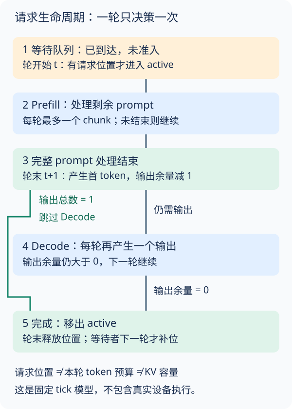

# Project2 Phase2：一步一步搭起可解释的调度模拟器

第 6 周 Checkpoint 1，建议 4–6 小时分段完成。先修 [Phase1](../project2/README.md)、[Lab5](../../labs/lab05/README.md)、[HW6](../../hw/hw06/README.md)。本阶段独立放在 project2_scheduler，保留 Phase1 文件、评分和学习记录，不覆盖已写代码。用 [报告模板](report_template.md) 记录每个检查点，而不是做完后凭记忆补报告。

## 1. 先划清系统边界

你要做的是**固定 tick 的调度模拟器**，没有模型、GPU、采样、真实 KV 或内存抢占。max_active 是请求数上限，不是显存约束；Phase1 的页池未接入。输入是请求到达与长度，输出是完整轨迹和每条请求的输出时间。正确目标是可复现的生命周期，不是跑出一个真实 GPU 加速比。

结构分四层：准入负责谁进 active；策略负责本轮选什么；执行负责更新计数、记录输出、结束请求；指标读取最终时间戳。未来接页池时，准入/执行前需要估算新增块并预留，失败时保留等待或撤销预留；完成后释放活跃引用，是否保留缓存由另一层决定。本阶段故意不把内存状态机与时间状态机混在一起。

## 2. Q1：复用自己的 Lab5 策略

[project2_scheduler.py](project2_scheduler.py) 中的 `plan_step(active,token_budget,chunk_size)` 与 Lab5 Q2 契约完全一致：完整验证，decode 优先，同阶段 FIFO，每请求一轮最多一个 chunk，不修改输入。迁移自己的实现，不直接导入另一个目录的 starter；这样每份作业可以独立下载和评分。

第一道检查点只运行 Q1。输入 A:(5,3)、B:(0,2)、C:(2,1)，预算4、chunk2，必须得到 B D1、A P2、C P1。再用 A:(1,3)、预算8、chunk2，确认只有 A P1，而非 P1 后又 D1。策略不推进时钟，不把新状态写回 active。

## 3. Q2 的完整接口契约

`simulate(requests,max_active,token_budget,chunk_size)` 返回 `{"trace":快照列表,"requests":按ID索引的结果}`。

requests 为 list，每项 tuple/list 恰含 `(id,arrival,prompt_tokens,output_tokens)`。ID 是非空且全局唯一的字符串；arrival 为非负整数；prompt_tokens/output_tokens/max_active/token_budget/chunk_size 为正整数。所有整数排除 bool。额外要求 token_budget>=max_active，保证每轮预算能覆盖全部活动 decode。提前验证全部输入，非法 ValueError。空输入返回空 trace 与空 requests，但仍验证公共参数；不得修改输入。

到达可以乱序，内部按 `(arrival,原输入位置)` 排序；同到达稳定，不按 ID 排。等待队列严格 FIFO。没有 active 和 waiting 时直接跳到下次到达，不输出空闲轮快照。未来请求不能提前放到 waiting 中。

## 4. 不要一次填完整循环：六个可运行的小台阶

### 台阶 A：先验证并做无副作用的数据准备

先支持空请求 `simulate([],1,1,1)`，得到 `{"trace":[],"requests":{}}`。再故意用同样空输入但 max_active=2、budget=1，必须 ValueError。此时还不需要主循环。为每个 ID 建独立的 token_times 列表，内部排序使用新列表，不原地排序用户输入。

### 台阶 B：只有一条、只有一个输出

只测 `[("A",0,1,1)]`，参数1/1/1。第0轮准入 A，计划 A P1，在时刻1发出首输出并完成；只有一条 trace，results 的 token_times 为 `[1]`。如果你得到 `[2]`，说明把 prefill 的首输出漏掉；如果得到 `[1,2]`，说明输出数减错。

### 台阶 C：加长 prompt，再加长输出

先变成 A=(0,3,1)、参数1/2/2，预期两轮 P2、P1，输出 `[2]`。再改 A=(0,3,3)，得到 P2、P1、D1、D1，输出 `[2,3,4]`。先不处理多请求，逐轮打印剩余 prompt/output，核对工作总量 `3+3−1=5`。这一步让首输出、普通 decode 和完成规则各自接受验证。

### 台阶 D：增加一个等待者，确认下一轮才补位

用 `[("A",0,1,1),("B",0,1,1)]`、参数1/1/1。第0轮只准入 A，轮末 waiting 是 B；第1轮才准入 B。两条输出时间分别 `[1]`、`[2]`。如果都在1，说明在轮末完成后又回到本轮准入/执行，这是同轮二次决策。

### 台阶 E：加入乱序到达与空闲跳跃

输入 `[("late",1000000000,1,1),("B",2,1,2),("A",2,1,1)]`、参数1/2/2。有效轮开始时刻是 `[2,3,4,1000000000]`，准入分别 `[B]、[]、[A]、[late]`。B 与 A 同到达，保留输入顺序；没有必要循环十亿次，也不能把 late 提前放入 waiting。

### 台阶 F：最后添加完整快照并检查隔离

所有事件逻辑可靠后，再把每轮数据包装成最终字段。不把 active 原字典或 token_times 原列表塞进多个历史快照；后续更新不能改变过去。先保存第0张，再执行第1轮，确认第0张未变。之后运行完整 A/B/C 基准与公开测试。

这些是实现顺序，不是允许最终函数只支持这些特例；完成后必须满足第3节的完整输入契约。各台阶可写在自己的临时验证文件，不应把个人报告或生成 CSV 放进公共课程目录。

## 5. 一轮执行的唯一顺序



在 t 将所有 arrival<=t 的新请求入队，FIFO 补满 active，使用**轮开始状态**调用一次 Q1。随后按 plan 执行，在 t+1 统一提交：prefill 减 count，刚变成0时产生首输出并减 output_remaining；decode 每条产生一个输出并减 output_remaining；输出时间都写 t+1。output_remaining==0 的请求完成，移出 active，等待者在下一轮才使用其位置。

图中“完成 prefill”不是允许本轮再执行一次 decode。每请求每轮最多一个输出。总处理工作为 `sum(prompt_tokens+output_tokens−1)`，不包括虚构的最后一次额外 decode。

| trace 字段 | 精确语义 |
| :--- | :--- |
| start / end | 本轮开始 t、结束 t+1 |
| admitted | 本轮准入 ID，FIFO 顺序 |
| plan | Q1 返回的 tuple 列表，decode 在前 |
| emitted / finished | 本轮输出/完成 ID，保持 plan 顺序 |
| active | 轮末 ID→(剩余prompt,剩余输出)，仅未完成者 |
| waiting | 轮末已到达未准入 ID，FIFO，不含未来请求 |

results[ID] 恰含 `{"arrival":原到达,"token_times":[输出完成时间]}`。历史快照、结果列表、输入之间不得共享可变容器；修改一张快照不能污染别的快照。tuple 状态值可以帮助表达历史不可变，但外层字典和列表也必须独立。

## 6. 完整手算验收：每一列都要对齐

A=(0,3,2)、B=(1,1,1)、C=(1,1,2)，参数 max_active=2、budget=3、chunk=2。

| 轮 | 准入 | 计划 | 输出 / 完成 | 轮末 active | waiting |
| :--- | :--- | :--- | :--- | :--- | :--- |
| 0→1 | A | A P2 | 无 / 无 | A:(1,2) | 空 |
| 1→2 | B | A P1，B P1 | A,B / B | A:(0,1) | C |
| 2→3 | C | A D1，C P1 | A,C / A | C:(0,1) | 空 |
| 3→4 | 无 | C D1 | C / C | 空 | 空 |

A 输出 `[2,3]`、B=`[2]`、C=`[3,4]`；TTFT 分别2、1、2；A/C 的 TPOT=1，B 为 None。总工作7，总输出5，两个分子不能混用。公开测试保存了精确快照；不要只比较最后完成时间，许多错误顺序会偶然得到相同终点。

建议每轮额外检查六个不变式：预算总和不超限；计划 ID 不重复；active 与 waiting 不交叉；请求只准入一次；输出时间严格递增；已完成请求不会复活。模拟结束时输出长度必须等于要求长度，prompt 总工作与 decode 总工作分别守恒。

## 7. 测试、预测和18组实验

从课程根目录运行；个人主页仓库先进入 `_courses/deepinfer`：

```bash
python course/tools/grade.py project2_scheduler --question q1 --failfast
python course/tools/grade.py project2_scheduler --question q2 --unlock
python course/tools/grade.py project2_scheduler
python course/projects/project2_scheduler/experiment.py
```

[experiment.py](experiment.py) 默认运行自己的实现，CSV 输出到终端，不覆盖文件。三个固定负载 × 两种并发上限 × 三种 chunk=18 行。若保存，重定向到公共课程目录之外。`--solution` 是显式查看参考实验，不能当作自己的通过证据。

先写两条可证伪预测，再运行：固定预算4，chunk从1改4，long_then_short 的首输出是否提前？max_active从1改2，短请求还需等长请求整个完成吗？比较时一次只改变一个参数，其他负载、单位、窗口必须一致；不要拿不同负载的两行归因于 chunk。

观察窗口从0到最后完成，含空闲。SLO为TTFT<=4 ticks、TPOT<=1 tick；吞吐单位token/tick，goodput单位请求/tick。因为预算覆盖全部活动decode，轮长又恒为1，所有有定义的TPOT应为1。这由假设保证，不能据此宣称真实GPU中chunk无影响。idle_gap负载帮助检查是否偷偷删去空闲时间抬高吞吐。

## 8. 出口自测与报告

<details>
<summary>卡住时：如何定位“整体轨迹错了”？</summary>

先找第一张不同的快照。admitted错，查到达排序/补位时点；plan错，单独调用Q1；plan对但active错，查首输出与剩余计数；早期快照后来变了，查共享容器；轨迹对但指标错，回到HW6的分母和单位。先缩到一至三条请求，不要在一百条随机请求里盲改。
</details>

阶段自评50分不变：Q1 10；Q2 20；手算、不变式与反例10；18组实验、解释与局限10。加Lab/HW为第6周100分，独立于第5周与Unit1。交付至少四个反例：单输出、同到达FIFO、极长空闲、历史别名。用 [报告模板](report_template.md) 写出真实证据，不编造调试经历。

最后不看代码口述一轮：准入、策略、执行、指标各自负责什么？你能标出未来页池预留与失败回滚的位置吗？若只能说“测试全过”，还没完成本项目的解释目标；若能指出目前没有模型、KV集成、抢占、校准成本与真实设备测量，才是在准确报告自己的系统。
